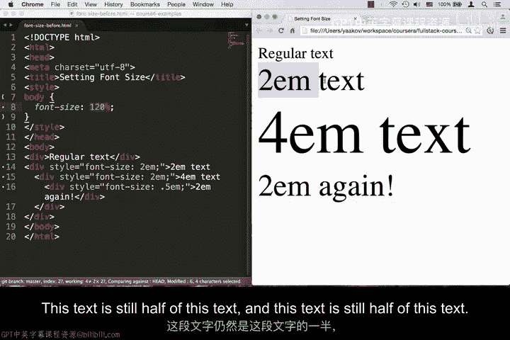
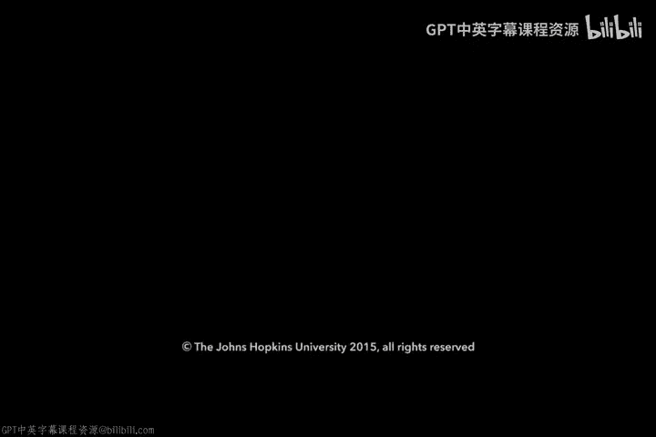

# 约翰霍普金斯大学《Web开发者的HTML, CSS, and Javascript》中英字幕 - P26：9_第18讲 第2部分 文本样式设计.zh_en - GPT中英字幕课程资源 - BV1WzY6z9EUd

🎼。

Okay let's talk a little bit about relative font sizing And for that we're going to take a look at font size before that HTML and it's located in the same folder as the previous file。

 Now there are two units of measurements that are relative that we're going to talk about and that is percent and ms let's start with percent first of all let's specify that our body tag should have font size of 120% and what that means is is that we want to take whatever the default size is and by default I mean whatever the browser provides by default and increase it by 120%。

 You could actually do a quick calculation and to figure out what pixel size that would be。

 Most browsers have 16 pixels as is default text size So 120% of 16 would be a little bit over 19 pixels So if we refresh the page we'll see that we increase the font size in the entire HTML document Let's now target the very first text here that says2。

😊，text so let's go ahead and actually use an inline style since were just testing and specify the font size to be2 M an M is a unit of measurement that is equivalent to the width of the letter M in this particular font that we're using it sounds a little confusing at first but the bottom line is it's a relative size it's a relative to something and for this div where it says2 m text what this is saying is it's relative to whatever the font size is at the moment we're applying it since we set the font size to 120% in the entire body。

 this div also received that 120% and when you combine this font size with this one this basically says I want to increase the font two times of whatever 120 was So if we take a look at this text。

 this 2 m text should really increase twice as large as this word regular text So if if we save the file and refresh and you could see now everything since。

😊，That div includes the other divs， they got increased and it looks just about right that it's twice the size of the regular text now you might find this confusing didn't we just override the font size and say it's 2M Y as 120%。

😊，Playing together with 2M instead of having 2M override the 120% and that's kind of the game of the relative sizing。

 When you specify them on subsequent elements， they don't have an overriding effect they have a cumulative effect instead because what you're saying here is whatever the size of this div is I want you to increase it or I want you to make 2 ms out of it。

 meaning make it twice as large So I'm sure you guess now。

 how do I make this 4M text actually 4 if I specify style and say font size What should I put here Should I put 4M Well that would be a mistake if I put 4M it will really be the 2M then already applying to this times 4M。

 which would make it 8 m but what we actually need to do is put4M in order to do that I just specify 2 m again So it means that this 4M text will be twice as large as the 2M text right here So let's save the file and refresh。

😊，And you can see now it's twice as large and this 2M This text also got cut into this because it is a child element of our div that we just styled So how do I make it 2 m again Well the answer is you don't overwrite it you just decrease it so let's go ahead and say style font size and in order to get back to 2M I need to half the size of my text So in order to do that I'll just say 0。

5 m and now when I refresh。😊，My text now is back to the same size as it was before because I hveed the relative size of4M couple of more quick points before we finish up。

 First it's a pretty common practice that if you want to increase the font size in the entire document that you specify percentage and you apply it usually to the most parent tag which is usually the body tag and technically speaking you could have continued to use percentages even here so 2M really translates to 200% so if I put 200 percent right here and save it and refresh you could see nothing really changed however it's more common to use Ms when you're talking about relative sizes within the document itself but one thing you should know is that even though you could use percentages here。

 I highly recommend you don't mix and match the percentage Ms and certainly not the absolute value units all over the place it could get very confusing and it'll become a mess so it's better to keep things consistent point number two is even though we increase。

F size here to 120 using CSS rule， a user of your website can do the same thing just by increasing the zoom for example here I will increase the zoom a couple of times as you could see I'm all the way to 200% zoom and hopefully now you see the value of having relative units of measurements for font size you could see that the visual size relationship between these different divs remains the same even though they're all now very big this text is still half of this text and this text is still half of this text。

