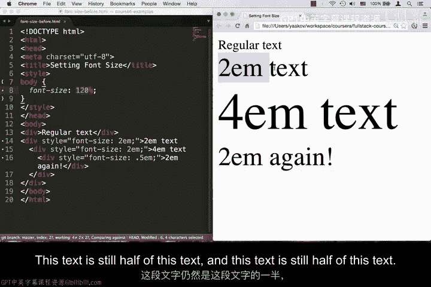
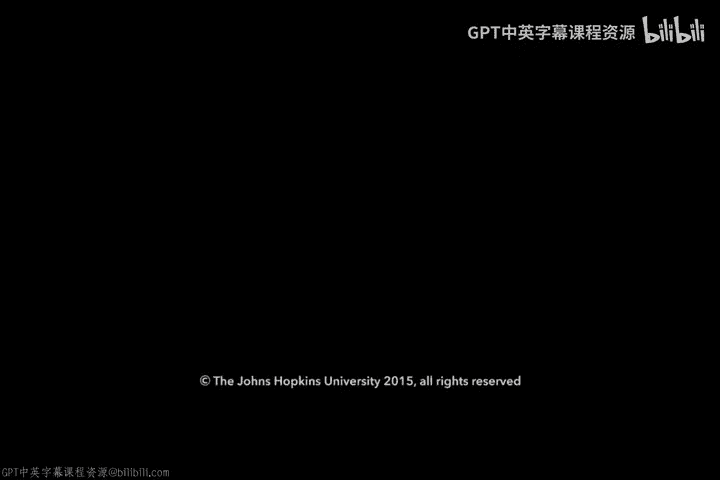

# Web开发者的HTML, CSS, and Javascript：P26：第18讲 第2部分 文本样式设计


## 概述
在本节课中，我们将要学习CSS中相对字体大小的概念，特别是百分比（`%`）和`em`单位的使用方法。我们将通过一个具体的例子来理解它们如何工作，以及如何在实际项目中应用它们来创建灵活、可缩放的文本布局。

---

## 相对字体大小介绍
上一节我们介绍了基础的文本样式，本节中我们来看看如何使用相对单位来设置字体大小。相对单位意味着字体大小不是固定的像素值，而是相对于其他元素（如父元素或根元素）的尺寸来计算的。

我们首先打开一个名为 `font-size.html` 的示例文件，它位于与上一节文件相同的文件夹中。

---

## 两种相对单位：百分比与em
我们将讨论两种相对度量单位：百分比（`%`）和 `em`。

### 使用百分比设置字体大小
首先，我们尝试使用百分比。我们指定 `body` 标签的字体大小为 `120%`。这意味着我们希望字体大小是浏览器默认大小的 `120%`。

**公式**：`目标大小 = 默认大小 × 百分比`

大多数浏览器的默认文本大小是 `16px`。因此，`120%` 对应的像素值计算如下：
`16px × 120% = 19.2px`

如果我们刷新页面，会看到整个HTML文档的字体大小都增加了。

---

### 使用em单位设置字体大小
接下来，我们使用 `em` 单位。`em` 是一个相对单位，它等于当前字体中字母“M”的宽度。更简单地说，`1em` 等于其父元素的当前字体大小。

为了测试，我们为第一个显示“2em text”的文本添加一个内联样式，将其字体大小设置为 `2em`。

**代码**：
```html
<div style="font-size: 2em;">2em text</div>
```

由于我们之前将整个 `body` 的字体大小设置为 `120%`，这个 `div` 也继承了该大小。现在，`2em` 意味着我们希望此 `div` 的字体大小是其当前字体大小的两倍（即 `120%` 的两倍）。

保存并刷新文件后，可以看到“2em text”的字体大小大约是“regular text”的两倍。

---

## 相对单位的累积效应
你可能会感到困惑：我们不是用 `2em` 覆盖了 `120%` 吗？实际上，在相对尺寸设置中，后续元素的指定不会产生覆盖效果，而是会产生累积效应。

当我们说 `font-size: 2em;` 时，意思是“将当前字体大小乘以2”。因此，它是在继承的 `120%` 基础上再次翻倍。

---

## 进一步调整字体大小
现在，我们想让显示“4em text”的文本大小变为 `4em`。如果我们直接设置 `style="font-size: 4em;"`，这将是错误的。因为该元素已经是 `2em` 文本的子元素，`4em` 会基于当前的 `2em` 再次计算，最终效果相当于 `8em`。

为了正确实现“4em text”是“2em text”的两倍，我们需要在其父元素（即“2em text”的 `div`）的基础上设置 `2em`。

**代码**：
```html
<div style="font-size: 2em;">
    2em text
    <div style="font-size: 2em;">4em text</div>
</div>
```
保存并刷新后，可以看到“4em text”的字体大小确实是“2em text”的两倍。同时，“2em text”本身也变大了，因为它是我们刚设置样式的 `div` 的子元素。

---

## 如何恢复字体大小
如果我们想将“4em text”内部的文本恢复成与“2em text”相同的大小，不能直接覆盖，而是需要减小其相对大小。

**代码**：
```html
<div style="font-size: 2em;">
    2em text
    <div style="font-size: 2em;">
        4em text
        <div style="font-size: 0.5em;">Back to 2em</div>
    </div>
</div>
```
这里，我们设置 `font-size: 0.5em;`，这意味着将当前字体大小（`4em`）减半，从而使其恢复到与“2em text”相同的大小。刷新页面后，可以看到效果。

---

## 最佳实践与注意事项
在结束之前，有几个要点需要说明。

以下是关于使用相对字体大小的一些建议：

1.  **全局字体调整**：通常，如果你想增加整个文档的字体大小，会使用百分比，并将其应用于最顶层的父标签（通常是 `body` 标签）。
2.  **单位选择**：技术上，你也可以在这里使用百分比，因为 `2em` 实际上等同于 `200%`。但在文档内部设置相对大小时，更常见的做法是使用 `em` 单位。
3.  **保持一致性**：强烈建议不要混合使用百分比、`em` 以及绝对单位（如 `px`）。这会使代码变得混乱且难以维护。最好保持单位使用的一致性。
4.  **用户可访问性**：即使用CSS将字体大小设置为 `120%`，网站用户仍然可以通过浏览器缩放功能（例如放大到 `200%`）来调整页面大小。使用相对单位的好处在于，即使整体放大，各元素之间的视觉大小关系（如“此文本是彼文本的一半”）也能保持不变，这体现了响应式设计的价值。

---





## 总结
本节课中我们一起学习了CSS中相对字体大小的核心概念。我们重点探讨了百分比（`%`）和 `em` 单位的工作原理，理解了它们的累积效应，并学习了如何通过它们创建可灵活缩放的文本布局。记住，在大多数情况下，使用 `em` 进行文档内部的相对调整，并使用百分比进行全局基准设置，是一种清晰且有效的实践方式。