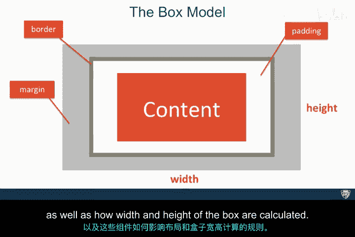
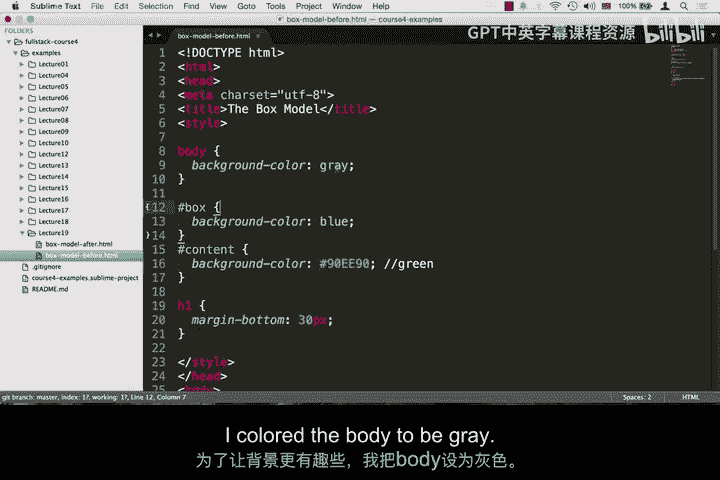
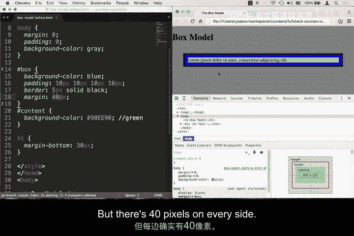

# 约翰霍普金斯大学《Web开发者的HTML, CSS, and Javascript》中英字幕 - P27：10_第19讲 第1部分 盒子模型.zh_en - GPT中英字幕课程资源 - BV1WzY6z9EUd

。In HTML， every element is considered a box， however。

 there is more to that box than just the content that the element wraps around let's take a quick look at a simple diagram。

Besides the actual content each box consists of padding， border as well as margins。

 the box model refers to the components that make up an HTML box。

 as well as the rules that govern how these box components affect the layout as well as how width and height of the box are calculated Let's jump into the code and take a look at some examples。

Okay so here I am in sublid text and I'm looking at the file called box model before that HTML and it's located in the examples lecture 19 folder let's quickly examine the HTML structure of this document it's actually pretty simple it just has one H1 here has a div that has an ID box and inside of that div there's another div with an ID content and has some lowerrimpsum basically some dummy text in it in addition to that I colored the box itself with a background color blue and the content which is that div right here this content I colored it with this color which is basically light green and just so we have some more interesting colors in the background I colored the body to be gray。

Okay， so here' is the representation of our page in the browser and since div is a block level element it tries to fill in the entire parent in terms of width。

 so it's try to fill up the entire width here in the browser so there's something strange going on if you take a look there's some space that's going on here right before Laurm and here at the end of our content the beginning end there's spacing going on so let's take a look at the Chrome developer tools real quick and figure out what that spa is about。

😊，Okay so we'll go ahead and choose the box。 That's our box and we'll take a look as to what's going on。

 There doesn't seem to be any spacing that's set on the box itself。

 But what about the body itself and the body tag and here we go see we realize that the body tag here has margin all around of eight pixels now where is that eight pixel coming from Well if you take a look here it's telling you where it's coming from it's coming from the user agent style style sheet which means it's the browser itself it's default。

 it's the default browser styles So that's actually pretty common that the browsers do stuff like that and what we're going to do is in order for it not to affect what we're doing we're going to reset it and it actually resets on the web out there plenty of resets on the web how to reset default browser settings So we'll go ahead and do margin zero and we'll also do padding0 so we won't be affected by any of that And when we do that and we save and refresh you see that now our。

Content is flush with the actual borders of the browser window Okay so moving on so we have our content and you could see the contents is green now we're not seeing the background of the box。

 the content is actually sitting in because we would have seen something blue in the background and always see is green and that is because the inner box the inner content div is covering up the outer one completely because they are the same size。

 they both try to fill up their parent which is in this case the body tag both try to fill it up all the way and since this one basically sitting on top or inside of this one it's covering up the blue background let's go ahead and set some padding on our box let's do padding and we'll do 10 pixels top 10 pixels right 10 pixels bottom and 10 pixels left now we set that and by the way there's obviously a shortcut for this you could actually remove all these 1 pixels right here and that would mean exactly the same thing。

I'll let you actually look up as to all the different shortcuts you could take but I'll leave this here for now。

 so the point is it always goes top right bottom left and let's go ahead and save that and refresh the browser and while now we're seeing the padding and what the padding is doing is is basically giving some padding around our content and our content being this div tag right here with with the content text is the one that's being kind of squeezed all around and the padding is showing up all around and you now you could see the blue because that's the background color of our box。

😊，Okay， so next let's give our box some border， let's go ahead and say border and we'll give it a border that's going to be three pixels thick。

And it's going to be solid as opposed to dash or something like that and there's other options here。

 you could welcome to look up and we want to give it the color black when we save that and we refresh the browser。

 we could see that the border showed up as well in fact let's make it a little bit thicker let's make it five pixels border and let's make it like that and then last but not least let's give it some margins as well。

 let's go it margin let's go ahead and use the shortcut notation， which is giving40 pixels。

 which means I'm saying I want 40 pixels all around So top right bottom and left So if I go ahead and refresh that you could see now there's 40 pixels on every side and you could see it on the bottom per se and you can really necessarily see it here but there's 40 pixels on every side well up until now sort of let the content and some of margins and so on dictate how big the actual boxes but what about if we actually set its with。

😊。

ourself let's go ahead and set its width to be， let's say 300 pixels when we save and refresh。

 we see the box now became smaller， but let's go ahead and examine this box。

 let's go ahead and click on it inside Chrome developer tools and let's take a look。😊。

So it's showing us that our box is， in fact， 300 pixels wide。

 and since we didn't restrain our height， it went ahead and wrapped around the text and basically the height will adjust unless we restrain it manually by specifying the height it will adjust however much it needs to fit。

 So if we make it a little bit smaller， let's make it let's say 100 pixels and we'll refresh。

 you'll see the height will become a little bit bigger。

 the height will become 72 because now we extra we squeeze it enough that extra lines got added。

 So now the content width is 100 but the height is larger。

 So let's go ahead and put it back to 300 and refresh And now if you look at this at this breakdown。

 we come to our first pretty interesting point。 Well first of all。

 let's go through all the components here this one is the pure content right here that I'm mouseing over right here。

 and then if I go out a little bit itll highlight for me in the browser。

 the padding that's going on there。 And if I highlight if I go out a little bit more I'll go straight。

😊，The border right and if you can't really see the margins if you roll over to the margin sidevo now you see what the margin is gone and even though to the right side it's showing you a little bit more than really the margin is going on。

 but the 40 pixels all around still stands Now what's interesting to find out is well how big is this box exactly as we're going start putting more and more boxes right we're going to start making layouts of different HTML components and to get our Ui just right we're going to find out how big is each box Well we' sort of specified that we want the box to be 300 pixels white the problem is is that it's not really 300 pixels white。

 let's take a look if we' take a look here it says 300 pixels white but we're forgetting that there's a border around it or the padding around it and the padding is 10 pixels on one side and 10 pixels on the other side but that's not all there's also a border around it as well that is five pixels wide and five pixels wide on this side So really it's 300 plus 10。

Plus10 that's 2320 plus 5 plus5 that's 330 So if you look at the actual visible border of this box this box this distance is not actually 300 this distance is 330 an interesting part is or kind of annoying part is that is it depending on what border and padding you set this width will change so let's take a look let's see if I make the border something really crazy like 20 pixels and go ahead and refreshre I'll take a look now that border is 20 pixels so now my box ends all the way there。

And if I make the padding even bigger， let's say I make the padding and this one is the right。

 so I'll make the padding 30。And on the left I make the padding 30 as well。

 and I take a look at the box， take a look how it's going to whoa， it became bigger again。

 So even though we said I want the width of the box to be 300 it turns out that we'ret really setting the width of the box we actually setting the width of the content and that's this piece right here in the green Well it turns out for layouts and just in general sanity。

 this is kind of annoying。 you really want to change that and CSs 3 actually did change it。

 It turns out that by default the box sizing is actually a property of every HTML element and by default。

 it's actually set to content box which means when you specify its height and width you're specifying the height and width of the content box not the entire thing Well CSS3 came out with a new value for that property and that's called border box's go ahead and set that right here。

 we'll say box sizing not sizing and well say。😊，Borderb and when we refresh。

Let's take a look look at that it became smaller so now if you take a look at the breakdown you could see that even though we specified the width to be 300 well that width is guaranteed to be the width of this box right here from the beginning the edge of this border to the edge of this border so if you take a look here 200 plus 30 plus 30 that's 260 plus 20 plus 20 that's another 40 that's 300 and if we change it back to content box which is the default it will jump back to its original size but the truthter is all the modern frameworks like bootstrap and others use box border box as its sizing model and as you plan and work with your layouts this is the same choice to make so make sure you always stay with the box sizing of border box。

