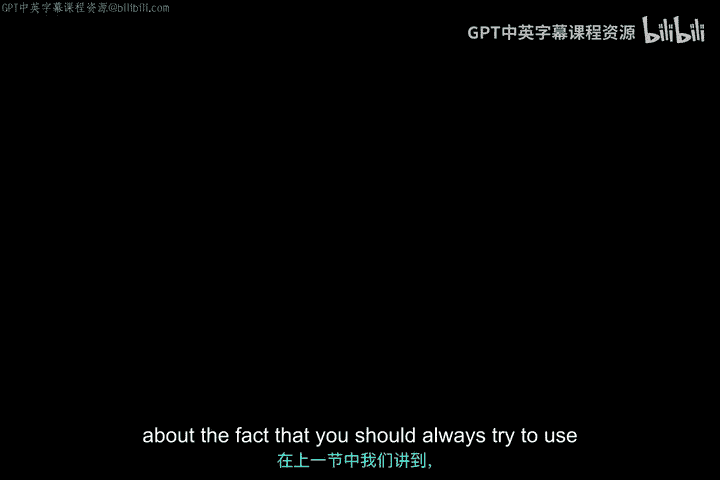

# 约翰霍普金斯大学《Web开发者的HTML, CSS, and Javascript》中英字幕 - P28：11_第19讲 第2部分 盒子模型.zh_en - GPT中英字幕课程资源 - BV1WzY6z9EUd

。

Okay so in the previous segment we spoke about the fact that you should always try to use box sizing border box as your box sizing model Now of course you don't want to specify box sizing border box and every element in your entire HTML so you definitely want to specify once and then have it be inherited everywhere so let's go ahead and try to do that let's remove this border box from here and body seems to be like a natural place to put it since body is the top level element and it should inherit everywhere so if I place the box sizing border box here and then I refresh this should stay the same。

O it didn't work Now why didn't not work It jumped back to the content box Well the reason that didn't work is because box sizing is one of those CSS properties that is not inherited you can't set it on its parent on a parent element and then expect that the child elements will inherit that property So how do we get around that Well the way we get around it is by learning about one more selector and that selector is the star selector let's go back up here and we'll go ahead and say star and then we'll cut and paste that border box property right here Now what is the staro first of all。

 let's refresh to see if it worked and sure enough now it's working what star does star selector says is go ahead and select every element there is and apply these particular CSS properties to them the difference between star and placing it placing some property in a parent element for example is that star says I am not asking you to inherit it。

Anything I'm saying select every element which means it's as if it took this property and this value and then it went to the HTML and then applied it to every element it saw it applied that particular property and value which in this case is box sizing border box so that's how properties like box sizing are applied across your entire page now I told you that border box is a property that's new in CSS3 When you hear something like that an alarm bell should go off Does every browser that I deal with support border box Well。

 we know just the research to check that out and we'll go to the website called can I use co and we'll type in border box border box is a CSS3 box sizing property and if we take a look excellent every single browser is green so every single browser fully supports this property value Okay so next let's close this up and let's try to advance our margin understanding a little bit better。

Okay so let's take a look at this diagram。 we have two boxes next to each other In other words。

 two elements and the gray part is the margins。 Well margins that are left and right are cumulative So if I have a margin right margin of 40 pixels on the left box and a left margin of 50 pixels on the right box the cumulative margin will be 90 pixels 40 plus 50 and that's pretty simple and this is exactly what you would expect but what happens if you have one element on top of the other element which is let's say these are two divs and each one is specifying a margin so one is specifying margin of 30 margin top for the bottom for the bottom element margin top is 30 and for the top element margin bottom is 20 would you expect this to be 50 pixels the cumulative Well the answer is it won't be the answer is the margin collapse and the larger margin wins so the actual distance between the border of one element。

😊，The border of another element will be in this case 30 pixels。

 meaning the larger margin will win and the other one will just collapse let's take a look at an example inside our code editor。

Okay so going back to the same file box model before that HTML we can take a look and see that we have H1 here and we defined a margin bottom of 30 pixels on H1 let's go ahead and go to our box and we actually remove the margin altogether and refresh and we'll take a look what it is without the margin so you can see there's just some margin going on here and that margin is coming from this H1 here margin bottom let's go ahead and define a margin top so we need a margin bottom is on H1 here and we need a margin top on our box let's define a margin top of 20 pixels and when we do that when we refresh absolutely nothing will happen and the reason that is is because the box is defining a 20 pixel margin yet the H1 is already defining a 30 pixel margin So when they come together and touch they collapse into whatever the larger margin is so in this case that's 30 however if I made。

😊，The margingin to be 40。 let's say even 50 pixels。

 Now you'll see that the box will move down because now the box has a larger margin than the one specified specified on H1 So there is now a bigger distance between the box model H1 and the actual box and it's actually 50 pixels。

 we can also notice by the way that the box model， the words box model are not flush at the top with the corner of the browser Now why is that let's go and investigate。

 let's go ahead and inspect the element let's take a look it's got a margin at 21。

4 something and where's this margin coming from。 Well， it's coming from again。

 the user agent style sheet and the reason it's coming here is because of some browser specific prefixes that we actually haven't talked about that are defining the margin before and margin after We're not going to delve too much into this。

 but the bottom line it means before the element and after the element they'll define some margin Now the reason our margin on the body that we。

Spified margin zero is not working here is very simple。

 Boddy says anything that is below me and inside of me right is going to have the margin inherited。

 but that's only if you don't overwrite it specifically for that element as you see here user agent style sheet as a selector H1 that is specifically overriding the margin which therefore wins this is a bit of a side point。

 but how do we overwrite this Well， not that we know about the star selector。 it's easy。

 you could just say and move the padding and the margin to the star selector and now what is basically saying is that I am selecting every element specifically and I am then I'm overriding its margin。

 So if I refresh the page now you could see now it's flushed together to the top we won't necessarily be doing this in our page is left and right but at least now you know that if you wanted to reset and it's called CSS resetting if you wanted to reset the CSS browser defaults you would do this most。

😊，At the time using this star selector。