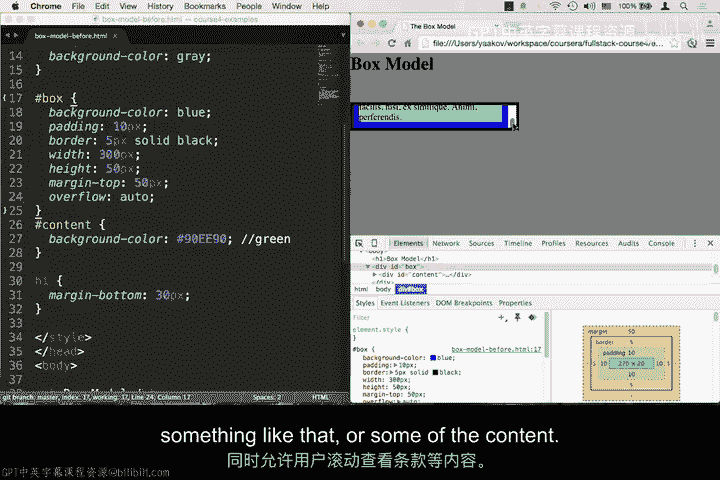
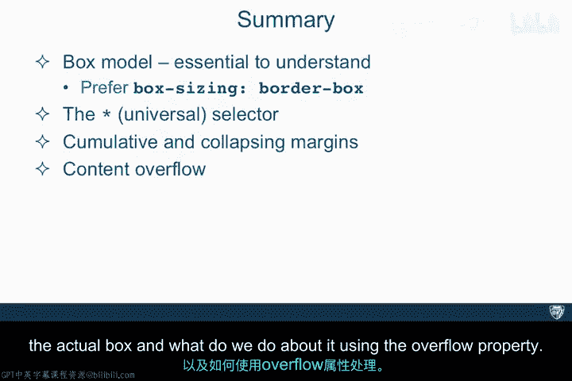
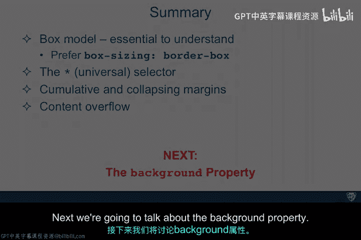

# 约翰霍普金斯大学《Web开发者的HTML, CSS, and Javascript》中英字幕 - P29：12_第19讲 第3部分 盒子模型.zh_en - GPT中英字幕课程资源 - BV1WzY6z9EUd

。

Okay， one more small topic before we finish this lecture。

 we spoke before about box sizing so specifying the size of the box and we talked about borders box sizing being the border box meaning that if I specify some width or some height it will include always include from the edge of the border to the other edge of the border and also show that as we change the width of our element since the content inside the box shifted the height of the box shifted as well so let's go ahead and add some more content into our box and we'll use the Emmet plugin EMM ET go ahead and look it up。

😊，We'll save it will。We'll refresh it and now we see it's much bigger than before let's lower this a little bit so you could see so because I edit extra content。

 you could see that the height of our element is not 162 now but what happens if I constrain our elements height as well something is going to have to give right because there's just no space left so let's adjust a couple of things first of all let's go ahead and make this back to 10 so the padding will be just 10 all around and the border is kind of looking unseemly so we'll make it like55 pixels and go ahead and the margin does margins just the matter now so let's refresh and now is a little bit better okay so let's go ahead and now give it a height that will clearly not be able to fit all the content of our box so let's give it a height of let's say 50 pixels and we'll save and refresh is you could see what's going what's happening now is is that our content spilled over outside of our box and if we actually place some element right below it let's go ahead and place。

😊，Another div and we'll say again lowerippsum here and we'll save and we'll refresh。

 You could see it's spilling over right over the other content。

 So it's basically spilling over out of the box。 let's go ahead and remove that for a minute。

 okay so how do we deal with this well there's a couple of ways of dealing with it and there's just a property to help us do that and the property is called overflow So were overflowing at the moment we are overflowing our content outside of the box。

 So what should we do with that overflow So by default by default the overflow is visible and this is exactly what's going on。

 So if I save this and refresh this again， it's the same thing。 however。

 there's a couple more options we could do。 number one is we could just clip it。

 So in order to clip it， we could say go ahead and have hidden So if it's hidden then if we refresh it'll just go ahead and clip it where the box ends However there's a couple more options we could do we could say out outta means go ahead and put scroll bars wherever there needs。

😊，It in order for us to look at the entire content so let's go ahead and refresh that you can see I have a scroll bar here and I can now scroll through my entire content right inside that box If I wanted to I could keep the scroll gutters always visible no matter whether or not I need them or not by just saying scroll。

😊，As the property value， if I refresh now I have scroll both ways。

 even though there is nothing to scroll here， but I could still scroll up and down。

 let's go ahead and change it back to auto。😊，And refresh。Okay。

 so now we have the scroll bar just where we need it while this is a perfectly acceptable solution to get your content inside the available space that you have。

 I will warn you that users absolutely hate double scrolling having a scroll bar on the side of the browser plus having to scroll inside some element is something that is not preferred however。

 there are cases where it's perfectly normal and expected to do， for example。

 if you're you know looking through， let's say terms of service and you just really want to pack in your entire UI into one visible chunk yet you want them to be able to scroll through some terms of service or something like that or some some other content。

 a solution for your overflow being out is certainly an acceptable one。

Okay， so in summary， we spoke about the box model and really the box model is this very essential topic to understand about CSS and as we go on to CSS layouts。

 we talked about the fact that you should prefer to use box sizing border box and that will keep things consistent for you as you change the border and the padding properties。

Wes spoke about the universalver selector， the star selector。

 and how it can affect every single element in the entire HTML page。

And we also spoke about cumulative and collapsing margins remember horizontal margins are cumulative and for the most part in most circumstances the vertical ones collapse We also spoke about the cases where the content overflows the size of the actual box and what do we do about it using the overflow property Next we're going to talk about the background property。

😊。

