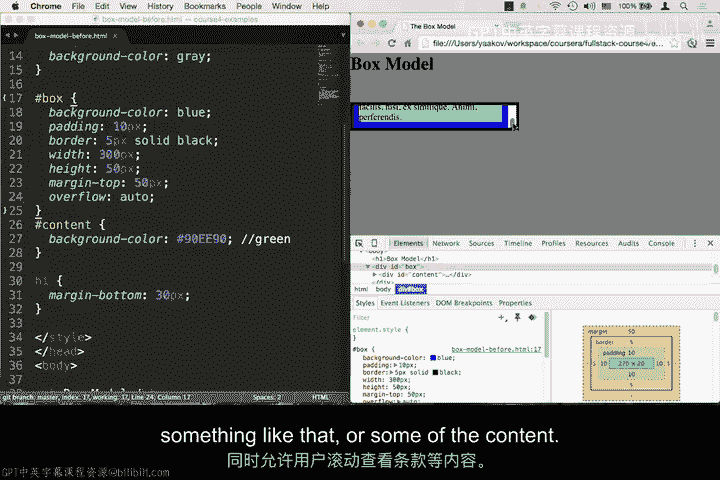
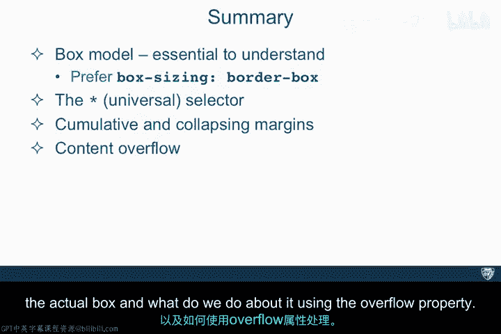
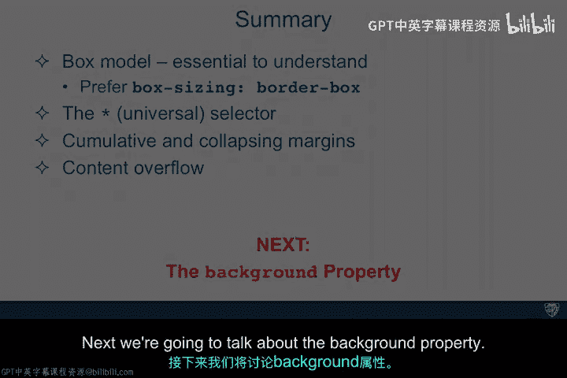

# Web开发者的HTML, CSS, and Javascript：P29：盒子模型第三部分


在本节课中，我们将要学习CSS盒子模型的最后一个重要概念：如何处理当元素内容超出其指定尺寸的情况。我们将探讨`overflow`属性的不同取值及其效果。

---

在上一节中，我们讨论了`box-sizing`属性，它决定了元素尺寸的计算方式。本节中，我们来看看当元素内容过多，超出其设定的宽度或高度时会发生什么，以及如何控制这种情况。

默认情况下，如果我们为一个元素设置了固定的`height`，但内容超出了这个高度，内容会“溢出”到盒子之外。这可能会影响页面布局，导致内容重叠。

以下是处理内容溢出的几种方法，主要通过`overflow`属性来控制。

**`overflow`属性选项：**

1.  **`visible` (默认值)**：内容会溢出到盒子外部并显示出来。
2.  **`hidden`**：溢出的内容会被直接裁剪掉，用户无法看到超出部分。
3.  **`scroll`**：无论内容是否溢出，都会在元素内显示滚动条。
4.  **`auto`**：只有当内容溢出时，才会在需要的方向上显示滚动条。

例如，对于一个高度固定的`div`，我们可以这样设置：
```css
div {
  height: 50px;
  overflow: auto; /* 或 hidden, scroll, visible */
}
```



使用`auto`是一个常见的解决方案，它只在必要时显示滚动条。然而，需要注意，在浏览器主窗口滚动条之外再出现内部滚动条（即“双重滚动”），可能会影响用户体验。但在某些场景下，例如在一个固定区域展示长篇条款或协议，使用内部滚动是合理且预期的做法。

---





本节课中我们一起学习了CSS盒子模型的收尾部分。我们总结了盒子模型的核心概念，并重点探讨了`overflow`属性的用法，它帮助我们管理内容超出容器边界的情况。下一节，我们将开始学习`background`属性。