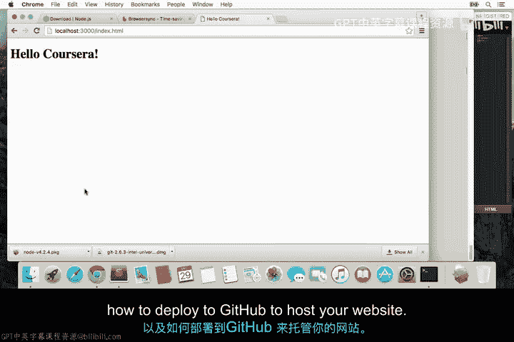

# 约翰霍普金斯大学《Web开发者的HTML, CSS, and Javascript》中英字幕 - P2：1_开发环境配置 第2部分 macOS版.zh_en - GPT中英字幕课程资源 - BV1WzY6z9EUd

Yeah。

Okay， so here I am in Mac OS and I'm actually using the latest one as of this recording。

 which is L Kit1 and let's go ahead and I already downloaded sublime text。

 so let's go ahead and double click that and install that real quick very easy it just opens up this window which just drag it to my applications folder。

And after about a second， it's done， just verify that it's actually in here。

 it is so I could close that， close that。And go ahead， eject。

The mount and now if I do command space and start typing sublime。

 it will come up sublime text right there， I said yes。

 I want to open it for the first time and actually I want to drag it right next to Chroe that I already installed。

Okay， so this way I could actually quit at this point。

And the next thing we want to do is we want to install Git。

 So we're going to go ahead and install the latest version of Git and we'll go to Google Ana。

Search for download Git for Mac。And this the first link comes up， that's exactly what we need。

And hopefully we'll start downloading it about a second。

 or we could just click ourselves and download it ourselves。Okay， so it's started to download。Okay。

 so once it's done。Go ahead and open it up。Double click on it。

And now we have to double click the package installer。

And it says here that our security preferences at the moment is such that we're not allowed to install anything that is not from the Mac app store。

 but that's not a problem， what we're going to do just click OK。

 it will go to our preferences and we'll go to security。Right here。

 allow apps downloaded from or we really need to have it anywhere， so we'll go ahead and unlock that。

And it we'll click anywhere says yes， I do want to from anywhere after we install we can always put it back to the original setting so you know we're not unsecure and now we could double click on that file and go ahead and go through the prompts。

 install， give it the password， admin password。And we're done so now we have just to double check that 2。

6。3 is actually installed and is in our command line。

 so we'll go ahead and do command space and we'll pull up the terminal。

And in the terminal we'll say git dash dash version， and it's 2。6。3， which is exactly what we need。

 Okay， so git is installed。 the next step is to install browser sync Well in order to install browser sync we first need to install no Js。

 So we'll go ahead and go to say download。Download node JS for Mac。And here it is。

And it says here Mac installer will go mature and dependable。Okay， once that's done。

 let's go ahead and open it up and double click it。The install will go through the prompts。Yes。

 we agree。Install can give it the admin password。And we're done and it just says here that we have to make sure that user local bin is in our path well let's go ahead and make sure of that we'll go to the terminal what actually we'll do is we'll restart the terminal so it's always a good idea to restart the terminal after things like that install and we'll say no dash dash version。

And that's the right one and another one is NPpm which standss for node package manager dash version。

 which is actually what we're really after right now， and it seems like that's working as well。

 we'll go ahead and echo the path just like they told us to to make sure and sure enough user local bin is inside our path so we're good to go So they still browse a sync。

 let's go ahead and Google it first B a sync。And we should get the browser syncs。The web page。

 and it tells us in order to install it， we need to do NPpM install G browser sync。

And dash G just means globally not just for our user， but for old users well。

 we're going to go ahead and copy this command， but since there's some new things that came in Mac OS L Capitan。

We're going to actually do a pseudo command instead of just directly installing。

 So do pseudompm install dash G browser sync。 We'll go ahead and execute that。

 It's going to ask us for the password。 We'll give it the password。

And hopefully this will install just fine。Okay， there were some warnings and it's also telling us we should install developer tools。

 we'll go ahead and click OK because that's something we're going to need hopefully you already have that installed for you but if you don't this is something that you'll definitely need as you keep developing。

Okay， it says software was installed and let's go ahead and double check that our browser sync actually got installed。

 Let's do browser sync dash version。And sure enough， that's working。

Now I can't guarantee that all these steps are going to be exactly the same because depending on what you actually have already installed on your machine。

 these steps might be might be a little bit different。

 but that's about what you're going to get there are some things that came out as error but it seems like browser sync actually installed after all so we could use it so let's go ahead and try it out let's go and open where it in our terminal let's go ahead and make a directory called test site。

Okay， and we'll open our sublime text and we' save this page。

 we'll save this page inside our test site folder。It's a user's yaakov test site and we'll just call it index that HTML。

Okay， and now we could actually have a shortcut here inside sublime if we do HTML and then control space。

 should give us a quick template of a page， we'll say hello， Coursera。And we'll just give it one H1。

Also'll again， hello， Coursera。Okay， we'll save that page。

 So now what browser sync is going to allow us to do is going to allow us to constantly have or be constantly kind of a little server for us that we could see our page in the browser end at the same time as we edit our page。

 It will update everything that we're editing straight in the browser。

 So the way we would do that is we could issue a command we'll first we'll go we'll switch to test site。

 we'll seed into test site。'll clear that there's our index that HTML。

 So we'll issue a command called browser sync。And say start， say server and server mode。

 and we'll give it another option called directory， it will actually serve up the entire directory。

 not just a particular file and we'll tell it what type of files to watch for that if any of those files change I want you to go ahead and refresh the browser and we'll put a start meaning I want any type of files that are going to change in this directory or any subdirecty。

 I want you to go ahead and reload the things in the browser so when I press enter。

 you'll see that already running a local server and pour 3000。

 and there's our index at HTML now if we didn't put the dash dash directory I believe it it would go right away to or try to go right away to the index that HTML but since we could have multiple files here。

 I'll just leave it to that and when we click that HTML， you see it's right there it's not working。

Okay， so in part three， this slide we're actually going to go ahead and use browser sync and I'll demo to you how we're going to use it in this course。

 and we're also going to go through some basics of Git and how to deploy it to GitHub to host your website。

😊。

