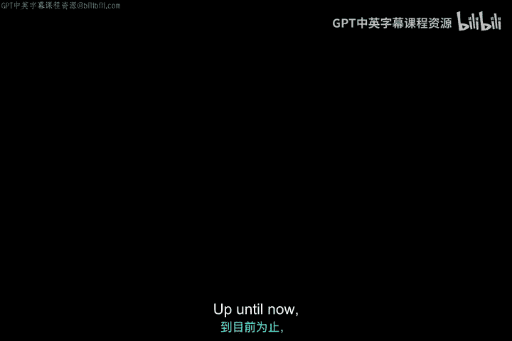
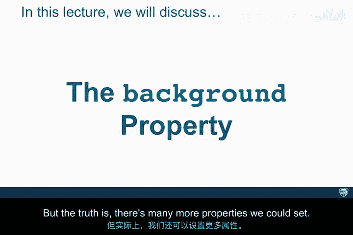
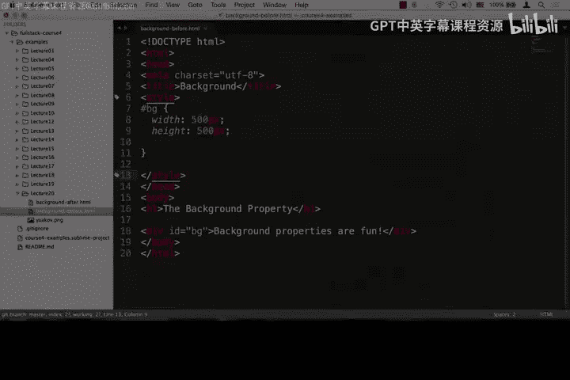
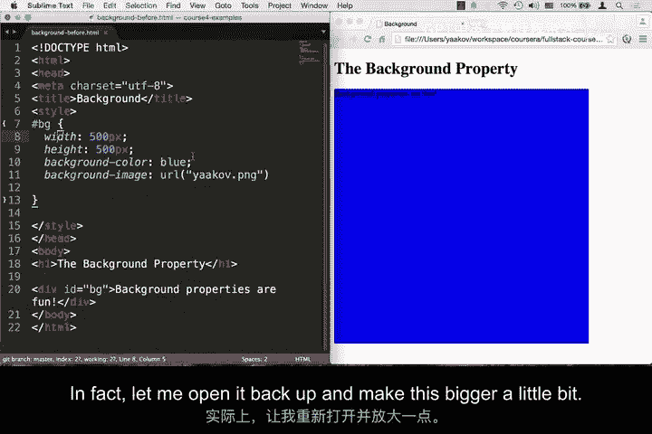
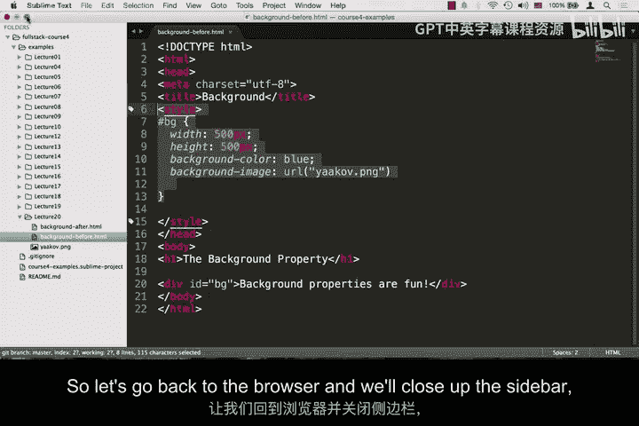
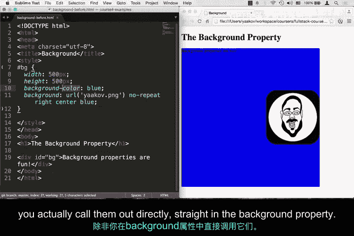
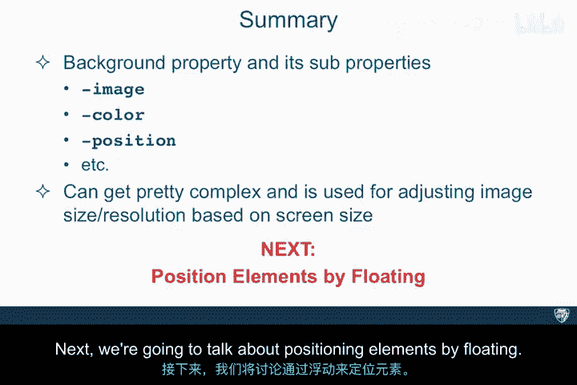

# 约翰霍普金斯大学《Web开发者的HTML, CSS, and Javascript》中英字幕 - P30：13_第20讲 背景属性.zh_en - GPT中英字幕课程资源 - BV1WzY6z9EUd

。Up until now we've been using the background property just to set the background color。

 but the truth is there's many more properties we could set。

 so let's jump into the code editor and take a look。

Okay so here I'm in sublime text and I'm looking at the file called background before that HTML and it's located in the examples lecture 20 folder and the structure of this HTML document is pretty simple。

 we have the H1 just to basically tell us what the title of this whole thing is be visible and we have the div with an ID called Bg and just set the content that just says background properties are fun and the Bg is styled with an ID selector and with being 500 and high being 500 so if we resize our editor a little bit and expose the browser so we see that's basically the page that's been represented。

 let's go ahead and close the sidebar and let's do what we have done previously which is set the background color of the element let's set it to blue if we refresh the page we see that we we have 500 by 500 pixels square that we've created So having a background as a color as a solid color is nice but what if we wanted。

😊，Image is a background color。 Well， there's a property to take care of that。

 And the property is called background dash image。 And if we do that， we could set up。

 supply a URL with parentheses and inside there and it's best practice just to put it in quotation marks。

 you could specify a file。 So let me take a look here at my file Expr here。

 And I see I have yakov dot P and G。 And if we take a look at it， yes， that's a caricature of me。

 and。😊，So I want to display that as the background is a background image。

 I'll specify yaakov Png right here Now before we go on notice that the URL that you specify right here。

 let me close this real quick In fact let me open it back up and make this bigger a little bit notice that URLl you supply is a relative URL but it has to be relative to your CSS So if this CSS that we're writing which is right now we're just writing inside the style tag。

 but if we were to put it inside of a subfolder like CSS or style subfold。

 the URL would be different or URL would have to be relative to the CSS file or actually to be very technically correct the URL would have to be relative to the way the CSS file is served in the browser so slash something something that's the URL that it would need to be relative to so let's go back to the browser and will close up the sidebar save this and。

😊。

Let's reload this andvoila we have our background image and you could see that it's being repeated and that's actually yet another property that you could set。

 So let's go ahead and put the semi here and say background background repeat and here we have a few options we have no repeat repeat repeat X repeat Y So if we do repeat X well as the repeat y。

 What else it's going do isre gonna repeat it vertically or we could just say no repeat and no repeat will just put one image in the top left corner by default Also notice that we're using a background color property and a background image property at the same time and you can see that the image wins in terms of priority it is on top of the color we can also specify the position of the image within the elements So that go ahead and do that right now we'll say background position。

😊，And we'll give it two values first is a horizontal value and then the vertical value。

 So let's say we want it to be top and right if we save that and refresh now we're top and right oh let's make it a little bit more interesting bottom。

 bottom and right。😊，Now specifying only one of these will make the other one。Default to center。

 so if I just specify right and refresh， you'll see that it's now vertically in the center and similarly。

 if I specify bottom。😊，And refresh， you'll see it'll be at the bottom。

 but horizontally now it will be in the center。So these properties， background color， background。

 image， repeat and so on， they're all individual properties。

 but the truth is you could combine them all into one and let's go ahead and do that now let's go ahead and erase this。

😊，And specify just the background。And if you specify just the background。

 you can now list these same properties right here without having to specify them one by one here I'll specify my background image。

 I'll specify that I don't want it to be repeated， no repeat and I can also specify its location so let's say I want it to be right and center and if I save that and refresh you could see that my image did move to the right and it's in the center。

😊，Now something strange though happen right I mean where did the color blue disappear to I thought it was both we could have both the color blue and at the same time I'm a background image when the reason it disappeared is because my background property is being specified after the background color property and since I chose to use the background without the dash for a particular property it's overriding every single property except the ones that I'm actually specifying so if I wanted to I could go ahead and say blue and refresh。

😊，And my blue is back so the point is if you specify background color specifically and then you go ahead and overwride it with a background。

 but you don't specify the color or you don't specify whatever the specific property is。

 whether it's background image or background repeat or background position and so on。

 if you went ahead then and specified background without any dash sub property。

 whatever properties that are inherited with a dash will be overwrittenden unless you actually call them out directly straight in the background property。

😊。

Okay， so to summarize we spoke about the background property in its sub propertiesties。

 image color position， etc and the background property can be pretty simple。

 but it can also get pretty complex and it's used for adjusting image size and resolution based on screen size now I know we haven't seen that because we haven't seen media queries yet。

 but we will in just a few lectures Next we're going to talk about positioning elements by floating。

😊。

