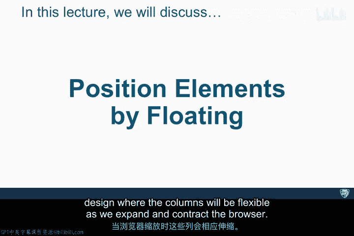
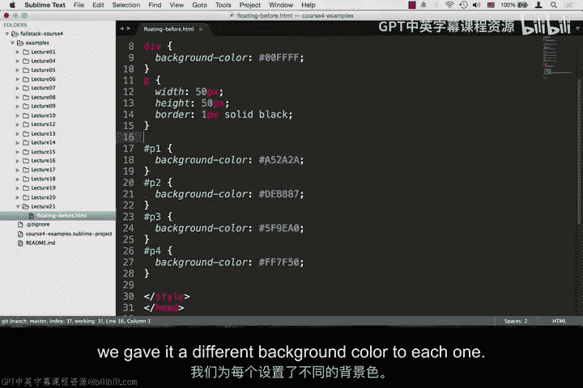
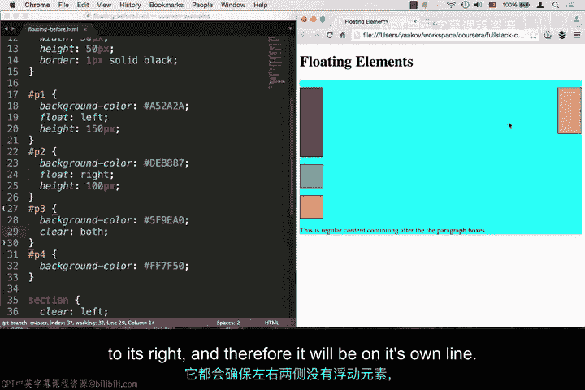
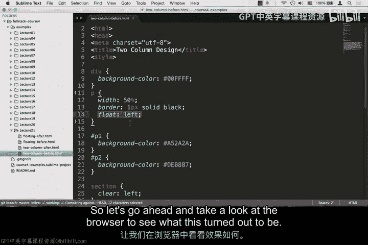
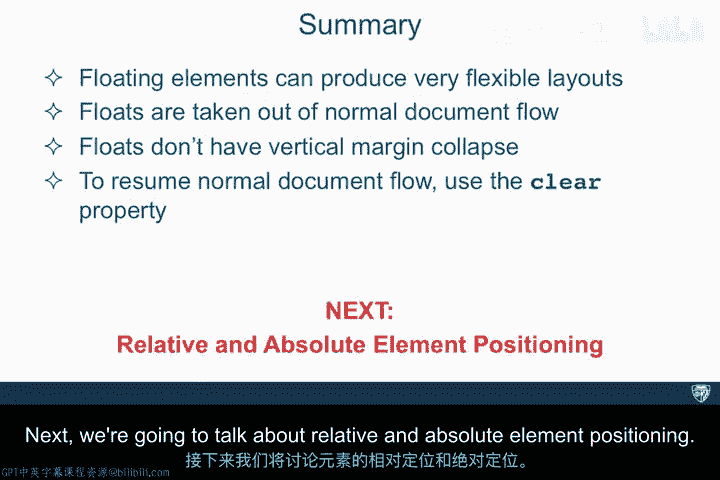

# 约翰霍普金斯大学《Web开发者的HTML, CSS, and Javascript》中英字幕 - P31：14_第21讲 浮动定位.zh_en - GPT中英字幕课程资源 - BV1WzY6z9EUd

。

In this lecture， we're going to talk about positioning elements by floating them。😊。

Now knowing how to properly float elements is an essential skill to half and this is partially because most of the Uis today web Uis to date that are made are made by floating the elements。

 In fact， by the end of this lecture we're gonna create a two column flexible design where the columns will be flexible as we expand and contract the browser So let's jump into the code editor and see how this works。

 so here we are in sublime text and we're looking at the file named floating before that HTML and let let's go over the structure of this HTML document real quick We have our regular H1 here just to announce what that is and then we have a div with four paragraph tags and a section tag with some text in it and the paragraph tags I P1 P2 p3 and P If you look at our div section we styled the div tag its background to be a certain color basically light blueluish color and every single paragraph tag with。

To be 50 pixels white and 50 pixels tall， and we gave it a nice one pixel border。

And just to differentiate between each paragraph box。

 we gave it a different background color to each one。

 so let's go ahead and take a look at what this looks like in the browser。

Okay so here are the four paragraph boxes that we had Okay so let's go ahead and float the very first paragraph box to the right。

 we'll say float right and we'll go ahead and refresh the page and you see that the box jumped all the way to the right top edge of the containing element Now a couple of quick things to notice right away first is that you could see that the rest of them moved up as if the maroon box isn't there anymore and the reason this is happening is because when you float elements。

 the browser takes them out of the regular document flow and this is why the second paragraph box moves in to the original spot of the first one because as far as the regular document flow is concerned that spot became empty second thing to notice is that even though each one of these paragraph boxes has a margin around them as you could see that theres a margin between each one of them right here that margin collapses as weve learned before when it is touching the margin of another element however when it comes to floated elements the margin。

😊，Never collapse。 and this is why youre now seeing the margin around the element on top。

 Also if you paid close attention， you will notice that the blue light blue box。

 the div became shorter to really illustrate what's going on。

 let's go ahead and remove the float right and instead make every single paragraph box float to the left。

 and to ensure that the boxes aren't squished right against the other。

 let's go ahead and give it a margin right of let's say 10 pixels。

 let's go ahead and refresh the page。 and you could see that now they're all floated to the left and there's a 10 pixel margin between them。

 However， what happened to our div our div seem to have completely collapsed and the only thing that's really keeping it open at all is the text that we put in here。

 This is happening because of the same point that I made before。

 When you float elements it takes them out of the regular document flow。

 Therefore it collapses in height and surrounds the last section element which has actually。😊。

Text in it in order to correct it we need to tell the browser then when it comes to this section element。

 the browser should resume the regular document flow and the way we do that is by using the clear property so let's go ahead and go to our styling and define section target and we say clear left and what this is doing is telling the browser that the section element is announcing that nothing should be allowed to be floating to the left of it and since every single paragraph that we've been floating is floating to the left when we save it and refresh this should jump right below here and so it does and this is not restricted to the non-fated elements we can ask a floated element to resume its regular document flow and then floated again so for example the reason this box is situated right here is because there's something already floated to the left of it but if I tell the browser to go ahead and resume the regular document flow on it it should jump to the next line and then resume floating from there on So that's box number three so let's go ahead。

And go over here and say clear and since things are floated to the left of the box we're going to say clear left so nothing should be allowed to flow to the left of it we save and refresh you can now see that box number three moved in its own line again and is floated to the left again There's one more value of the clear property that should explain before we move on to try to create our two column layout and that value is both so you could say clear both so let me show you a circumstance where that would actually apply we're going to reset our page back to the way it was and we'll go ahead and remove the floating elements here。

😊，And we'll refresh， so this is how it was when we started。

 so let's go and float the first element to the left as we did before。

 and we'll float the second box to the right。😊，Okay。

 so now if we refresh the browser you could see that both boxes floated and you could see the other two kind of moved into their places。

 so we already know how to deal with that in order to move them to the next line。

 we can just say clear and now we need to clear what now there's a box floating to the left and there's a box floating to the right so we can't say clear right。

And when we refresh the browser， this will go on its own line。 However。

 we could equally say clear left because there's a box that is on the left as well。

 So it seems like in this particular circumstance， it doesn't make any difference。

 whether you say left or right however it will make a difference if I make the right box much taller than it is now so I'll go ahead and go to box number two and I'll make its height something much taller。

 let's say 300 pixels and when I refresh the page he could see that it really went all the way down and it's totally ignoring the fact that I want to clear this element。

 meaning I want really on the next line by itself。 And the reason it's happening is because I'm actually clearing this element only from the left floating elements but I'm not clearing it from the right floating elements So therefore if I wanted to I could say here clear right again and want to refresh it will jump all the way down But the problem is that what happens when this element becomes too tall then it'll start overlapping again so if I make this element let's make it。

😊，bit less let's make it 100 and when we refresh you could see now it's still not overlapping because we're clearing to the right but let's now make element number one taller。

 let's make its height， let's say 150 pixels and refresh and you could see now it's overlapping so in order to ensure that both columns are both left and right floated elements are not encrouching on our space here of the third element we could just say clear both and refresh you could see that no matter which one is going to be taller it will still insist that nothing should be floated to its left or to its right and therefore it will be on its own line so let's go ahead and try to achieve that two column layout design in order to do that we're going to take a look at a file called two column before that H and it's located in the same folder examples lecture 21 an HTML structure is basically very similar to the file we just looked at the differences here is that I only have two paragraph tags inside that div I removed the other two and we。

Have a section tag inside of it and what we want to achieve is that this first paragraph should be the left column and the second paragraph should be the right column。

 So let's see what we did here。 So first of all for now we're keeping the background colors of all the elements and on the paragraph tag was said the width and the width we did something different this time we didn't specified pixels was specified percent So we're saying the width should be 50% of its containing element and the containing element is the div while the div is a block level element so it tries to fill in the entire width of its containing element which is the body or the entire browser basically what we're saying is that a paragraph should take 50% of the entire viewport we also gave it a one pixel border and we floated each one of them to the left so let's go ahead and take a look at the browser to see what this turned out to be and looking at the browser not quite exactly what we wanted the second paragraph is still in the bottom Why is this happening Well the reason this is happening is because we're still using the default box sizing which is content box and then we're saying that。

We want the box to take 50% of the screen and then we're adding that one pixel over that really breaks the whole thing。

 So if we remove that pixel right here and refresh the browser now it's floating exactly how we want it by the way this is a great illustration of what happens to floated elements when they can't fit on the same line and what happens is they float to the next line this is actually what happened when we had the border pushing the size of the box a little bit too much that it didn't fit on the same line anymore however for now we do want the border and if we get the border then we can't have the floating so how do we fix this well hopefully you still remember how to reset the box sizing and the box size we're gonna say is border box and once we do that the border will be included in the 50% of the width so now we save the file we go ahead and refresh and now we see even with the border we can have both of them floating side by side let's enhance our layout a little bit by giving some padding to the content inside each paragraph so let's say padding let's give it 10 pixels all around let's refresh。

😊，And we could see now we have the content separated from its border a little bit better and finally we could actually remove all these background colors and the border because they were only there to help us visualize things so we're going to go ahead and comment them out we'll go ahead and refresh and now we see we have a two- column layout let's make this a little bit bigger and as you can see now the layouts that have a two column layout and as I squeeze the browser the two column layout stays and not only that they're flexible and the reason they're flexible is because we didn't specify them with a particular pixel size。

 we specify them as a percentage of its container element So in summary floating elements can produce very flexible layouts floats are taken out of their normal document flow and they're positioned at the top left or right edge of the containing element。

😊，Also， floats don't have vertical margin collapse。

 so previously hidden or collapsed margins will show up once you float the element。

And remember that to resume normal document flow， use the clear property， either clear left。

 clear right， or clear both。😊，Next， we're going to talk about relative and absolute element positioning。

