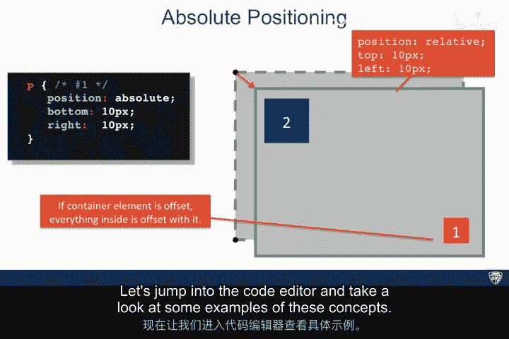
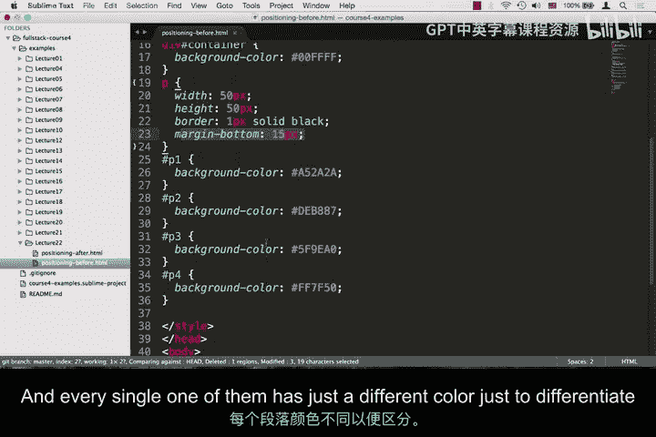
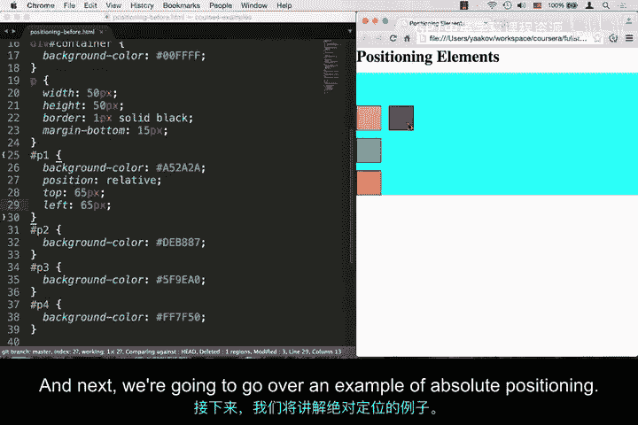

# 约翰霍普金斯大学《Web开发者的HTML, CSS, and Javascript》中英字幕 - P32：15_第22讲 第1部分 相对与绝对定位.zh_en - GPT中英字幕课程资源 - BV1WzY6z9EUd

。

Previously we spoke about one type of alternative element positioning and that's floating elements。

 I say alternative because it is alternative to the normal document flow in this lecture we're going to speak about a couple more positioning schemes and that's relative and absolute these positioning schemes allow you to specify precise offsets to move the target element to a different part of the page or region。

😊，First let's talk about static positioning static positioning is basically a different way of saying normal document flow it is actually a default setting for all elements except HTML。

 and if you try to apply positioning offsets on elements whose position property is set to static。

 the offsets are just ignored。A different type of positioning scheme is called relative positioning When you apply position relative on an element。

 the element is positioned relative to its position in the normal document flow In other words。

 if you were to apply offsets on that element， they will be offset from the original normal document flow position of that element。

So the positioning CSS offset properties are top bottom left and right。

 so when you position an element as relative， you're basically creating like an anchor for the offset。

 so the element's top bottom left and right edges become the boundaries from which you offset the element the important thing to know about relative positioning is that the element that is set to relative positioning is not taken out of normal document flow in fact even if it's moved by using the offsets its original spot is preserved so as far as the rest of the HTML elements and the rest of the HTML page is concerned that element is still sitting in its original spot even though visually its offset somewhere else。

So let's give a quick visual example so here's the paragraph and it's basically represented by this orange box As soon as we set position relative on the element。

 its edges become almost like an anchor for future offsets Now when we apply the offsets the element moves relatively to its original position in the normal document flow So in this case it's moving top 50 pixels and left 50 pixels Now these values might be a little bit confusing since we're saying left 50 pixels but yet moving the element to the right So the way you could think about these offsets is really not top or left but more like from the top and from left so if you take from left 50 pixels you move 50 pixels to the right and you take from top 50 pixels you really moving 50 pixels from the top Also note that nothing really changed about the document other than this element moving the original space for that for that element still remains in the original laid out element around that element still remain。

😊，Exactly the same because they think the element is still sitting in its original spot it can also use negative values for these offsets and which one you use bottom right or top left。

 it's really more of a convenience for you depending on the use case you're trying to code to so in this example we achieve the same result by using negative bottom right values as we did by using positive top and left values。

Now the idea of the absolute positioning is that all offsets top bottom left right are all relative to the position of the nearest ancestor。

 which has positioning set on it other than static in other words。

 some parent grandparent oh on and on and on ancestor has to have its positioning set other than static and then the absolute positioning will actually start working by default HTML element is the only element that has nonst positioning set on it。

 and it's actually set to relative。Unlike relative positioning。

 the element is taken out out of its normal document flow if its positioning is set to absolute。

Let's say we have this gray box and it's some kind of a container element and its position is set to relative and we have this box number one。

 that's the one we're going to target and some kind of a box number two。

 some other element that's number two so if we set the position absolute on number one what's going to happen is it's going to be first of all taken out of its normal document flow and it's going to remain in the place where it was without any other offsets so as you can see in this illustration element 2 moved up underneath element1 since element1 is no longer a part of the document flow element2 doesn't think it's even there。

😊，Now if we do some offsets and in this case we're doing bottom right offsets。

 we're going to be relative to our container element since that container element's position is set to relative。

 and we're going to do bottom from bottom 10 pixels and then from right 10 pixels over and that's how we end up with this number one box being in the bottom right of our container element。

😊，A really cool feature of this combination is is that if your container element is itself offset。

 everything inside of that container is offset with it。

 so you could set up a particular layout within a container element and then move that container element or offset it all around the screen that worrying about having to offset particular values of every element within that container element。

Let's jump into the code editor and take a look at some examples of these concepts。

Okay so here I am in sublime text and I'm looking at a file called positioning before that HTML and it's located in the examples lecture 22 folder so let's examine real quick the structure of the HTML it's super simple we just have an H1 just announcing what we are what we're doing here and we have a div which has an ID container and then four paragraphs each one having ID P1 p2 p3 p4 and that's it and our initial styles are pretty simple as well first of all we reset the margin and padding as well as set our box sizing to border box we also gave the H1 since we reset the margin we gave H1 the very first one a bit of a bottom margin 15 to push down the rest of the contents of the page。

We gave our diff container that familiar light blueluish color and every paragraph tag is 50 pixels by 50 pixels and it has a border black border of one pixel and also has a margin bottom of 15 pixels every single one of them and every single one of them has just a different color just to differentiate which one we're looking at so let's go ahead and take a look at what this looks like in the browser。

So as you can see here's our four paragraph boxes and they're sitting inside this light bluish container。

 this di container so the first thing we're going to do is we're going to work on this first box right here and what we will do is we will set its position to relative and when we do that save and refresh。

We see nothing really happen Well actually what's going on here is now we've set in anchor so now all offsets of this element are going to be relative to its normal document flow position which still remains right here let's go ahead and give it some offsets to simulate it going basically down to the second to the second row we'll give it top 65 so it's from the top 65 pixels down and then from the left 65 pixels from the left and we'll refresh the page。

😊，And here we go so we move this element from here to here and as you could see this element is not taken out of document flow because the rest of the elements are still sitting in their original spots and this space is still completely unoccupied Well the truth matter is the browser's thinking it's actually occupied by this element which we just moved over here so that's the basic rundown of your relative positioning and next we're going to go over an example of absolute positioning。

😊。

