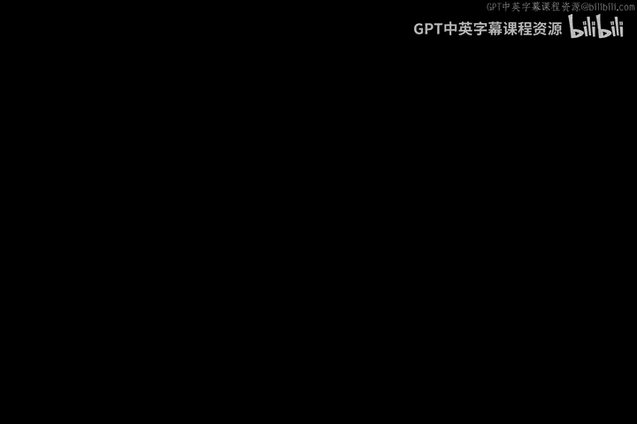
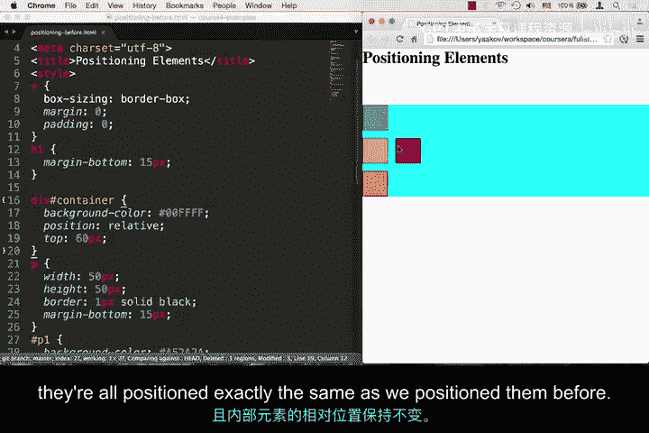
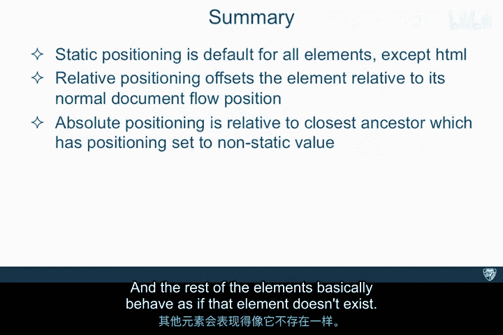
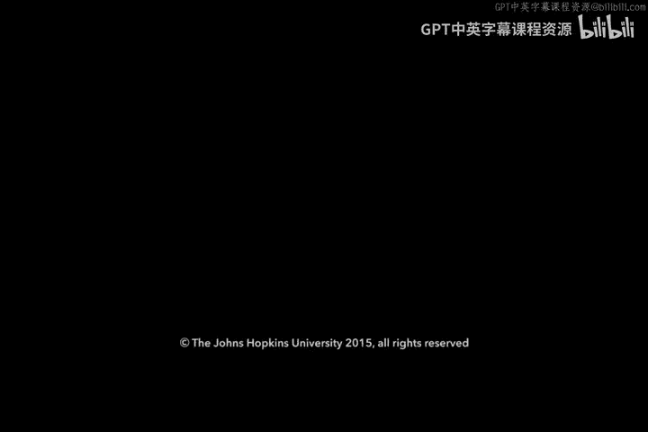

# 约翰霍普金斯大学《Web开发者的HTML, CSS, and Javascript》中英字幕 - P33：16_第22讲 第2部分 相对与绝对定位.zh_en - GPT中英字幕课程资源 - BV1WzY6z9EUd

🎼。

Let's play around a little bit with the absolute positioning let's take this third box which is colored cadet blue。

 even though to me it looks a little bit green， let's take that and let's try to set its absolute positioning to move it right back to where the maroon box used to be so let's go to paragraph 3 and we'll set its position to absolute and we'll give it a top of zero。

😊，And we'll give it a left of zero as well， and when we save it。

 let's see what happens when we refresh。And whilea， when we refreshed。

 you could see it was taken out of the regular normal document flow。

 but it's not quite where we wanted it。 We wanted it right here in its original in the spot where the maroon box used to be。

 but yet it's flush right flush with the browser's edges。 Now， why is that happening。 Well。

 let's take a look at our document structure one more time to figure that out。

 This is the box number three right here represented by paragraph with the Iine P3。 Well。

 we remember that absolute positioning needs a relative or an absolute parent or an ancestor。 Well。

 it goes up to chain and says is this element something that has its position set to either absolute or relative。

 And the answer is no， So it keeps going。😊，And it goes up to the body element and as as this element has an absolute or relative position set on it and the answer is no again。

 so it jumps all the way to the HTML element which has its position set to relative by default and that's how we end up with the bugs going all the way up top so how do we fix it Well simple we just need to anchor the ancestor or the container of our paragraph tag with the position relative and any element contained within that container element will then be positioned relative to its edges？

In our case， since we want this box to be relative to the containing div。

 we need to set the containing di elements position to relative， let's go ahead and do that。

 we'll say position relative， we'll save it， we'll refresh and when we do it should jump right here where the maroon box used to be and exactly so it does。

😊，Last but not least， let's try to move the entire container element down a few pixels and see if all the containing elements will move exactly in the same position down with it in order to do that let's go ahead and go to our div container and we'll give it a top value of 60 pixels。

And once we save， let's refresh and the entire container move down together with all its containing elements and they're all positioned exactly the same as we position them before。

So in summary， static positioning is default for all elements except HTML HTML actually has its positioning set to relative。

😊，Relative positioning offsets the element relative to its normal document flow position。

 and the normal document flow is not affected whatsoever by moving or offsetting the relatively positioned element。

😊，Absolute positioning is relative to its closest ancestor。

 which has positioning set to a nons static value， which is either absolute or relative。

The important thing to remember about absolute positioning is that the element is taken out out of its normal document flow。

 and the rest of the elements basically behave as if that element doesn't exist。

Also， as you saw， offsetting the relative container element offsets its contents as well。

 which gives you great flexibility to move around a whole set of elements and not just one。Next。

 we're going to talk about media queries。

