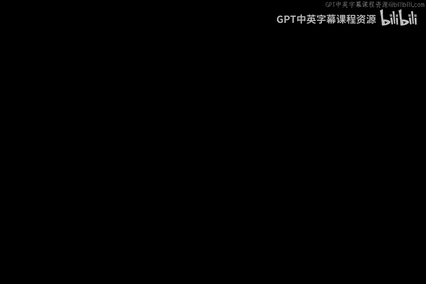
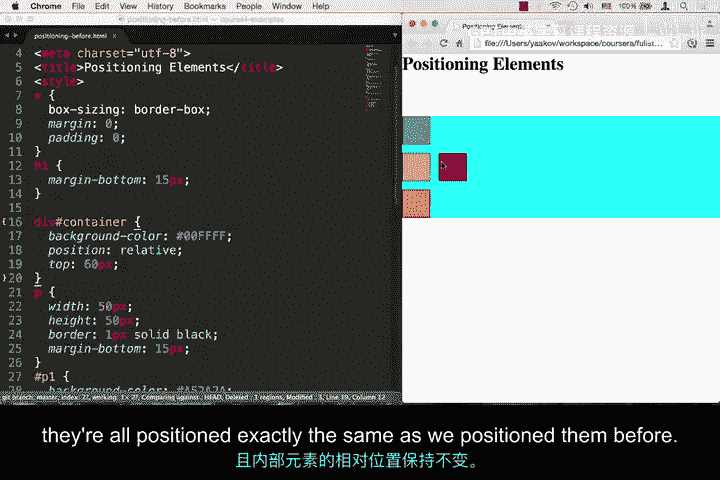
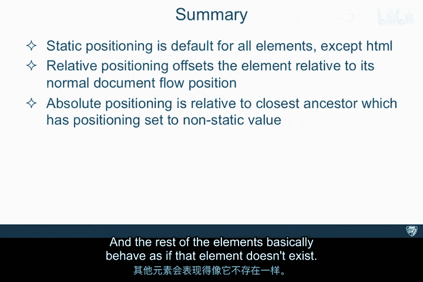
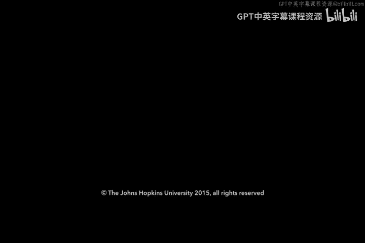

# Web开发者的HTML, CSS, and Javascript：16：相对与绝对定位（第二部分）



在本节课中，我们将继续探索CSS定位，重点通过实际操作来理解绝对定位的行为，特别是它与祖先元素的关系。我们将通过移动一个盒子来演示关键概念。

上一节我们介绍了相对定位的基本概念，本节中我们来看看绝对定位在实际布局中如何工作。

## 实验绝对定位

让我们实际操作一下绝对定位。我们选择第三个盒子，它的颜色是军蓝色（虽然看起来有点偏绿）。我们将尝试使用绝对定位将它移回原来栗色盒子所在的位置。

为此，我们选中代表第三个盒子的段落（P3），并为其添加以下CSS样式：
```css
position: absolute;
top: 0;
left: 0;
```

保存并刷新页面后，我们发现盒子确实被移出了正常的文档流，但它并没有出现在我们预期的位置（即原栗色盒子处），而是紧贴在了浏览器的边缘。

## 理解定位的“锚点”

为什么会出现这种情况？让我们再次审视文档结构来找出原因。

代表第三个盒子的元素是`<p id="p3">`。我们回忆一下，绝对定位的元素需要一个设置了`position: relative`或`position: absolute`的父级或祖先元素作为其定位的参照物（“锚点”）。

该元素会向上查找其祖先链：
1.  首先检查其直接父容器（`div.container`）是否设置了非`static`的定位。答案是否定的。
2.  于是它继续向上查找`<body>`元素。答案同样是否定的。
3.  最终，它找到了`<html>`元素。默认情况下，`<html>`元素的`position`被设置为`relative`。因此，这个绝对定位的盒子就以整个浏览器视口（viewport）的左上角为原点进行定位了。

## 修复定位：设置相对容器

如何修复这个问题？很简单：我们需要为绝对定位元素的**容器**设置一个相对的定位上下文。

既然我们希望这个盒子相对于其外层的`div`容器进行定位，我们就需要将这个容器的`position`设置为`relative`。

让我们为`div.container`添加样式：
```css
position: relative;
```

保存并刷新后，第三个盒子现在准确地跳转到了原栗色盒子的位置。这是因为现在`#p3`找到了一个设置了`position: relative`的最近祖先（`div.container`），并以其边界为基准进行定位。

## 移动整个容器组



最后，让我们尝试将整个容器元素向下移动一些像素，观察其内部所有元素的定位是否会随之整体移动。

为此，我们为`div.container`添加一个`top`偏移值：
```css
top: 60px;
```

保存并刷新页面，可以看到整个容器连同其内部所有定位好的元素一起向下移动了60像素，并且它们彼此之间的相对位置关系保持不变。

这个特性为我们提供了巨大的灵活性，可以轻松地移动一整组元素，而不仅仅是单个元素。

## 本节总结



本节课中我们一起学习了绝对定位的实践应用。以下是核心要点的回顾：

*   **静态定位**：是除`<html>`外所有元素的默认定位方式。`<html>`元素的定位默认为`relative`。
*   **相对定位**：使元素相对于其**在正常文档流中的原始位置**进行偏移。移动相对定位的元素**不会影响**其他元素的正常文档流布局。
*   **绝对定位**：使元素相对于其**最近的一个设置了非`static`定位（即`relative`或`absolute`）的祖先元素**进行定位。
*   **关键影响**：绝对定位的元素会被**完全移出正常文档流**，后续元素在布局时会表现得如同这个元素不存在一样。
*   **容器控制**：通过为容器设置`position: relative`，可以控制其内部绝对定位子元素的定位基准。移动这个相对定位的容器，其内部所有定位元素会作为一个整体随之移动。



下一节，我们将开始学习媒体查询，这是实现响应式网页设计的关键技术。