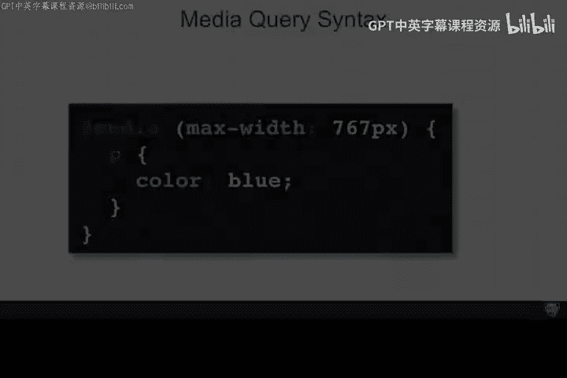
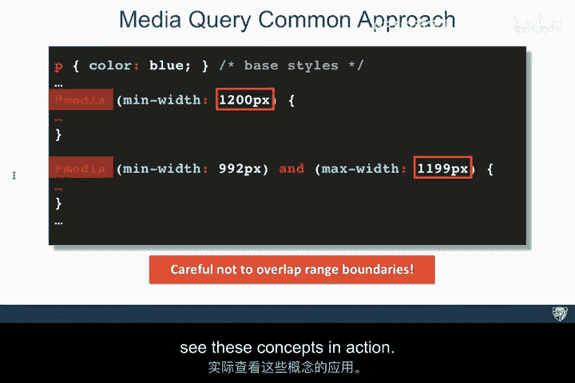
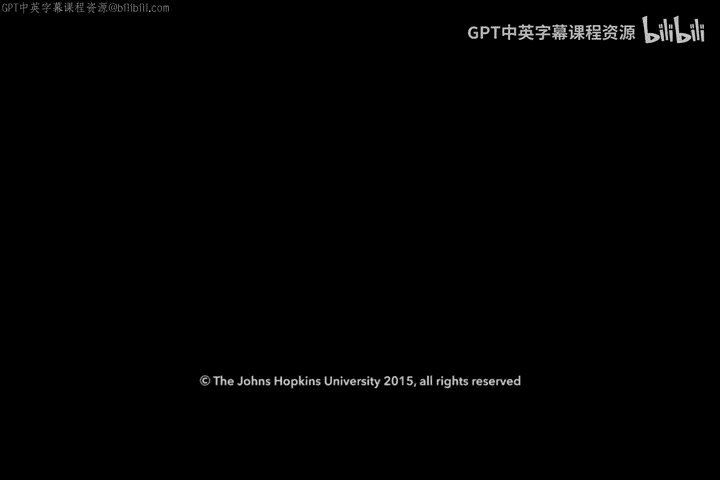

# 约翰霍普金斯大学《Web开发者的HTML, CSS, and Javascript》中英字幕 - P34：17_第23讲 第1部分 媒体查询.zh_en - GPT中英字幕课程资源 - BV1WzY6z9EUd

。

Media queries allow you to group styles together and target them to devices based on some criteria。

 For example， you can target a device by its width。

 its height orientation like landscape or portrait。

 Of course one of the most obvious differences between viewing a website on a desktop browser and your cell phone is the screen size。

 remember that using CSs you have the power to produce very different webpage layouts from the same HTML。

 remember CSsgar co So it only makes sense then that the most common way to adjust the styling and layout of your page is to provide different styles for different screen sizes of the user's devices。

 This is why it's crucial to learn at least the basics of how to utilize media queries without them responsive design which will start talking about fairly soon wouldn't be possible。

 Let's go ahead and explore the basic syntax of media queries。😊。

A media query starts with a keyword at media， and then it is followed by a media feature and followed by curly braces within those curly braces you have your styles。

 it's basically like a style sheet within a style sheet。

Each media feature resolves to either true or false and you can have more than one media features combined together using logical operators if the media features resolve to true the style within the curly braces apply when writing media queries。

 make sure you close the curly braces for the media query as a whole and then separately each styling rule。

😊，There are quite a bit of these media features that are available， so you could have Max width。

 you can have Min width， you could have height， which is not listed here。

 you can even target orientation of your device， portrait or landscape。

 you could target only screens as opposed to targeting only print again if any of these things evaluate to true the styles contained within the curly braces of the media query will be in effect。

As I mentioned before， even though there are quite a bit of these media features that are available。

 the most common ones are the max width and the Min width， and again。

 the fact that there is most common really is connected to the fact that the most common way of targeting different devices is by the width of the device。

In addition， as I've said before the media features can be combined using logical operators one of the most common logical operators is the and operator as an example here's a code snippet that targets a width range here you see we're targeting any device that falls within the range of its width being anywhere from 768 pixels until 991 pixels if the devices has a width that is smaller than that or larger than that。

 the styles applied within this media query will not apply。

Another way to combine media features is to place a common between them which would basically translate into being a coolant to an ore operator。

 and this code snippet， were showing that we're targeting any device whose width is no larger than 767 pixels or any device that is at least 992 pixels in width。

Now practically speaking， when you approach responsive design and responsive layouts。

 the most common logical operator is the and operator。

 so if you know that operator you're in pretty good shape。Now before we jump into a code example。

 I'd like to show you a very common approach how you structure media queries within your style sheet What usually happens is you have a few of these media queries but you almost always start with some base styles base styles will apply across the board no matter what screen size you are actually are viewing the website on and then you go ahead and start targeting a particular screen size by either changing some of the properties of the base styles or adding something else to them or maybe taking something away now an important point to point out and especially when you're using widths of screen sizes of the devices is that you have to be very careful not to overlap range boundaries so in this example you will notice that the first query has the minimum width of 1200 pixels and the second query is coming up it's a range again and it comes up up to max width of 1199 pixels if I were to say 1200 pixels it will mean。

😊，Always inclusive it will mean that both sets of styles will apply and most probably things will be pretty messy and very hard to maintain so it's important when you structured these mediaqueries that you have very clean separate boundaries in part two of this lecture we're going to jump into the code editor and see these concepts in action。

😊。

