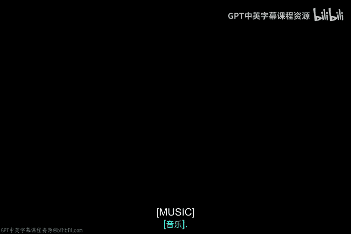
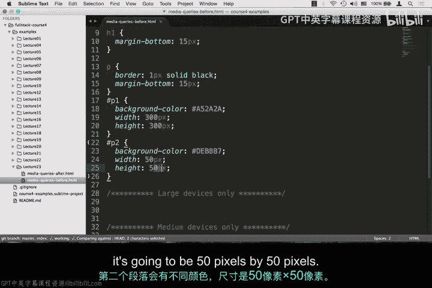
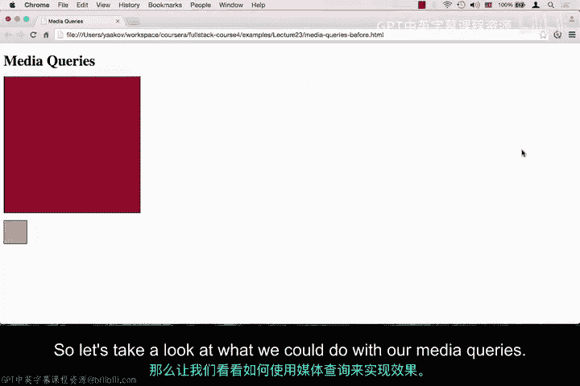
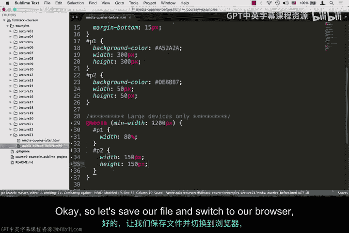
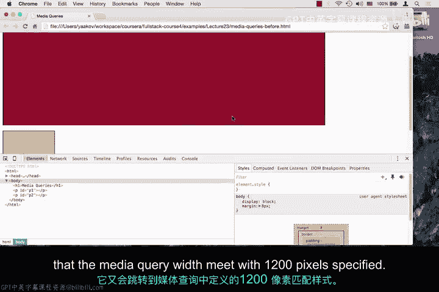
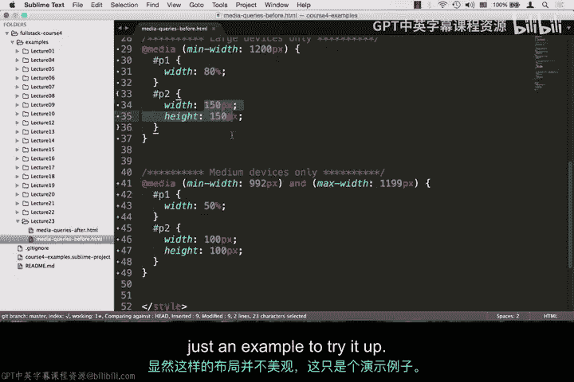
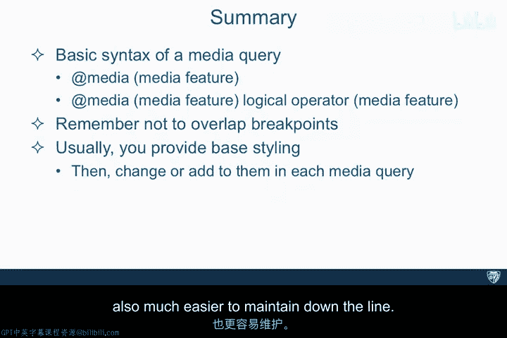
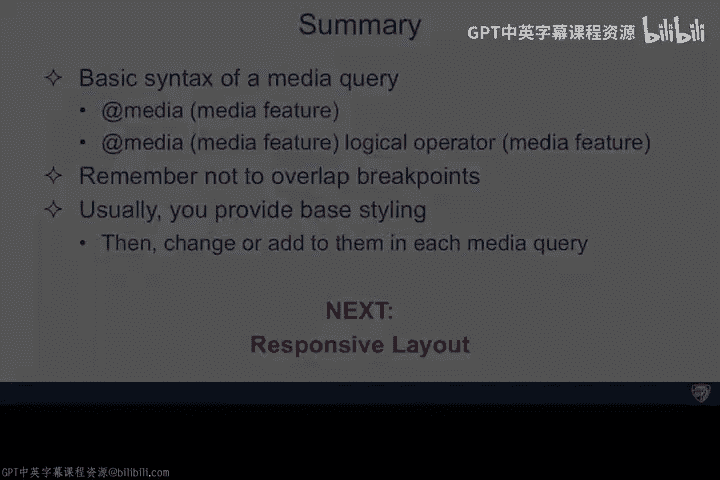

# 约翰霍普金斯大学《Web开发者的HTML, CSS, and Javascript》中英字幕 - P35：18_第23讲 第2部分 媒体查询.zh_en - GPT中英字幕课程资源 - BV1WzY6z9EUd

。

Okay so I'm in sublime text and I'm looking at the file called media queries before that HTML and it's located in the examples lecture 23 folder。

 let's take a quick look at the structure of our HTML and it's a very simple one again just the H1 just to tell us where we're holding you know we have an our HTML really is two paragraphs first one is I with P1 and the second one is I with P2 let's take a look at the styles that we have for these paragraphs so far as you can see we're following our own advice and we have some base styling that we're going apply to these paragraphs before we even get to the media queries we're not going pay too much attention to H1 that's just really for our web page to look a little bit more decent pay attention to the paragraph tags however。

 so here we're targeting our paragraph and basically just giving it a border of one pixel solid black and giving a bottom margin of 15 pixels and then we're distinguishing each paragraph by using the ID selector by giving it a particular color and the first paragraph is gonna to be fairly large it's going to be 300 pixels by。

300 pixels and the second one is going to be a different color and it's going to be 50 pixels by 50 pixels Well let's take a look as to what this looks like in the browser。

So here are our two paragraphs， one is fairly large， another one small。

Let's take a look at what happens if we make the browser width smaller and smaller and smaller and as you can see really nothing happens at all。

 right， we could go on and nothing is going on so let's take a look at what we could do with our media queries。

😊。

So here I have a couple of sections that I specifically designated for our mediaqueries The first one is going to try to target large devices only so what are large devices well large devices in my vocabulary will be anything that is at least 1200 pixels white so we'll go ahead and write media query for that and the mid width mid width is going to be 1200 and don't forget pixels and we'll open the curly brace and close the curly brace and we're ready to target our paragraphs just for devices that are at least as large as 1200 pixels wide so we'll go ahead and do our first paragraph and what we'll do is we'll change its width to let's say Windows width to let's say 80% so what that will mean is that paragraph number one with 1200 pixels or wider we'll take 80% of our screen as for paragraph number two we'll make it that it's width is 150。

😊，Pixels which is a little bit larger than it is actually three times is large right because it was 50 pixels before and will actually change its height to 150 pixels as well so it will be perfect square let's say a file and switch to our browser let's reload and let's take a look since our browser now is definitely wider than 1200 pixels you see that both of the paragraphs actually were affected now how do I know that my browser is wider than 1200 pixels well if I press command option I or on PCs control option I I will bring up my Chrome developer tools and now if I start dragging the side of the browser you'll see in the top right corner that it's showing you the actual size and you see something else interesting you see at 1200 pixels 1214 pixels and as we go smaller and smaller when it goes to past 1200 pixels you see that everything jumps to its original base sizes and if I make it a little bit wider again。

It will jump again to the styles that the media query with min width 1200 pixels specified。

 Let's go back and make this larger again。 so let's switch back to our code and write one more media query。

 but this time for medium size devices what are medium sized devices Well medium size devices is probably something around 992 pixels and 1199 pixels Now where are I pulling out these numbers while I'll tell you the secret I'm cheating a little bit。

 I'm pulling them out out of the standard ranges with ranges that the Twitter bootstrap framework defines for its different media device sizes。

 we'll speak about Twitter bootstrap fairly soon but for now our mediaqueries should be minimum width of 992 pixels and remember that and and Max width of 1199 pixels and remember we're trying to make sure we don't overlap with the previous media query otherwise were basically going。

😊。

Applying both styles again， so we're going to open up to curly brace and we'll target again paragraph one and we'll go ahead and make it smaller。

 we'll make it width still in percent， but at least it'll make it as smaller make it 50% and paragraph number two will make it width to 100 pixels so again a little bit smaller than for larger screen size and the height also will make it 100 pixels。

So now you can see that our base size makes the first one， 300 by 300， second 50 by 50。😊。

If the screen width falls into the range of 992 pixels and 1199 pixels。

 we're going to increase our size of the first one and we'll make it 50% of the screen and paragraph number two will become 100 by 100 instead of 50 by 50 and if we stretch our browser all the way to 1200 pixels and above the first paragraph will become 80% of the screen and the second paragraph will become 150 pixels large and obviously none of this makes any sense in terms of nice layout this is really just as an example to try it out so let's switch the browser and see how that worked out。

😊。

Let's make this a little bit smaller so we could see all of them。😊。

But still see the screen sizes and go ahead and refresh it。

 So we're now at above 1200 as we go a little bit slower to 1200 when we get to a little bit less than 1200。

 we switch to our second media query， which makes this be 50% of the screen as opposed to 80 if we could go back well see the 80% of the screen。

 that's the 80% of the screen。😊，And go a little bit down and if we below 1200。

 this is 0 50% of the screen and this is 100 by 100 pixels and if we go even below 992 pixels as we get closer and we switch from 992 to 991 you could see that we're back to our base style in because we have no media query that is defined for that particular screen size I'd like to show you one more thing that the Chrome developer tools has here you'll see this cellphone looking icon if we click that we'll see a whole different view of our page that we're able to play with and it tells us here that we might need to reload it so we'll go ahead and reload that right now to get rid of that warning but you see here I could select any device I want and even select between portrait and landscape mode and see what my website looks like in on that particular device and I can also go ahead and change the device size right here just by dragging the border of this thing and one more thing is。

😊，If you take a look， it actually shows us in our own CSS that we loaded into this page what are the different ranges in terms of the mediaqueries that exist and you could see here we have one that's from 992 pixels to 1199 and the other one from 1200 and on and if we go ahead and start selecting subde let's see what does it look like on the Apple iPad it looks just like that and the portrait mode but if I switch it will be in landscape mode it's telling us again to refresh go ahead and do that and you could see that we can actually go and see what happens at these breakpoint and the points between one media query and another one it's called breakpoint so we're now going towards our second break point and when we get there you see that our first box basically made itself 80% and I can't remember what the size of that box anymore is but you see the difference and if we jump back now this one is applying and if we make it even smaller than that that breakpoint 992 pixels and 991 pixels the breakpoint。

😊，Change and now were back to our base styling so Chrome developer tools are incredibly useful when you're trying to design and test and basically see and debug a little bit your responsive designs。

😊，So in summary we looked at a basic syntax of a media query and remember it's a media with some media feature in parentheses or you could combine media features with some logical operator。

 so here we have media feature and parentheses followed with some logical operator and in responsive layouts it's usually the and operator and then followed another media feature also again in parentheses remember not to overlap breakpoints we talked about how if we structure our media queries with different widths of different devices that the breakpoints of these width should not overlap even by one pixel。

😊，Usually the way you approach this is you provide some base styling and then you change your add to them in each of the media queries and usually structuring your CSS in this way makes it much cleaner and also much easier to maintain down the line。

😊。

Next， we're going to speak about responsive layouts。

