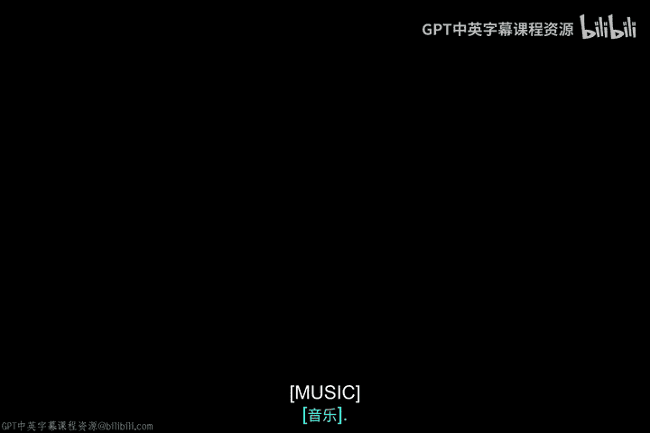
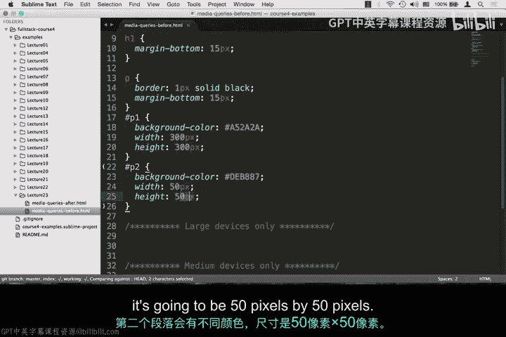
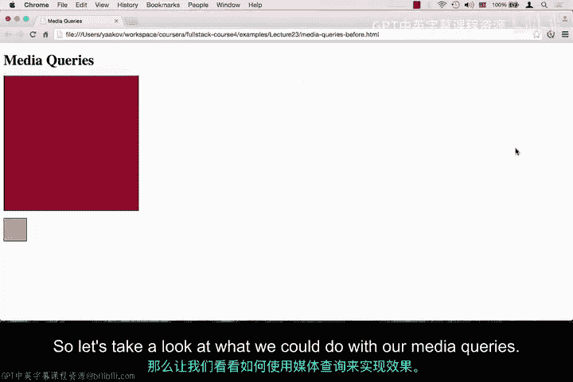
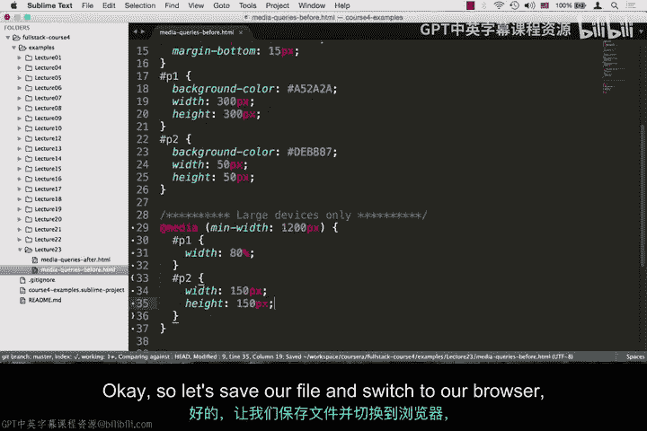
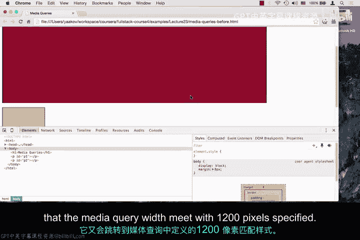
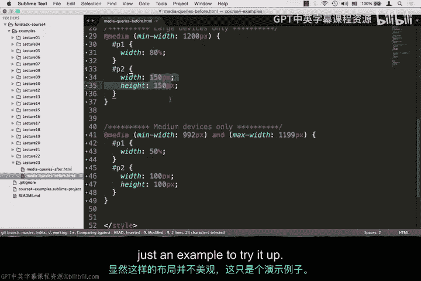
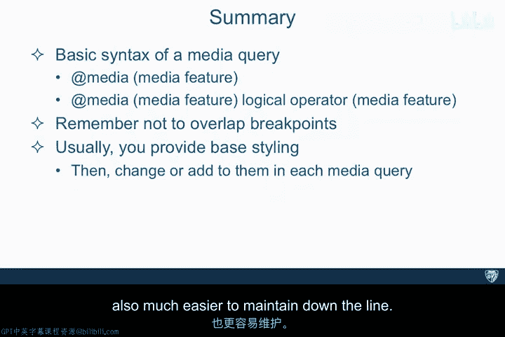
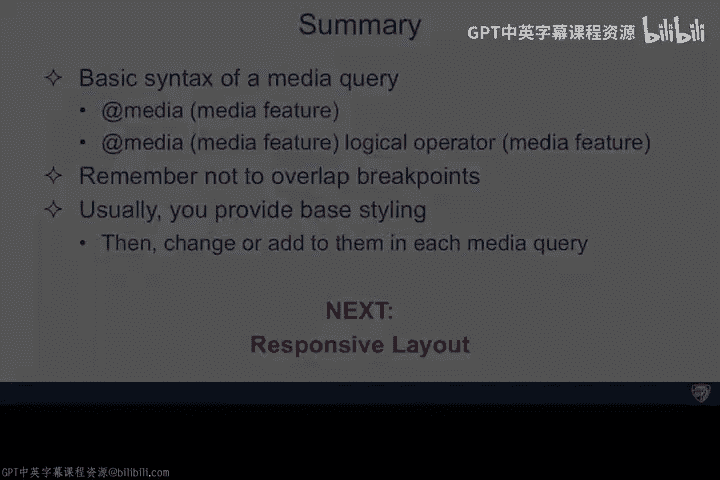

# Web开发者的HTML, CSS, and Javascript：23：媒体查询实践



在本节课中，我们将学习如何使用CSS媒体查询来创建响应式网页设计。我们将通过一个简单的例子，了解媒体查询的基本语法、如何设置断点，以及如何使用浏览器开发者工具进行调试。

---

上一节我们介绍了媒体查询的概念，本节中我们来看看如何在实际代码中应用它。



我们首先查看一个名为 `media queries before` 的HTML文件。它的结构非常简单，包含一个H1标题和两个段落。



以下是该HTML文件的基本结构：
```html
<h1>媒体查询示例</h1>
<p id="p1">第一个段落</p>
<p id="p2">第二个段落</p>
```

在应用任何媒体查询之前，我们为段落设置了一些基础样式。这些样式将作为所有屏幕尺寸的默认样式。

以下是应用于段落的基础CSS规则：
```css
p {
    border: 1px solid black;
    margin-bottom: 15px;
}
#p1 {
    background-color: lightblue;
    width: 300px;
    height: 300px;
}
#p2 {
    background-color: lightcoral;
    width: 50px;
    height: 50px;
}
```

在浏览器中查看，我们可以看到两个不同大小的盒子。当我们缩小浏览器窗口时，它们的样式不会改变。接下来，我们将使用媒体查询来根据屏幕宽度调整它们的样式。

---



现在，让我们开始编写我们的第一个媒体查询。我们将针对“大”设备，即宽度至少为1200像素的屏幕。

以下是为大屏幕设备（≥1200px）编写的媒体查询：
```css
@media (min-width: 1200px) {
    #p1 {
        width: 80%;
    }
    #p2 {
        width: 150px;
        height: 150px;
    }
}
```
应用此查询后，当屏幕宽度达到或超过1200像素时，第一个段落的宽度将变为屏幕宽度的80%，第二个段落将变为150x150像素的正方形。我们可以使用Chrome开发者工具（按 `Cmd+Opt+I` 或 `Ctrl+Shift+I` 打开）来拖动窗口边缘，观察在1200像素断点处样式的切换。

---



上一节我们为大型设备设置了样式，本节中我们为中型设备添加另一个媒体查询。为了避免样式冲突，我们需要确保断点不重叠。

以下是为中型屏幕设备（992px - 1199px）编写的媒体查询：
```css
@media (min-width: 992px) and (max-width: 1199px) {
    #p1 {
        width: 50%;
    }
    #p2 {
        width: 100px;
        height: 100px;
    }
}
```
现在，我们的样式规则如下：
*   **基础样式**：`#p1` 为300x300像素，`#p2` 为50x50像素。
*   **中型屏幕（992px-1199px）**：`#p1` 宽度变为50%，`#p2` 变为100x100像素。
*   **大型屏幕（≥1200px）**：`#p1` 宽度变为80%，`#p2` 变为150x150像素。

在浏览器中调整窗口大小，可以清晰地看到在992像素和1200像素这两个断点处，样式发生了切换。



---

Chrome开发者工具提供了一个强大的功能来模拟不同设备和屏幕方向，这对于测试响应式设计至关重要。

以下是使用Chrome开发者工具测试响应式设计的步骤：
1.  打开开发者工具（`Cmd+Opt+I` / `Ctrl+Shift+I`）。
2.  点击工具栏上的**切换设备工具栏**图标（手机形状）。
3.  在顶部可以选择预设的设备（如iPad），或手动调整窗口尺寸。
4.  工具还会在CSS面板中高亮显示当前生效的媒体查询规则。

通过这个工具，我们可以方便地观察网站在不同断点下的表现，并进行调试。

---

本节课中我们一起学习了媒体查询的实践应用。

我们回顾了媒体查询的基本语法：`@media (媒体特征) { ... }`。在响应式布局中，我们通常使用 `and` 逻辑运算符来组合多个特征，例如 `@media (min-width: 992px) and (max-width: 1199px)`。

我们强调了设置断点时**不要重叠**的重要性，通常的做法是：
1.  先编写适用于所有设备的基础样式。
2.  然后通过媒体查询，针对越来越大的屏幕尺寸，逐步添加或覆盖样式规则。

这种方法使CSS代码更清晰、更易于维护。

---





接下来，我们将探讨响应式布局。