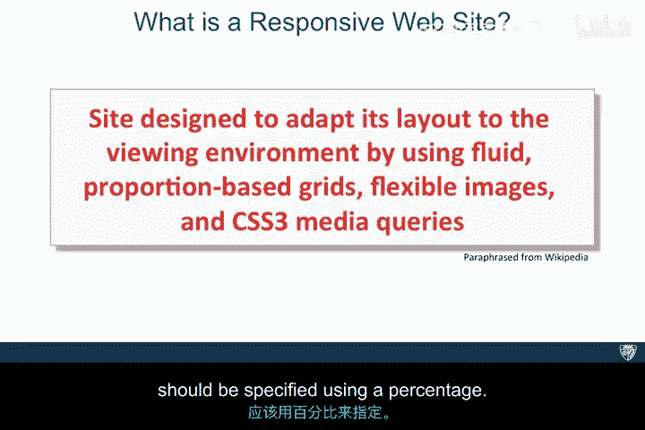
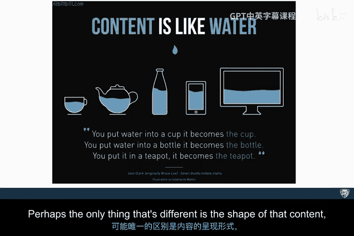
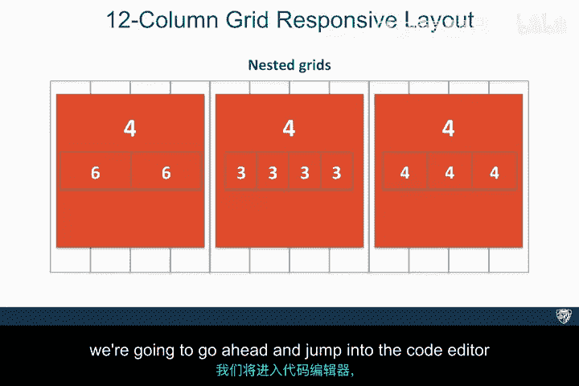

# 约翰霍普金斯大学《Web开发者的HTML, CSS, and Javascript》中英字幕 - P36：19_第24讲 第1部分 响应式设计.zh_en - GPT中英字幕课程资源 - BV1WzY6z9EUd

。

Responsive design was born primarily out of the need to deal with the explosion of mobile devices that started being able to browse the web。

 much in the same way that a desktop browser a user browsed the web。

I found this line graph on the web and it's attributed to some research done by Morgan Stanley research I don't really know how exact any of these numbers are。

 but the general point is well known browsing their mobile devices exceeds that of regular desktop browser and if you look at this graph that sounds just about right that this actually happen around 20132014 So it's been a little bit since this that happened So the point is you just can't ignore mobile you have to design your sites for mobile as well but when it comes to mobile there's so many devices so which devices do we want to target and which devices do we want to support and the answer is really all of them you can't really afford to ignore any of them there's such a plethora these devices out there and ignoring some of them would ignore chunk of your user base So how does responsive design help us do that Well I think the answer lies in what responsive design is。

So what is the responsive website Well that's a site that's designed to adapt its layout to the viewing environment by using fluid proportionbased grids。

 flexible images and CSS3 media queries and by proportionbased grids。

 what we mean is or hinting to is that the width of these grids or these columns。

 as we'll see in a moment， should be specified using a percentage。

I really like this visualization that somebody put together and put in Wikipedia when you search for responsive design so this is one of the images on that page and this is basically paraphrasing or maybe actually taking verbatim a quote from Bruce Lee a famous martial arts expert and basically it says you put water in a cup it becomes the cup you put water in a bottle it becomes the bottle and you put it in a teapot it becomes the teapot an idea is pretty simple that content should be like water you put it in whatever different devices you put it into and it should still display the content should be the same and the information conveyed should be the same and perhaps the only thing that's different is the shape of that content the way it's being displayed So using kind of the idea of the previous graphic we could certainly understand now that the site's layout is supposed to adapt to the size of the device in practice most of the time if not all the time this means that the site should adjust based on the width of the device and I should also point out that content ver。

😊。

Or its visual delivery may change For example， for a restaurant site。

 a phone number which used to be displayed somewhere in the site without attracting too much attention to itself for a desktop version of that site is now front and center and the most prominent item on the page in the mobile site and that's perhaps because we want people to have the phones once they have the phone to be able to just to tap and call and put the order in or perhaps we just don't have the flexibility and a mobile device to let them go and find that phone number somewhere else just glance at it because because of our real estate being so small That's number number two is some parts of the site may even be hidden another mobile version as we now have to measure very carefully which parts are the most crucial。

😊，Now are there any alternatives to the responsive design principles Well actually there are what you could do is you could have a server side technology that detects your user agent。

 in other words， the type of browser that you're using and figure out whether or not you're on a mobile device or on a desktop device and then based on an information either serve up a regular desktop version of the website or serve up to the client。

 the mobile version of that website and this is basically what the websites that wanted to have a mobile version as well used to do before the responsive design kind of came to the forefront but the problem is there's a couple of issues with this type of approach number one is you have high risk of feature version between apps because now you' really technically speaking now have really two different applications running your website one is a mobile version one is a desktop version number one and number two is well mobile device are just too varied in size among themselves so it's hard to make a mobile site that satisfies。

😊，every client so what ends up happening is that you end up sacrificing user experience because you're trying to kind of make one mobile website that fits them all and that basically never works so nowadays by and large because of these issues people really stay away from this approach。

The largest part of responsive design is obviously the layout and the most common layout out there or responsive layout is a 12 column grid responsive layout and this is what bootstrap Twitter bootsottrap uses and just about almost really every responsive framework out there uses nowadays and the reason 12 is what's used is because of the factors of 12 you could basically it's evenly nicely divisible by one。

2，3，4，6 and obviously 12 itself which means we could subdivide our page into sections that are evenly split and nicely layout themselves。

So for example， we can have content that is split into three columns out of the 12 so it's 3。

333 so that all iss up to 12。 Now in case you're confused。

 I just left some padding here guess I can assume there's going be some padding over there just for visualization and be able to see the different columns easier and obviously you can have 6 and 6 in this layout and 44 and 4 and any other combination you want you can have 8 and4 you can have 9 and3 and so on and the approach this responsive layouts is that we know that the browser window is 100% that's the width of the browser window which means that we can calculate what one column in this 12 column grid layout is that's 100% divided by 12 and that turns out to be about 8。

33% which means when we specify in our framework in our bootstrap or whatever it is youre using how wide a particular column should be we could convert these threes into 25。

😊，Because three columns is 25% of 12 columns and the six columns become 50% of the 12 column and the444 becomes 33。

33%。And obviously we're not limited to having just one12 grid12 column grid layout we could certainly have nested ones so if you have four。

4 and four inside each four columns we can consider that 100% and then have another 12 column grid layout inside of it So here in the first on the left one we see6 and6 and the middle one we see a bunch of threes and the left one the most right one we see4。

4 and4 and that's totally acceptable in fact is done all the time Okay so enough theory for part one of this lecture and the part two this lecture we're gonna go ahead and jump into the code editor and see these concepts in action。

😊。

