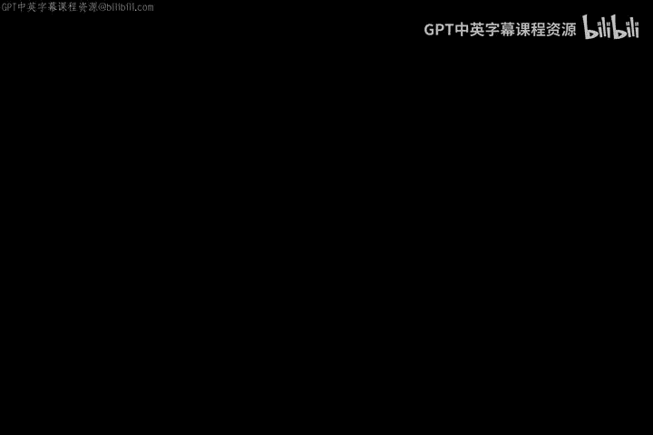
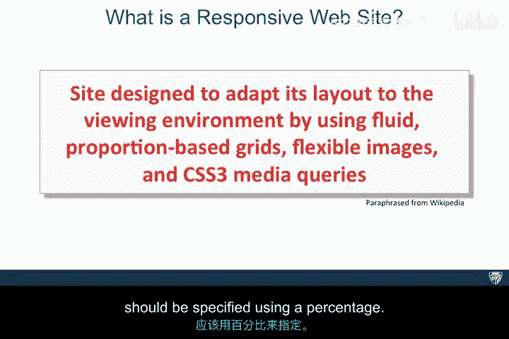
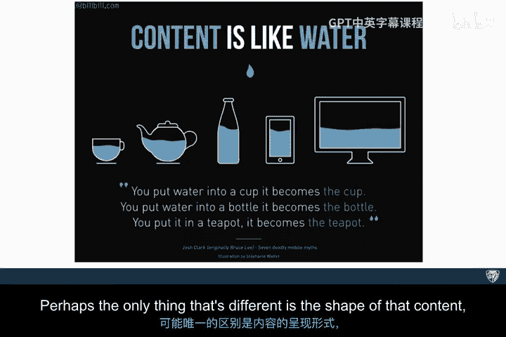
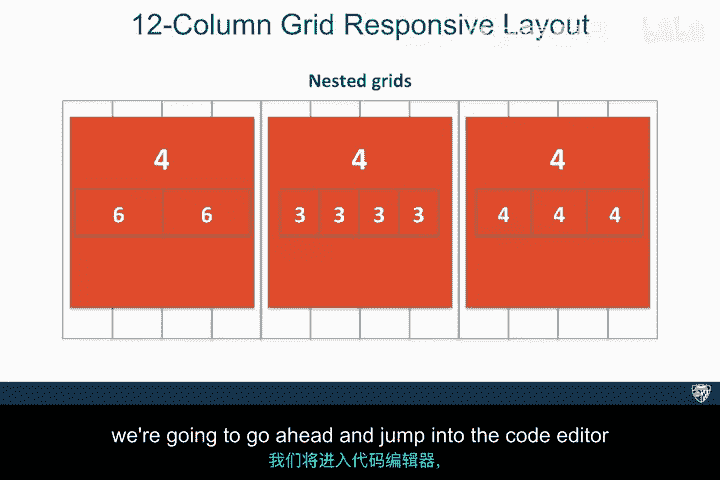
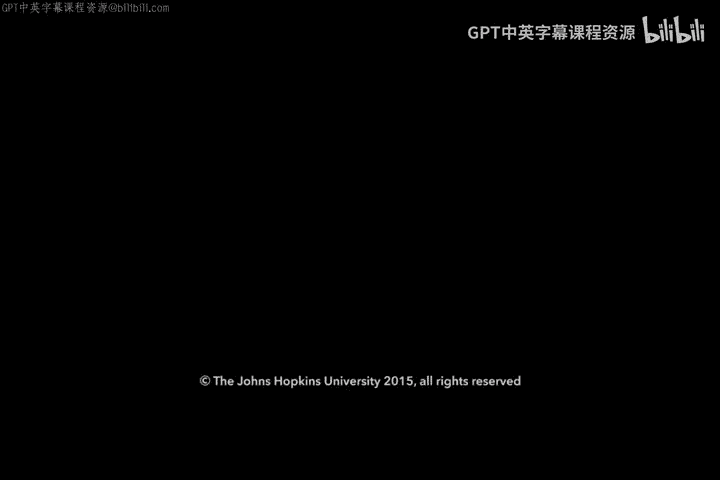

# Web开发者的HTML, CSS, and Javascript：P36：19_第24讲 第1部分 响应式设计

## 📱 概述
在本节课中，我们将要学习响应式设计的基本概念、其重要性以及实现它的核心原则。我们将了解为什么响应式设计是现代网页开发不可或缺的一部分，并初步探索其背后的布局思想。

## 🌍 响应式设计的诞生背景
响应式设计主要源于应对移动设备爆炸式增长的需求，这些设备开始能够像桌面浏览器一样浏览网页。

我在网上找到了这张折线图，它源自摩根士丹利研究所的一些研究。我无法确认这些数字的精确性，但其核心观点是众所周知的：使用移动设备浏览网页的用户数量已经超过了使用常规桌面浏览器的用户。观察这张图表，这个转变大约发生在2013至2014年间，这看起来是合理的。这件事已经发生了一段时间了。

因此，关键在于你无法忽视移动端。你必须也为移动设备设计你的网站。

## 📱 目标设备的选择
当涉及到移动设备时，设备种类繁多。我们想要针对和支持哪些设备呢？答案实际上是所有设备。你无法承担忽视任何设备的后果。市面上的设备种类如此丰富，忽视其中一部分就等于忽视了你的一部分用户群。

那么，响应式设计如何帮助我们做到这一点呢？我认为答案在于响应式设计本身是什么。

## 💧 什么是响应式网站？
响应式网站是指通过使用**流式、基于比例的网格**、**灵活的图片**和**CSS3媒体查询**，来使其布局适应观看环境的网站。

当我们说“基于比例的网格”时，我们的意思是，这些网格或列的宽度（我们稍后会看到）应该使用**百分比**来指定。

## 🥤 内容如水
我非常喜欢有人在搜索响应式设计时整理并放在维基百科上的这个可视化比喻。这是该页面上的图片之一，它基本上转述（或者可能是直接引用）了著名武术专家李小龙的一句话：“把水倒入杯中，它就成为杯的形状；把水倒入瓶中，它就成为瓶的形状；把水倒入茶壶中，它就成为茶壶的形状。”

这个理念很简单：内容应该像水一样。无论你把它放入哪种不同的设备中，它都应该能够显示。内容本身应该是相同的，所传达的信息也应该是相同的。可能唯一不同的是内容的形状，即它的显示方式。

## 🔧 响应式设计的实践含义
运用前一张图的理念，我们现在可以理解，网站的布局应该适应设备的大小。在实践中，大多数时候（如果不是所有时候），这意味着网站应该根据设备的宽度进行调整。

我还应该指出，内容的呈现方式或其视觉传达可能会改变。

以下是响应式设计可能带来的具体变化：

*   **元素重要性的调整**：例如，对于一个餐厅网站，在桌面版本中，电话号码可能被显示在网站的某个位置，并不特别引人注目。而在移动版网站中，它可能被置于最前面、最中心的位置，成为页面上最突出的项目。这可能是因为我们希望人们在手机上能直接点击拨打电话下单，或者仅仅是因为移动设备的屏幕空间有限，无法让他们去其他地方寻找那个电话号码。
*   **内容的隐藏**：网站的某些部分甚至可能在移动版本中被隐藏。因为我们现在必须非常仔细地衡量哪些部分是最关键的。

## 🔄 响应式设计的替代方案
响应式设计原则有替代方案吗？实际上是有的。你可以使用服务器端技术来检测用户的**用户代理**（换句话说，就是他们使用的浏览器类型），从而判断他们是在移动设备还是桌面设备上。然后，基于这个信息，要么提供常规的桌面版网站，要么向客户端提供该网站的移动版本。

在响应式设计成为主流之前，那些也想拥有移动版本的网站基本上就是这样做的。但问题是，这种方法存在几个问题：

1.  **功能版本不一致的风险很高**：因为从技术上讲，你现在确实有两个不同的应用程序在运行你的网站，一个是移动版本，一个是桌面版本。
2.  **移动设备尺寸差异太大**：很难制作一个能满足所有客户需求的移动网站。最终的结果是，你牺牲了用户体验，因为你试图制作一个适合所有人的移动网站，而这基本上从未成功过。

因此，如今由于这些问题，人们基本上都避免使用这种方法。

## 📐 响应式布局的核心：12列网格
响应式设计中最大的部分显然是布局。目前最常见或最流行的响应式布局是**12列网格响应式布局**。这是Bootstrap（Twitter Bootstrap）使用的布局，现在几乎所有响应式框架都在使用。

之所以使用12，是因为12的因数。12可以很好地被1、2、3、4、6和12本身整除。这意味着我们可以将页面均匀地分割成多个部分，并很好地布局。

例如，我们可以将内容分割成12列中的3列（即3.333...），这样加起来总共是12列。如果你感到困惑，我在这里留了一些内边距，只是为了可视化，让你能更容易地看到不同的列。

显然，在这种布局中，你可以有6和6、4、4和4，或者任何其他你想要的组合，比如8和4、9和3等等。

这种响应式布局的方法是：我们知道浏览器窗口的宽度是**100%**。这意味着我们可以计算出在这个12列网格布局中，一列的宽度是多少。那就是**100%除以12**，结果大约是**8.33%**。

这意味着当我们在我们的框架（如Bootstrap或你正在使用的任何框架）中指定某一列应该有多宽时，我们可以将这些列数转换为百分比。例如：
*   3列变成12列的**25%**。
*   6列变成12列的**50%**。
*   4列变成12列的**33.33%**。

显然，我们不仅限于只有一个12列网格布局。我们完全可以在内部嵌套网格。如果你有4、4和4的布局，在每个4列内部，我们可以将其视为100%，然后在其中再放置另一个12列网格布局。

因此，在左边第一个例子中，我们看到6和6；在中间的例子中，我们看到一堆3；在最右边的例子中，我们看到4、4和4。这完全可以接受，事实上也经常这样做。

## 📝 总结
本节课中，我们一起学习了响应式设计的起源和必要性，理解了“内容如水”的核心哲学。我们探讨了响应式网站的定义及其三个关键技术：流式网格、灵活图片和媒体查询。我们还分析了响应式设计与传统服务器端检测方法的优劣，并重点介绍了目前最主流的12列网格布局系统及其数学原理。

在下一部分，我们将进入代码编辑器，亲眼看看这些概念是如何在实践中应用的。