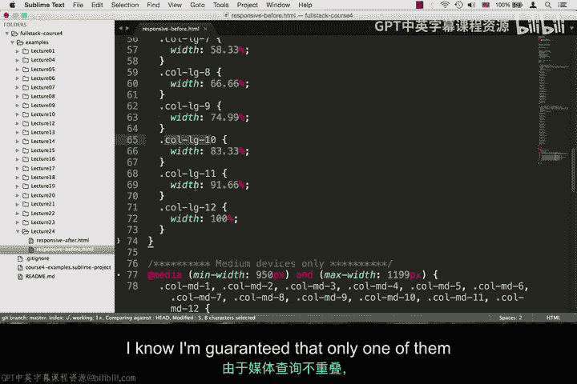
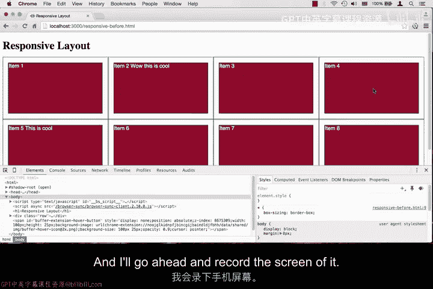
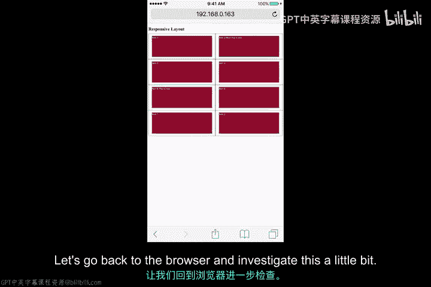
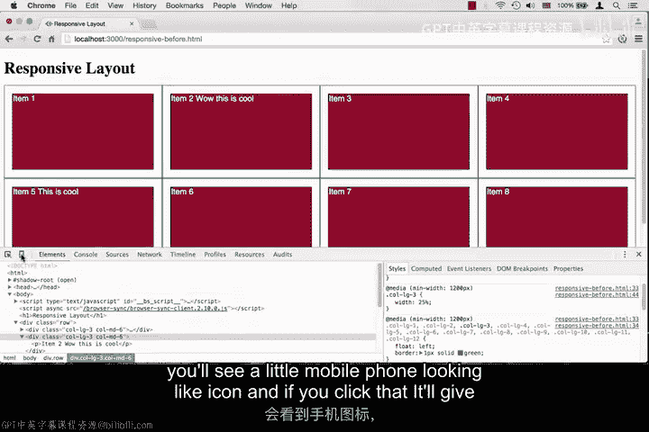
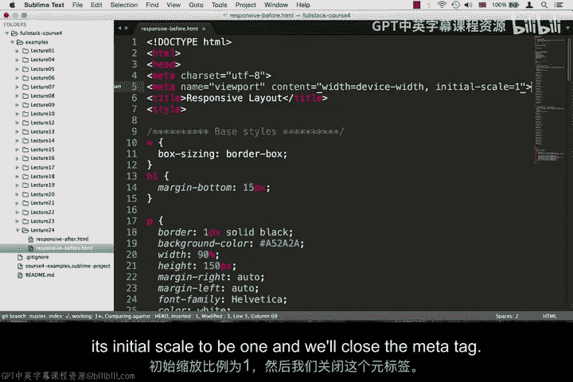
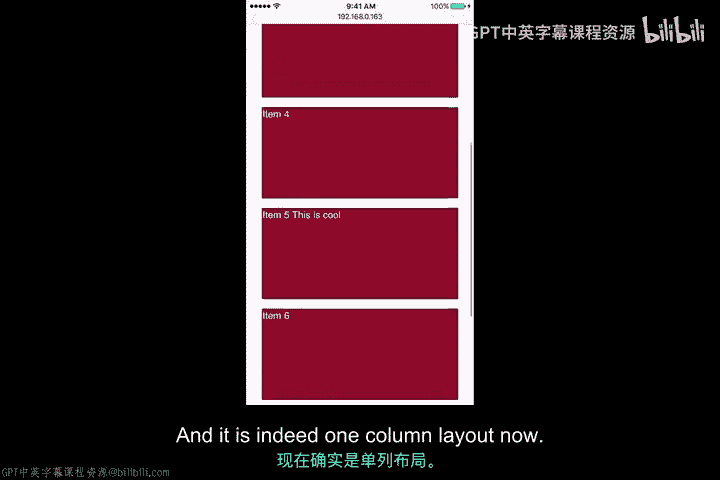
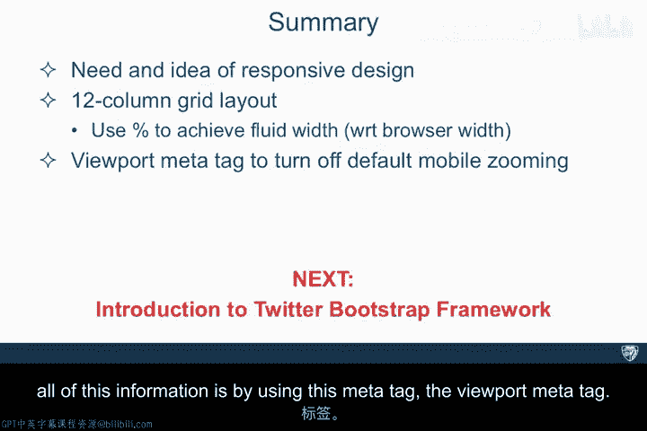

# 约翰霍普金斯大学《Web开发者的HTML, CSS, and Javascript》中英字幕 - P37：20_第24讲 第2部分 响应式设计.zh_en - GPT中英字幕课程资源 - BV1WzY6z9EUd

。

Okay， so here I am in sublime text and I'm looking at the file named Responsive before that HTML。

 which is located in the examples lecture 24 folder first we're going to style a paragraph tag because because we're going to use it as our visual kind of anchor to see where the elements fall and basically I'm just giving it some background color some border and giving it a specific height of 150 pixels and I'm giving it a width of 90 pixels kind of to simulate some padding so it's not going to take up the entire cell in our grid it's going to take up 90% of it and here actually I'm using this little trick to center our paragraph tag inside a block level element which is going to be a div and the way to center it is to make sure the width is specified and then to give it margin right out auto and margin left auto。

Okay so here comes our framework。 our responsive framework we're going to code up is' going to be pretty simple。

 but pretty effective as well。 So here first we define our row and all that is is just saying that is' going to be 100% of wherever you put the row is is going to try to take up 100% of that space and then we're going to start having some mediaqueries So the first one is mid width is 1200 pixels。

 which means that if the display the device display is larger than 1200 pixels all these styles will apply and notice that what we're doing is we're defining these columns and we are marking them with Lg for large and1。

2，34 and so on and what we're saying is every single column they should float left So basically we're gonna have a floatbased layout also give each one of them a border。

 but that's just so we could see it on the screen and then what I'm doing is pretty simple and something that I've described before and what I'm doing is I'm just saying so if it's a 12 column layout that means。

😊，Each column is 100% divided by 12 so that becomes 8。

33% Well the two columns is 100 divided by 12 times 2 and that's 16。

66% and so on and so on until we get to column large 12 and that's going to take up 100% of of the entire grid and either this style as we've defined for large screen devices now what about medium screen devices what we're going to do is we're going to have a range and I picked the lower part of the range to be 950 pixels which is not exactly the standard Twitterwi bootst has a different number that it uses but I just picked this for demo purposes because I'm going to need it to demonstrate something for you and you'll see that in a minute and again I'm listing all these classes and again I'm going to be left floating left and again I'm giving them a border and this time I'm doing the same thing except I am now calling this MD for medium and since these classes don't really exist outside of these media queries。

Mean that I could specify for different devices， different layouts depending on device size so I could for smaller device for example。

 specify layout expressed in MD and medium devices columns or medium devices classes and for a larger device I could express the same thing with LG larger devices so I could give the same element two different classes and I know I'm guaranteed that only one of them will apply at a time since my media queries don't overlap so both classes will never really be existing at the same time and I could define more of these media queries but for the demonstration purposes let's stop here and let's take a look at our HTML well again we have our H1 just to announce to the world what we're trying to do and here we have one single row and a single row contains eight divs contains eight items8 divs each one has a paragraph that says item 12。

34 all the way to8 and notice the classes that I'm。

signing to each one what I'm trying to tell the browser is that when it is a large device。

 I want only the classes with LG to apply and it will happen automatically since the classes with MD don't even exist according to the browser when the browsers larger in width than 1200 pixels and since I know that floating elements just flow to the next line when they can fit I could very easily set up3。

3，3 and continue to three so that's right there 12 columns but I can keep going because it's just gonna to flow to the next line。

 it's 3，3，3 and3 again so really I should have basically four of these things3。

3 and 3 and3 that's four columns across However， when the browser size or the device size becomes smaller and it becomes less than 1200 pixels or 1199 pixels and lower I want the layout to switch to these classes and these classes are specifying that they should really each item each one of these things should take half。

😊，enSo six columns plus six columns will take up the entire width of the screen and again another couple of six columns will take the entire width of the screen and so on。

 So as I squeeze the browser and make it narrower， I should see that my four column layout which is expressed in these threes it's a little confusing but it's three columns and there's 12 columns altogether so you have four columns across so my four column layout as I squeeze the browser make it narrower should become a two column layout because I'm now specifying in a smaller device size6 and6 instead of 3。

3 and3 Now with the browser size gets to less than 950 pixels none of these classes will exist as far as the browser will concerned and what's can happen then well our divs will no longer be floated because the floating is only defined inside the media queries which means they will behave just like regular block level elements and they will automatically stack one on top of the other So as the device size gets smaller and smaller I should。

Have one column with each one of these items stacked one on top of the other and the truth be told I could have specified that media query for that size of the device。

 but since I in this case it's just a demo and I knew that the items will stack anyway I just left it alone this way let's go ahead and take a look at what this looks like in the browser。

Okay so here's our three，3，3， and3 layout， which gives us four items across and it's just spilling over to the next line and gives us another four items across again。

 and notice if I squeeze the browser， in fact， what we're going do is we're going to open Chrome developer tools So as I squeeze in this corner right here youll see the pixel size of the viewport and as I start squeezing the browser you see it jumps to two as it gets closer and closer to 1200 once it gets past 1200 pixels it becomes now 6 and6 column layout which means that now we're taking up half the space of the entire width of the browser and if we squeeze it past 950 let's take a look and squeeze it past 950 pixels right here boom the items are now stacking one on top of the other and obviously as I pull it back apart or pull it wider。

 it becomes back to our 33 and 3 layout 333 and3 layout four times and now we have。😊。

4our column layout across so that's pretty cool so as seems we're done and we could now serve this website to regular mobile phones so let's take a look at what this site looks like on an iPhone6 and I'll go ahead and record the screen of it。

Okay so here I am on my phone and I'm serving up the website using this tool called browser sync and we're gonna to talk more about this tool when we get to the development of a real restaurant website just in a few lectures but for now bear with me and you could barely see here so let me zoom in here right here responsive before the HTMLl I go ahead and click that and here we go so here we have our website but something is really strange I thought if we go on a mobile site that's a pretty small device we wouldn't have two columns we would have one column because it's such a small device it seem to have worked in our browser why isn't it working on the phone let's go back to the browser and investigate this a little bit。

 So let's go ahead and investigate this and we're going to use Chrome developer tools to do that if you look at Chrome developer tools here you'll see a little mobile phone looking like icon and if you click that itll give you basically the layout that we've seen before when we investigated media queries And right now it's set to some laptop device we're going go and switch that to。

IPhone6And when we switch to iPhone 6 it tells us that we should reload。

 let's go ahead and do that and now that we reload it。

 our iPhone simulator device is showing us exactly the same thing as the real iPhone was showing us before let's take a look at one of these elements that was supposed to take up the entire screen and for some reason is only taking up half let's go ahead and take a look at its box model sizing so let's take a look this div right here is saying that it is 480 pixels wide and that's really impossible because the screen itself is only 375 pixels wide So what's going on here Chrome developer tools is actually giving us a hint as what's going on here。

 Take a look at the right side of the screen it's showing you the zooming level of the phone simulator what it's telling you is that it's only 40% of its100 percent zoom it basically just means the phone zoomed out and this is really a default feature on all the phones they try to zoom out on websites that don't tell them to do anything different so they could try to fit the entire。

Content into the viewport of the phone So how do we tell the phone's browser that no this is actually a responsive website and you don't need to try to zoom out just stay at the regular zoom level well the way we do that is by specifying a special metatag let's go ahead and switch to our code editor again and we'll go all the way to the top and we'll place one more meta tagag here and the name of this metatag is called viewport and what we need to tell it is that the content of our viewport is first of all consider it width to be device width don't try to zoom out and also its initial initial scale to be one and we'll close the metatag so now with this metatag in place the browser will consider the device width as the width of the viewport and its initial scale factor will be one meaning it won't scale anything up or down and now let's go ahead and switch back to the browser and you see that now it' switch。

😊。

To being one column just for fun， let's go ahead and try it out on a real phone and see if it worked so here we are again we're trying to serve up this responsive before the HTML let's go ahead and click on it and sure enough we could see that it worked that now is only one column and we could scroll it scroll up and down and it is indeed one column layout now So in summary we went over the idea and the need of responsive design and we talked about the 12 column grid layout which is the most common and most convenient grid layout there is out there right now and we spoke about the fact that in order to achieve fluid width we actually use percentages to specify the width of each column and different items within the columns as well and we also spoke about the fact that we needed to tell the devices out there that they should not try to zoom out and try to fit all the contents they can instead they should behave as they are mobile devices with more narrow screens and smaller screens and way we tell those devices all this information is by using this meta。

ag the viewport metatag。Next， we're going to start getting introduced to the Twitter Boottrap framework。

