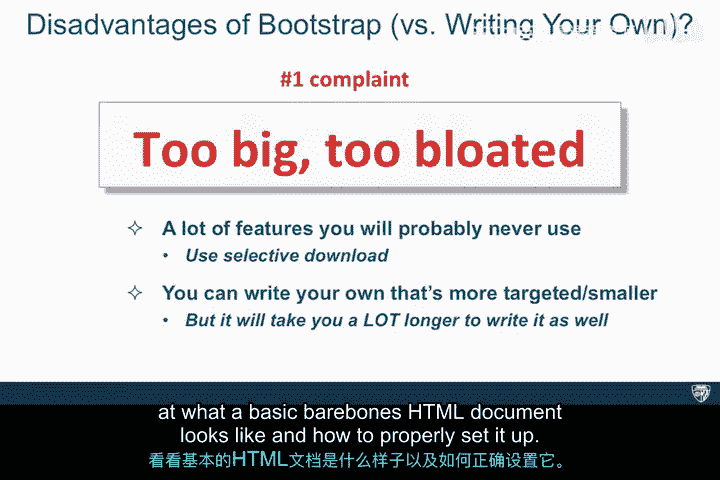

# 约翰霍普金斯大学《Web开发者的HTML, CSS, and Javascript》中英字幕 - P38：21_第25讲 第1部分 Twitter Bootstrap入门.zh_en - GPT中英字幕课程资源 - BV1WzY6z9EUd

Yeah。

In this lecture， we're going to start introducing Boottrap， which is a CSS framework。

 one of the most popular CSS frameworks， which was made by the engineers at Twitter。

Now what is Boottrap Well Boottrap is the most popular HTML CSS and JavaScript framework for developing responsive mobile first projects on the web and this is a direct quote from the Boottrap website so let's take it apart a little bit first of all it's the most popular framework Well Github which is basically a large website with code repository that has a social component to it has over 90。

000 stars or likes of the bootsottrap project so it's the most popular project on the entire website and it's been forked over 38。

000 times。Bottrap consists mostly of CSS it prefins a lot of CSS classes for you so you know a lot of the times。

 especially with a user interface that's a bit more complex than just a single HTML element or something CSS needs to target a certain HTML structure well because of that reason Boottrap oftentimes requires you to have a particular HTML structure in your HTML page in practice。

 however it's not as scary as that sounds。 It doesn't really invade your HTML code and make you write some crazy HTML contracts It just asks you to add an extra div here and there and give it a particular class so that the CSS Boottrap defined would apply properly It's jascript framework it shouldn't be overlooked either it has a very cool ja framework actually based on the JQury As and plugin architecture that lets you put in or lets others put in different plugins that really enhance your website quite a bit。

Booottrap is also called a mobile first framework Now what does that mean Well in general。

 the term means that you deal with how your user interface is laid out on a mobile device first in reality from what I've seen there are two approaches to what this means there' is the purest approach which says you code your mobile version first and the claim is that it really helps your content strategy。

 how you're going to lay out your content what the content should be it really forces you to think what's really important in your content that you're about to present there's also a second approach to what mobile first means。

 and I would call that not 100% purest approach and I kind of count myself among that type of thinking group So the idea there is that you plan for mobile in your styles but you can start coding with desktop version first if it feels more comfortable for you if it just makes more sense for your project。

😊，Ooh， I could just feel all the user experience pureists over there getting upset at me for saying that。

Oh， well。So as far as coding is concerned， I would say either approach starting from mobile and going to desktop or starting from desktop and going to mobile are really two valid approaches。

However， everybody will agree on this that mobile first definitely means is that you plan for mobile from the start。

 you don't ignore it till the end or the middle of your project。

 you plan for it from the start and they also agree that CSS framework whether written by you or you take something like Boottrap should be mobile already already and what that means is is that it shouldn't be again an afterthought where after you've set up your desktop version somehow you have to write some or include some other CSS that would now kind of magically try to turn this the entire website into this mobile website as well and interestingly enough。

 Boottrap wasn't always a mobile first framework it used to be I forgot which version that was already I think maybe two or something like that that Botrap had a separate CSS file and separate set classes if you wanted your website to be responsive or basically be able to be viewed on mobile devices as well。

Nowadays， Botrapap is a mobile first framework。So are there any disadvantages of using Boottrap versus for example writing your own like we did in the previous lecture Well the number one complaint the disadvantage of Botrap is that it's too big and it's too bloated and what that means is there's a lot of features in there that you will probably never use Well the mitigating factor is you could use selective download on the Boottrap website and only download the features you actually think you will use but the truth matter is and even though it is a little bit too bloated it's not really that bad。

And the claim also is that you could write your own a framework that's more targeted and therefore much smaller Well that may be true。

 but it will take you a lot longer to write it and certainly take you a lot longer to write it just as well as the guys at Twitter did which they put a lot of thought and a lot of painstaking decisions into every little turn that you'll probably just not have the time and the bandwidth to deal with in part two of this lecture。

 let's jump into the code editor and take a look at what a basic barebones bootstrap HTML document looks like and how to properly set it up。

