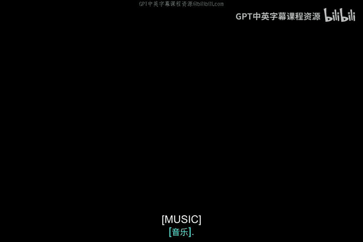
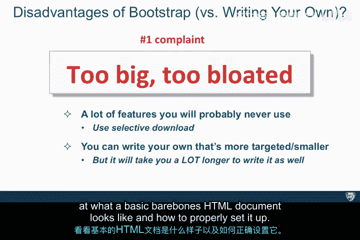
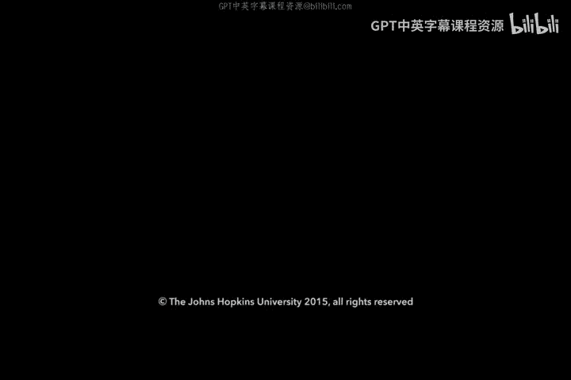

# Web开发者的HTML, CSS, and Javascript：P38：21_第25讲 第1部分 Twitter Bootstrap入门

## 概述
在本节课中，我们将要学习Twitter Bootstrap，这是一个非常流行的CSS框架。我们将了解Bootstrap是什么、它的核心特点、优势与劣势，并初步了解如何开始使用它。

---

## 什么是Bootstrap？🚀

Bootstrap是最流行的HTML、CSS和JavaScript框架，用于在Web上开发响应式、移动设备优先的项目。这是Bootstrap官网的直接引用。

让我们来详细解析一下。首先，它是最流行的框架。Github是一个拥有社交功能的代码仓库网站，Bootstrap项目在那里获得了超过90,000个星标或点赞，是整个网站上最受欢迎的项目，并且被分叉了超过38,000次。

Bootstrap主要由CSS构成。它为你预定义了许多CSS类。很多时候，特别是对于比单个HTML元素更复杂的用户界面，CSS需要针对特定的HTML结构。因此，Bootstrap通常要求你在HTML页面中拥有特定的HTML结构。

然而，在实践中，这并不像听起来那么可怕。它并不会真正侵入你的HTML代码，迫使你编写一些奇怪的HTML契约。它只是要求你在这里或那里添加一个额外的`
`，并赋予它一个特定的类，以便Bootstrap定义的CSS能够正确应用。

Bootstrap也是一个JavaScript框架，这一点不容忽视。它有一个非常酷的JavaScript框架，实际上基于jQuery的插件架构，允许你或其他人添加不同的插件，从而极大地增强你的网站。

---

## 什么是“移动设备优先”框架？📱

Bootstrap也被称为“移动设备优先”框架。那么，这是什么意思呢？

一般来说，这个术语意味着你首先处理用户界面在移动设备上的布局。根据我的观察，对于这个含义有两种理解方式。

第一种是纯粹主义者的方法，即首先编写移动版本。其主张是这确实有助于你的内容策略，帮助你规划内容的布局和内容本身，迫使你思考即将呈现的内容中真正重要的是什么。

第二种是对“移动设备优先”含义的理解，我称之为非100%纯粹主义者的方法，我自己也属于这种思维方式。其理念是你在样式中为移动设备做规划，但如果感觉更舒适或对你的项目更有意义，你可以先从桌面版本开始编码。

就编码而言，无论是从移动端开始再到桌面端，还是从桌面端开始再到移动端，都是两种有效的方法。

然而，每个人都会同意这一点：“移动设备优先”绝对意味着你从一开始就为移动设备做规划，而不是等到项目中期或末期才考虑。他们还同意，无论是你自己编写的还是像Bootstrap这样的CSS框架，都应该已经是移动设备优先的。这意味着它不应该是一个事后才考虑的东西，在你设置好桌面版本后，才不得不编写或包含一些其他CSS来试图神奇地将整个网站也变成移动网站。

有趣的是，Bootstrap并非一直是一个移动设备优先的框架。我忘了是哪个版本（也许是版本2左右），那时Bootstrap有一个单独的CSS文件和一套单独的类，如果你想让你的网站具有响应式能力，或者基本上也能在移动设备上查看的话。

如今，Bootstrap是一个移动设备优先的框架。

---

## 使用Bootstrap的优缺点 ⚖️

与例如像上一讲中我们自己编写框架相比，使用Bootstrap有什么缺点吗？

首要的抱怨，也就是Bootstrap的缺点，是它太大、太臃肿。这意味着里面有很多你可能永远不会用到的功能。

缓解因素是，你可以在Bootstrap网站上使用选择性下载，只下载你认为实际会用到的功能。但事实是，尽管它确实有点臃肿，但情况并没有那么糟糕。

还有一种说法是，你可以编写一个更有针对性、因此更小的自己的框架。这可能是真的，但编写它需要你花费更长的时间，而且肯定需要你花费更长的时间才能写得像Twitter的工程师们那样好，他们对每一个小细节都投入了大量的思考和艰苦的决策，你可能根本没有时间和精力去处理。

---

## 下一部分预览

在本讲座的第二部分，我们将跳转到代码编辑器，看看一个基本的、骨架式的Bootstrap HTML文档是什么样子，以及如何正确地设置它。

---

## 总结

本节课中我们一起学习了Bootstrap框架的基础知识。我们了解到Bootstrap是一个流行的、移动设备优先的CSS和JavaScript框架，它能帮助开发者快速构建响应式网站。我们讨论了它的核心概念，包括预定义的CSS类、对特定HTML结构的要求、以及其“移动设备优先”的设计哲学。同时，我们也客观地分析了使用Bootstrap可能带来的优点（如快速开发、社区支持）和缺点（如文件体积较大）。下一节，我们将进入实践环节，开始搭建第一个Bootstrap页面。