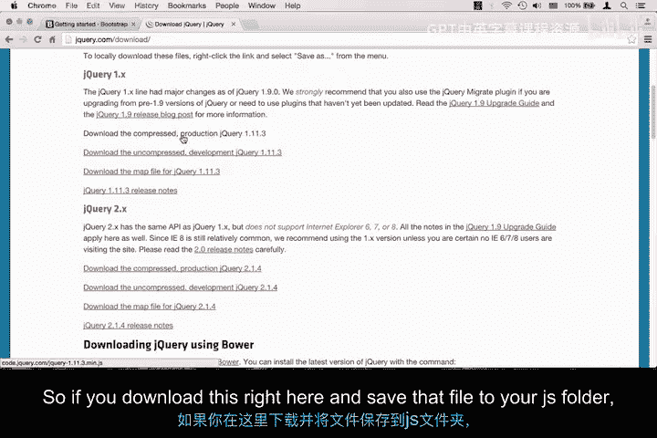
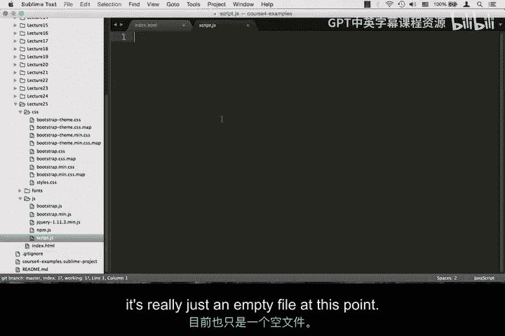
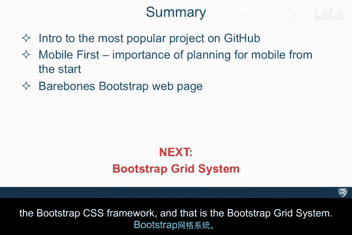

# 约翰霍普金斯大学《Web开发者的HTML, CSS, and Javascript》中英字幕 - P39：22_第25讲 第2部分 Twitter Bootstrap入门.zh_en - GPT中英字幕课程资源 - BV1WzY6z9EUd

Yeah。

Okay， so here I am in sublime text and I'm looking at the file called indexex HTMLtm。

 which is located in the examples lecture 25 folder。

 You could see there are some extra folders that are inside the lecture 25 folder namely CSS fonts and Js folders Now where did I get them Well they come from the installation or download to be more exact of bootstrap let's switch to the bootstrap web page which can be found that get bootstrap co and we're looking at the getting started page we could look at actually the front page here is that quote that I actually put on one of the slides but if we click on getting started The very first section here is download and we could choose a whole bunch of different option here but the simplest one is to choose bootstrap itself it's already compiled from some sources and you could just click download when you download this and unzip it inside that zip file you'll have three folders and the three folders will be CSs fonts and。

😊，JS and if you open up the CSS folder you'll see that this is where the bootstrap CSS is located and bootsottrap that Min that CSS it's just a different version of Botrap CSS that is themified version meaning they removed all the spaces and extra things like that that when you downloaded to your browser you know those extra spaces and carriage returns wouldn't be downloaded because they don't really make any difference then there's the font folder and we're not going to talk about this right now but it's definitely needed for basic bootstrap functionality。

And there's the JS or ja folder and Boottrap does have a jascript component so you're definitely gonna need this And again there's two different files there's bootsottrap that Js and there's bootstrap that Minjs Now the min again is the Minified version Spaces taken out certain variables are renamed so they're not so long and and so on and so forth Now you can also see here that I have downloaded a version of jQury Now the reason I did that is because bootstrapjs depends on jQury and in order to get this file I would go to jQury。

com and let's go back to the front page jQury。com and I will click on this download link。

And you'll see that there' are two different jQury versions there's 1。x and 2。

x Well the difference between them is none there's no difference the only real difference is is that the 2。

x does not support6708 Inter Explorer 6708 and for now I think which is going to go ahead and use JQury 1。

x and but I think in the future as we keep moving along with the course we will switch to the JQury 2。

x since the support for Internet Explorer is really kind of dying and Microsoft just recently announced basically not supporting anything in Internet Explorer anything below a version 11 so it makes sense just to move on from it and the user base for those earlier versions is really really small at this point。

So if you download this right here and save that file to your JS folder， you will end up being jQu。

111。3minjS and this is obviously as of this recording let's close that up and take a look at the main HTML page Well the beginning of it is nothing that you haven't seen before already you've seen this already and there's the heading tag or the head tag I should say declares to be ETF8 this tag or this meta tagag you haven't seen but this is something the bootstrap recommends you do and basically just tells some versions of internet Explorer that they should you go ahead and use the latest version or the latest compatibility version of its rendering engine there's our familiar meta viewport tag exactly the same as we had it in some of the previous lectures and there's the HTML5 shim and respond that JS and what basically this is is a wait for。

Internet Explorer 8 to support HTML5 and media queries well hopefully this is going to be taken out soon as Internet Explorer 8 will become less and less irrelevant。

Then we have the title tag and finally we have the tooling tag The first one is the bootstrap that mean that CSS that's the actual bootstrap CSS framework and the second one is styles that CSS and that's really our styles if we take a look at the CSS styles It's an empty file we haven't really put any of our custom styles there yet so all we're doing right now is relying on the bootstrap framework and we put the styles here already just so we have a placeholder for our styles in the future note that we declared our style after we declared the bootstrap CSS styles and the reason that is is because we're going to be customizing whatever bootstrap gives us and therefore we want to be overr what bootstrap gives us not having bootstrap overwride what we're trying to style Finally we get to the body tag and at the very end of the body tag right before we close it we declare some ja files or some ja libraries that we're going。

First of all， Botrap ja depends on jQury and that means that we first have to declare jQury and then we will declare and reference the Boottrap。

 Js and last we reference our own ja file which is likely to be using either the jQury or the bootstrap JavaScript files and again if you go and actually take a look at that or that script。

js it's really just an empty file at this point it's just a placeholder for our future script Well let's take a look at what this HTML file looks like in the browser。

Well it looks just like that， there's absolutely nothing here and that makes sense since we really didn't put any content in well let's go ahead and put some content in right now let's go just start with H1 and say hello Coursera。

😊，We save that and we go back to our browser and we see Ho Carsera shows up and clearly something's different than you would expect before。

 the fun family clearly is not the default one and the color is a little bit different as well So it looks like some bootstrap styling is being applied Well to verify that let's go ahead and right click on it and go to inspect element。

And when we inspect that element， let's take a look。

 yes indeed there' are some styles that are being applied from the Botrap。

 CSS Another important thing to take a look at is the console because if you misspell something or you reference the wrong JavaScript file or something like that there would have been some errors showing up right here and since I don't see any errors looks like we're in good shape so this is the basic and the base bootstrap starter page that you could take and start coding your bootstrapbased web pages。

So to summarize we got introduced to the most popular project on GitHub which is Boottrap and we got introduced to the concept of mobile first that is the importance of planning for the mobile version of your website from the very beginning and we went over the Bearbones Boottrap webp page we saw how to download and install the Boottrap artifact files as well as JQury that is needed for the bootstrap JavaScript framework and we tested out that our bootstrap page actually works and contained no errors Next we're going to talk about one of the core topics when discussing the Botrap CSS framework and that is the Botrap gridit system。

