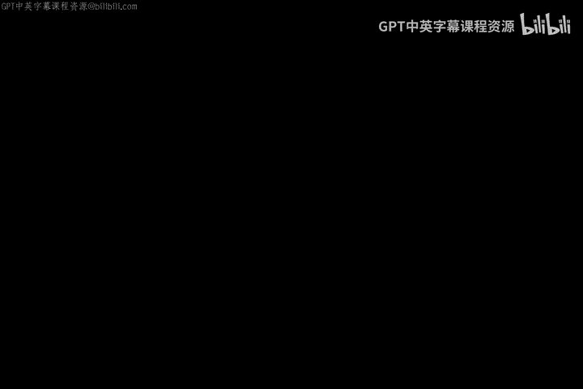
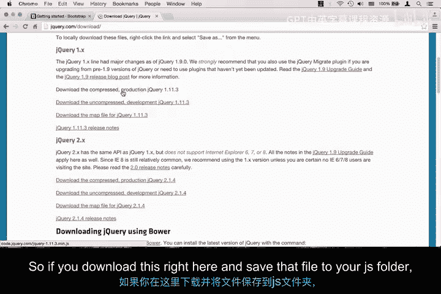
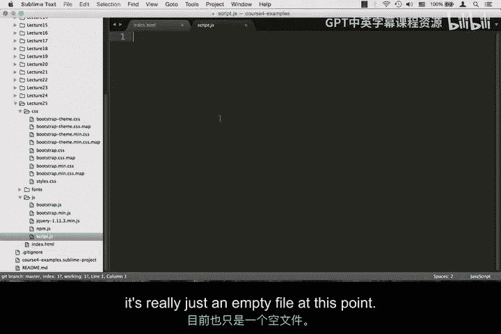
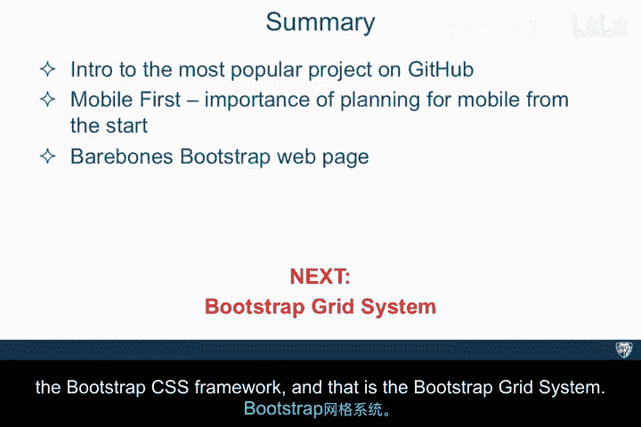
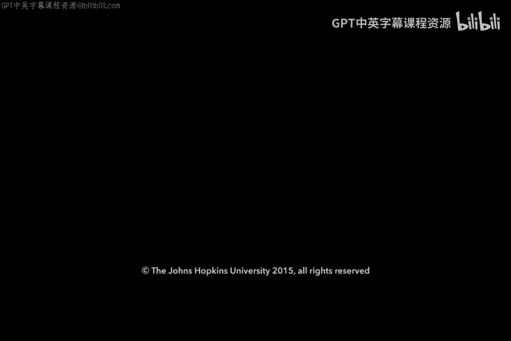

# Web开发者的HTML, CSS, and Javascript：P39：22_第25讲 第2部分 Twitter Bootstrap入门



## 概述
在本节课中，我们将学习如何下载、安装并设置一个基础的Twitter Bootstrap项目。我们将了解Bootstrap项目的基本结构，以及如何创建一个包含必要依赖的HTML页面。

## 下载与项目结构

上一节我们介绍了Bootstrap的基本概念，本节中我们来看看如何获取Bootstrap文件并搭建基础项目。

首先，访问Bootstrap官方网站 `getbootstrap.com`。在“Getting Started”页面，可以找到下载选项。最简单的选择是下载已编译好的Bootstrap版本。下载并解压ZIP文件后，你会得到三个核心文件夹：`css`、`fonts` 和 `js`。

以下是这些文件夹的内容说明：
*   **`css` 文件夹**：包含Bootstrap的核心样式文件。其中 `bootstrap.css` 是完整版，`bootstrap.min.css` 是压缩版（移除了空格和换行以减小文件体积）。
*   **`fonts` 文件夹**：包含Bootstrap框架所需的图标字体文件，对基本功能是必需的。
*   **`js` 文件夹**：包含Bootstrap的JavaScript组件。同样提供完整版 (`bootstrap.js`) 和压缩版 (`bootstrap.min.js`)。

此外，Bootstrap的JavaScript组件依赖于jQuery库。你需要从 `jquery.com` 下载jQuery。通常建议下载1.x版本以确保对旧版浏览器的兼容性，但随着IE旧版本用户减少，未来可考虑使用2.x版本。下载后，将jQuery文件（例如 `jquery-1.11.3.min.js`）也放入项目的 `js` 文件夹中。

## 基础HTML页面解析

了解了项目文件结构后，接下来我们分析一个基础的Bootstrap HTML页面模板。

```html
<!DOCTYPE html>
<html lang="en">
<head>
    <meta charset="UTF-8">
    <meta http-equiv="X-UA-Compatible" content="IE=edge">
    <meta name="viewport" content="width=device-width, initial-scale=1.0">
    <!--[if lt IE 9]>
      <script src="https://oss.maxcdn.com/html5shiv/3.7.2/html5shiv.min.js"></script>
      <script src="https://oss.maxcdn.com/respond/1.4.2/respond.min.js"></script>
    <![endif]-->
    <title>Bootstrap 101 Template</title>
    <link rel="stylesheet" href="css/bootstrap.min.css">
    <link rel="stylesheet" href="css/styles.css">
</head>
<body>
    <h1>Hello, Coursera!</h1>

    <script src="js/jquery-1.11.3.min.js"></script>
    <script src="js/bootstrap.min.js"></script>
    <script src="js/script.js"></script>
</body>
</html>
```



以下是页面关键部分的详细说明：
*   **`<meta http-equiv="X-UA-Compatible" content="IE=edge">`**：此标签建议IE浏览器使用其最新版本的渲染引擎。
*   **`<meta name="viewport" ...>`**：视口标签，确保页面在移动设备上正确缩放，与响应式设计相关。
*   **条件注释与脚本**：`<!--[if lt IE 9]> ... <![endif]-->` 这段代码是为IE8及以下版本引入HTML5支持 (`html5shiv`) 和媒体查询支持 (`respond.js`) 的垫片脚本。随着IE8逐渐被淘汰，这部分未来可能会移除。
*   **样式表顺序**：首先引入 `bootstrap.min.css`，然后引入自定义的 `styles.css`。这样做的目的是让我们的自定义样式能够覆盖Bootstrap的默认样式。
*   **脚本顺序**：在 `</body>` 标签结束前引入JavaScript文件。顺序很重要：必须先引入 `jquery...js`，然后才是 `bootstrap.min.js`，因为Bootstrap的JS依赖于jQuery。最后引入我们自己的 `script.js` 文件。

## 测试与验证

现在，让我们在页面中添加一些内容来测试Bootstrap是否正常工作。在 `<body>` 标签内添加一个标题：

```html
<h1>Hello Coursera</h1>
```



保存文件并在浏览器中打开。你会看到“Hello Coursera”的样式已经发生了变化（字体和颜色与浏览器默认不同），这表明Bootstrap的样式已成功应用。

为了进一步验证，可以在页面上右键点击并选择“检查元素”。在开发者工具中，可以看到该 `<h1>` 元素确实应用了来自 `bootstrap.css` 的样式规则。

同时，检查浏览器的控制台（Console）非常重要。如果文件路径错误或脚本加载失败，控制台会显示错误信息。没有错误信息则表明所有依赖都已正确加载，项目基础搭建成功。

这个页面就是你可以用来开始构建基于Bootstrap的网站的基础模板。

## 总结
本节课中我们一起学习了如何开始使用Twitter Bootstrap。我们认识了GitHub上最受欢迎的项目之一——Bootstrap，并理解了“移动优先”的设计理念。我们详细讲解了如何下载和安装Bootstrap的核心文件及其依赖项jQuery，并逐步构建和测试了一个基础的Bootstrap HTML页面，确保其没有错误且能正常工作。





接下来，我们将讨论Bootstrap CSS框架的核心主题之一：Bootstrap网格系统。