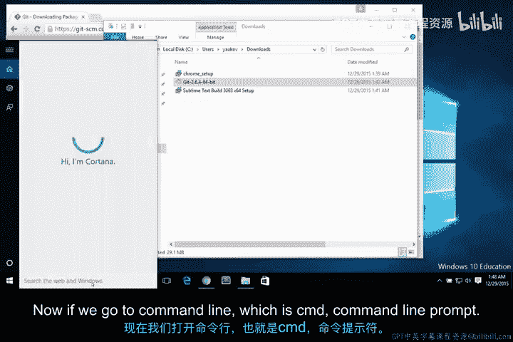
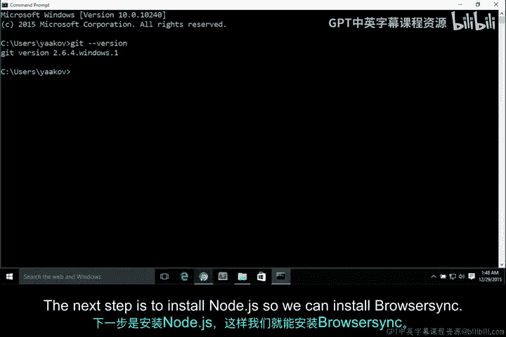
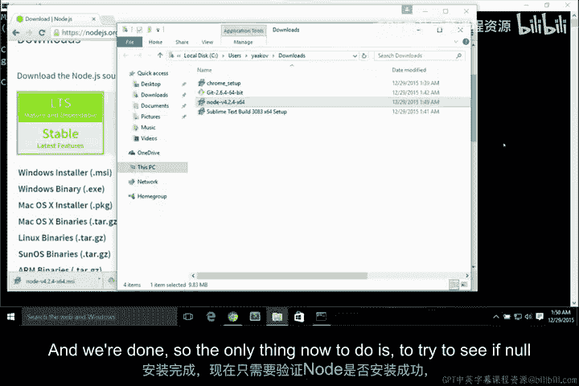
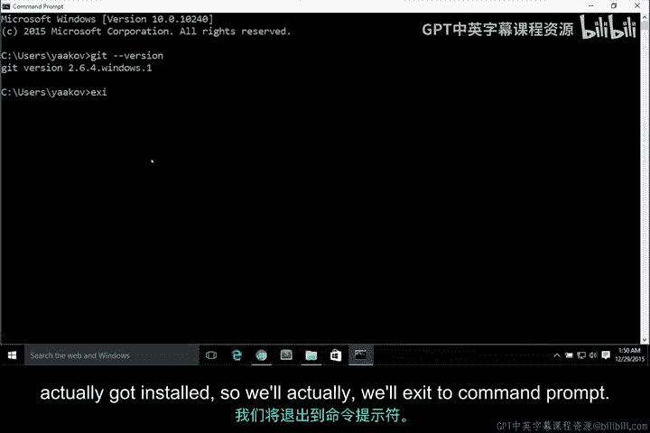
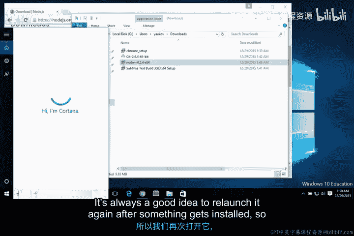
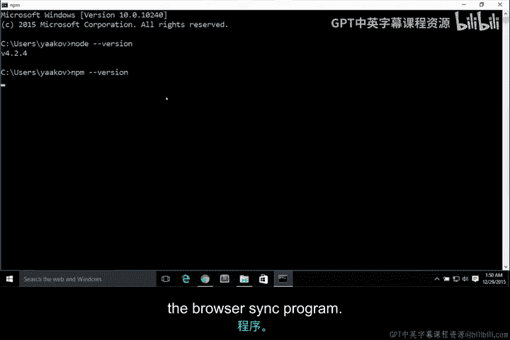
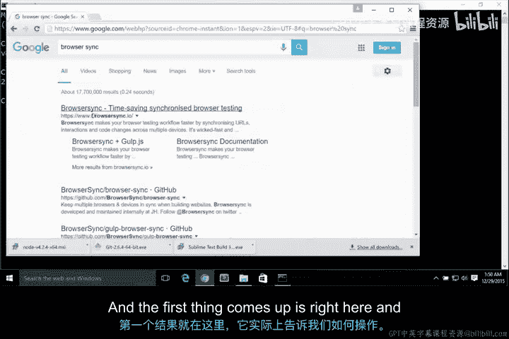

# 约翰霍普金斯大学《Web开发者的HTML, CSS, and Javascript》中英字幕 - P3：2_开发环境配置 第2部分 Windows版.zh_en - GPT中英字幕课程资源 - BV1WzY6z9EUd

Yeah。

Okay， so here I'm in Windows andm for this installation I'm using Windows 10 and let's go ahead and open up Chrome and we'll set it as our default browser。

😊，For now， at least。And we'll go ahead and search for Sublime text。

 we'll go ahead and install Sublime text three。That's the first thing it comes up and what we want is since I'm running 64 bit windows。

 I'll just choose 64 bit， it will download。😊，Let's go ahead and show it and folder。

And we'll go ahead and double click it and basically here I'm just taking all the defaults。

 all the defaults are just fine。I'll go ahead and。And that should be done and from here the search to web or and Windows I should be able to now say sublime and the first thing comes up as sublime and I can now right click on the icon here and sayP it to taskbar。

And we'll drag it right here。Okay， for now we could close it and the next thing that we need to install is Git。

 we'll go ahead and go to the browser again and we'll just type download Git for Windows。😊。

And the first thing that's not a sponsored link here， we don't see any sponsored links anyway。

 we'll go ahead and click download Git for Windows and it should right away start downloading and it is and okay it's done let's show it in folder。

 we'll double click the Git installation file， we'll say yes to that。And we'll click next here。

 next here， next here， and next here again。Once again next。

 and when we get to this window here that says adjusting a path variable environment。

 make sure that instead of use Git from Gitbsh only if you would like to use the regular command prompt。

 Windows command prompt， click the middle one says use Git from Windows command Pro we' click next after that。

And we'll leave this as is and instead of this minty default terminal。

 we'll use the Windows default console window， so we'll check that。

We'll click next and finally we'll install。Okay and it's done we don't need to view the release notes so we'll uncheck that and we'll click finish and now if we go to command line。

 which is CMd command line prompt we'll make it full screen and we'll go ahead and say git version to verify it installed and since it comes up with Git version 2。

6。4 Windows that one which is the version we downloaded so our git is working just fine Now let me digress for just a second to clarify something to avoid future confusion I'm going to be using a Mac throughout the course and I'll be referring to the terminal the terminal on the Mac is the same thing as the command prompt or CMd program on Windows is just a command line interface meaning it's something you type commands into instead of clicking on buttons to accomplish something All the programs that we're installing have commands that are the same whether you're on Windows or a Mac however file system commands are operating system specific。

For example， a very common difference is that in order to list the files in a directory or folder and a Mac。

 you use the LS command， which stands for list， however。

 to list the contents of a directory on Windows， you have to use a different command called DIR De command standing for directory。

The next step is to install no Js so we can install browser sync we'll go ahead and go to the browser and say download。

Notode JS for Windows。And the first Lied comes up I guess I didn't spell it very well first Li comes up is right here and we'll go ahead and choose our Windows install except I know that I have a 64 bit once I'll go ahead and choose the MSi installer 64 bit。

😊，Once it's done， we'll go ahead and open it up， we'll double click the installation file。😊。

And we'll click next， we'll accept the terms， that sounds good add to path to make sure that it's going to add to path to our console as well。

 we'll go ahead and click next and we'll click install。And we'll definitely say yes。

And we're done so the only thing now to do is to try to see if node actually got installed。

 so we'll actually exit the command prompt， it's always good idea to relaunch it again after something got installed。

 we'll open it up again， make it full screen and it will say node dash dash version。

And that works and another command from node JS is NPpm which standss for node package Manager and we'll do version。

 actually NPpM was what were really after at this point because we're going to use node package manager to install the browser syncnc plugin or the browser sync program。

And that seems to work just fine as well。 So the next thing we need to do is install browser sync what we'll go back into the browser and we'll search for browser sync。

😊，And the first thing comes up is right here。

And it's actually telling us how to do this right it's selling us NPpM installG browser syncnc and DG is just there for installing it for all the users。

 not just your particular user， so we'll copy the command。

 we'll come here and go ahead and paste the command and we'll press enter。Okay。

 so it looks like it installed， let's go ahead and verify that。

 we'll again exit just in case and we'll go back and say CMD。And now we'll say。

 we'll make this full screen again， and we'll say browser。Dash sink。And we'll do dash dash version。

And sure enough that's working Okay， so we're done with our installations and in part three of this lecture。

 I'm going to show you how we're going to use browser syncnc in order to serve and our website and develop together with it。

 and we'll also look into how to deploy and host your web pages directly on Github。com。😊。

