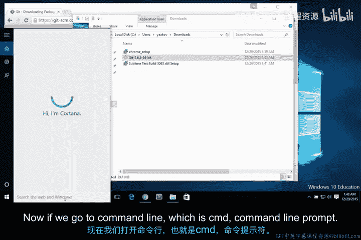
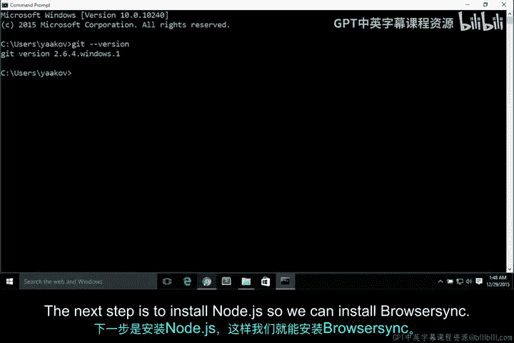
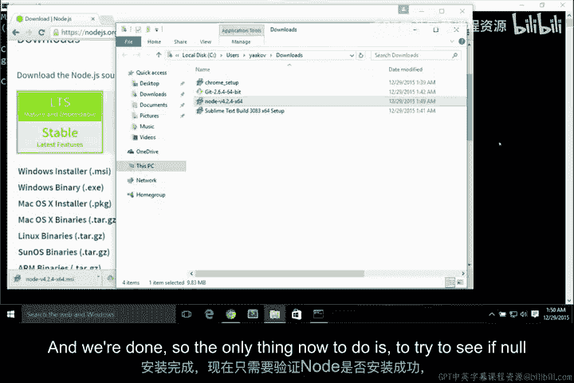
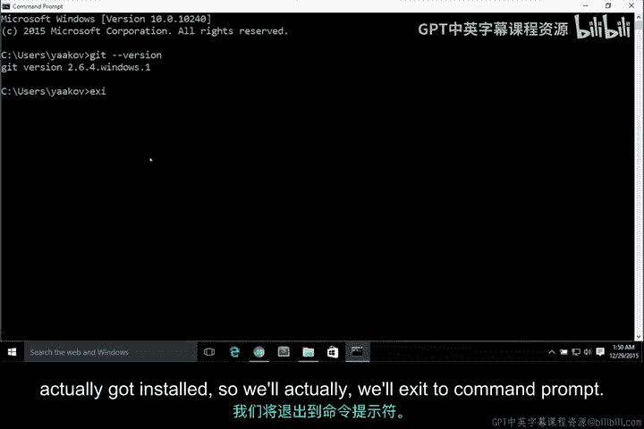
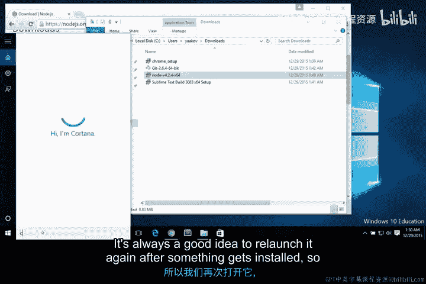
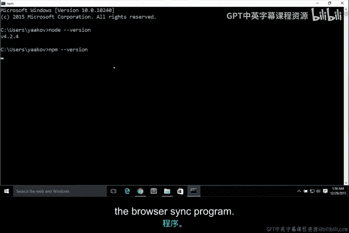
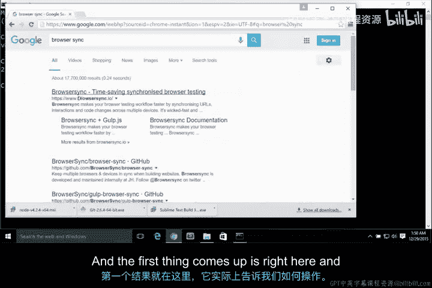

# Web开发者的HTML, CSS, and Javascript：P3：开发环境配置 第2部分 Windows版


在本节课中，我们将要学习如何在Windows操作系统上配置完整的Web开发环境。我们将安装代码编辑器、版本控制工具以及用于实时预览的本地服务器工具。

---

## 🖥️ 设置默认浏览器

首先，我们需要设置一个默认浏览器。这里以Chrome为例。

1.  打开Chrome浏览器。
2.  在系统设置中，将其设置为默认浏览器。

---

## 📝 安装代码编辑器：Sublime Text

上一节我们设置了浏览器，本节中我们来看看如何安装代码编辑器。Sublime Text是一款流行的代码编辑器。

以下是安装步骤：

1.  在浏览器中搜索“Sublime text”。
2.  下载Sublime Text 3的安装程序。根据你的系统选择64位版本。
3.  运行下载的安装文件，并接受所有默认设置完成安装。
4.  安装完成后，你可以在开始菜单中搜索“sublime”，找到程序图标。
5.  右键点击图标，选择“固定到任务栏”，以便快速访问。

---

## 🔧 安装版本控制工具：Git

接下来，我们需要安装Git，这是一个用于跟踪代码更改的版本控制系统。

以下是安装步骤：

1.  在浏览器中搜索“download Git for Windows”。
2.  点击下载链接，开始下载Git for Windows安装程序。
3.  运行安装文件，在安装向导中点击“Next”。
4.  当出现“Adjusting your PATH environment”窗口时，选择“Use Git from the Windows Command Prompt”选项，这允许你在命令行中使用Git。
5.  在“Choosing the default terminal emulator”步骤中，选择“Use Windows‘ default console window”。
6.  继续点击“Next”并完成安装。
7.  为了验证安装是否成功，打开命令提示符（CMD），输入以下命令并按回车：
    ```bash
    git --version
    ```
    如果看到类似 `git version 2.6.4.windows.1` 的输出，说明Git已成功安装。

---

## 💡 关于命令行的重要说明



在继续之前，需要澄清一个可能引起混淆的概念。本课程主要使用Mac的“终端”（Terminal）进行演示。在Windows上，与之对应的是“命令提示符”（Command Prompt或CMD）。

它们都是**命令行界面**（Command Line Interface），即通过输入文本命令来操作计算机的程序。

我们安装的软件（如Git、Node.js）的命令在Windows和Mac上是相同的。但是，**文件系统相关的命令**则因操作系统而异。



一个常见的区别是：
*   在Mac上，使用 `ls`（list的缩写）命令来列出目录中的文件。
*   在Windows上，需要使用 `dir`（directory的缩写）命令来达到相同目的。

---

## 🚀 安装Node.js与npm

现在，我们来安装Node.js。Node.js是一个JavaScript运行环境，我们将使用它附带的**npm**（Node Package Manager，Node包管理器）来安装其他工具。

以下是安装步骤：



1.  在浏览器中搜索“download Node.js for Windows”。
2.  进入官网，根据你的系统（例如64位）下载对应的`.msi`安装程序。
3.  运行安装文件，接受许可协议。
4.  在安装选项中，确保勾选了“Add to PATH”，这样可以在任何命令行位置使用Node.js。
5.  完成安装。
6.  为了验证安装，**请关闭并重新打开**一个新的命令提示符窗口，然后分别输入以下两个命令：
    ```bash
    node --version
    ```
    ```bash
    npm --version
    ```
    如果两个命令都输出了版本号（例如 `v10.15.3` 和 `6.4.1`），则说明Node.js和npm均已安装成功。





---

## 🔄 安装实时预览工具：BrowserSync



最后，我们将使用npm来安装BrowserSync。这个工具可以创建一个本地服务器，并在你修改代码时自动刷新浏览器页面，极大提升开发效率。

以下是安装步骤：



1.  在浏览器中搜索“browser sync”。
2.  进入其官网，你会看到安装命令。
3.  在命令提示符中，输入以下命令并回车：
    ```bash
    npm install -g browser-sync
    ```
    参数 `-g` 表示全局安装，这样你可以在任何项目目录中使用它。
4.  安装完成后，同样建议**关闭并重新打开**命令提示符，然后输入以下命令验证：
    ```bash
    browser-sync --version
    ```
    如果显示了版本号，说明BrowserSync已准备就绪。

---

## 📋 总结

本节课中我们一起学习了在Windows 10系统上配置Web开发环境的完整流程。我们完成了以下核心工具的安装与验证：

1.  **Sublime Text**：作为我们的代码编辑器。
2.  **Git**：用于版本控制，并通过 `git --version` 命令验证。
3.  **Node.js 和 npm**：提供了JavaScript运行环境和包管理工具，通过 `node --version` 和 `npm --version` 验证。
4.  **BrowserSync**：用于创建具备实时重载功能的本地开发服务器，通过 `browser-sync --version` 验证。


现在，你的开发环境已经搭建完毕。在接下来的部分，我们将学习如何使用BrowserSync来启动本地服务器并开发网站，同时也会探讨如何将你的网页部署到Github Pages上进行托管。