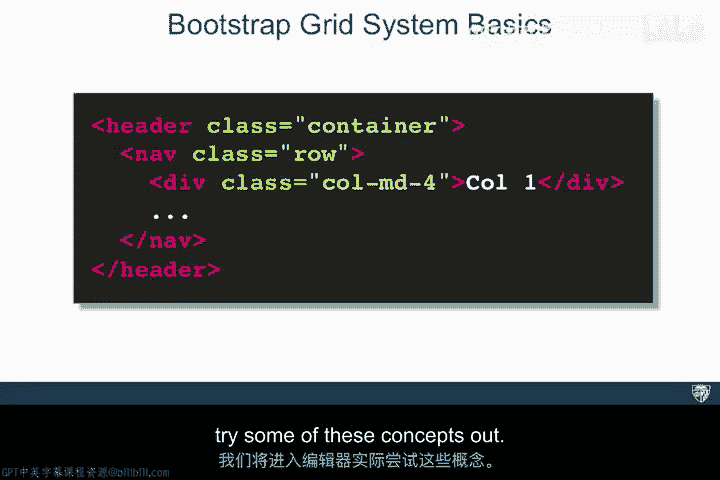

# 约翰霍普金斯大学《Web开发者的HTML, CSS, and Javascript》中英字幕 - P40：23_第26讲 第1部分 Bootstrap网格系统.zh_en - GPT中英字幕课程资源 - BV1WzY6z9EUd

Yeah。

Probably one of the most central components of Boottrap that allows developers to easily create responsive layouts is the grid system。

 so let's go ahead and take a look how it works。So here's a quick snippet of HTML that's going to help us go through the different components of the grid system。

 so pretty much any bootstrap grid layout is going to have these components as part of it。😊。

And as I mentioned before， you could see that it doesn't post a bit of a structure into your HTML code。

 but most of the time it would probably come up with this type of structure anyway。

 so let's go ahead and take a look as to what the structure is。First of all。

 your bootsstrrap grid always has to be inside of a container wrapper。

 There are a couple of choices for that。 one， you could use the container class or you could use the container fluid class。

 The container fluid class stretches your layout to full width of the browser and provides consistent padding around your grid and other content。

 There's other content that could go into the container not just the grid is's just that the grid requires that it should be inside of a container wrapper So that's container fluid regular container class has predetermined fixed width that is still responsive based on the width of the browser In other words。

 as certain width of one breakpoint， a different width or a different break point and so on。

 remember that breakpoints are those media query range boundaries that we covered in one of the previous lectures。

😊，The next component of the grid is the row， so the row class creates horizontal groups of columns。

 which means that the columns collapse and interact with each other as a group but independently from columns in another row the row class also creates a negative margin to counteract the padding that the container class sets up Now why is that done Well each column already has its own padding because we want to visually separate columns from each other if negative margin wasn't applied to the row。

 the padding of the container would then be in addition to the padding of the edge column so the content of the column will no longer align nicely with the rest of the content outside of the grid。

Now the booster documentation actually talks about this and explains it， but to be honest。

 I myself stared at it for a while before I finally understood what it's trying to say。

 so let me put together a quick diagram so you'll visually see what we're talking about。😊。

Okay so obviously I'm going to start with the browser and then I'm going to visually build up what our grid layout is going to look like。

 So the first thing that the communication says is we need to have an element whose class is equal container。

 well that's our element right there it's in white that's our container class then we're going to have another element inside of that that is a row at least has a class row except this time just for demonstration purposes we're not going to give it a row we're going to give it a row no negative margin。

 meaning it's going to be the same row but we're not going to give it to negative margin just for these illustration purposes and you could see outside of our grid。

 but yet still within the container， we have some regular content that is basically right against the edge of the container and then we're going to place our columns。

😊，Each column as you can see， has some padding around it so it could separate itself from the other columns So so far so good right well not exactly because if you look as to where the line of the column content starts and where the line of the regular content starts you'll see that it don't match Now having consistently aligned edges of different content structures within your page is actually a pretty basic design principle and bootstrap implements that basic design principle for you so you don't trip up So let's go ahead and visually now fixed this problem So we're going to do is we're going again start with a browser and a container element with some regular content and then we're going to add our real bootstrap class row element and what it does is again it stretches itself beyond the container。

 it negates the container's padding of actually 15 pixels to be exact and it adds a negative 15 pixel margin So what that does for our content in the columns is that it pushes it out。

😊，Outwards。 So what does that do。 Well， what it does is it now that our column content aligns perfectly with the regular content that is outside of our grid。

 but is still inside the container wrapper。 Now the concept of aligning the different edges of content blocks to each other is nothing new and any good website actually does that。

 In fact， if you ever look at a website and something just doesn't feel quite right。

 take a look at the aligning。 I bet you they aligning of different blocks of different content elements within the page aren't align nicely and your eye kind of naturally tells you that somethings wrong。

 Well let's take a quick look at the webage Facebook do com Cora web devev， which by the way。

 I'm once again， encouraging you to go ahead and like and sign up for the notifications when I publish some optional free content。

 But let's take a look at this page and I'll just took one little piece of that page。

 And if you take a look， this concept of aligning different blocks of content is alive and well here as you could see the。

😊，Picture the text and even the buttons below very well aligned together and it's very pleasing to the eye and it's easy to read at the same time Coursera Webde and published by Yaakov Heen right is's also very much aligned as well and it gives it such structure such that it's pleasing to the eye and there's certainly plenty of studies about the fact that this is the way that the human eye actually follows a web page。

Okay， so that's what the row class does let's move on to the columns you've seen this type of column class definition in our lecture and the response design before。

 so in terms of how Boottrap defines it， let's go ahead and take it apart。😊。

So every bootstrap column class is defined using this template its COL call for column dash size and then dash span and let's go over the components of this or the two components of this template first of all the size Well the size is a screen width range identifier and it's like something like MD for medium LG for large and so on and you could look up what that means in the bootstrap documentation so for example LG is defined this 1200 pixels and above so minimum of 1200 pixels and what that means is that columns will collapse in other words they'll stack one upon each other below that width so if the screen width is 1200 pixels and above for let's say a large size it will go ahead and honor whatever you specified in this column dash size dash span but if the screen width is below 1200 pixel。

This class will no longer apply and basically what that will mean is that the columns in your row will collapse on each other。

 meaning they will stack one on top of the other， which basically means that if you had several columns before now you'll just have one column because everything is going to just stack one upon the other and that is all unless there's another rule that applies this is assuming there's no other rules that apply So for example if for Lg large。

 you specified one column span and then for a medium size you specified in another column span well when you squeeze the browser make the browser less wide and you cross that threshold of 1200 pixels the large column span will no longer apply but if you specified an MD or medium medium size of the screen that then will kick in and that will apply and the span is really all it is is how many columns the element should span so the values up from one to。

12。And I've mentioned many times that bootstrap is a 12 column grid layout and what that means is the second the columns will add to 12 so if you specify let's say 4。

4 and4 that will adapt to 12 if you start specifying more than 12 columns within the row well they'll do what other floats do is that they will wrap to the next row but it won't be a row within bootstrap it will just basically wrap itself automatically So the point is if you're specifying a whole bunch of columns the element that pushes the total sum of the spans above 12 will automatically wrap to the next line and this process can keep keep going every 12 columns。

Lastly， there's nothing really magical about using divs as we did before in an example in the slide。

 you're free to use whatever makes sense to you in your design and this example we're using the header and nav elements to define container and row components。

In part two of this lecture， we're going to jump into the editor and try some of these concepts out。

