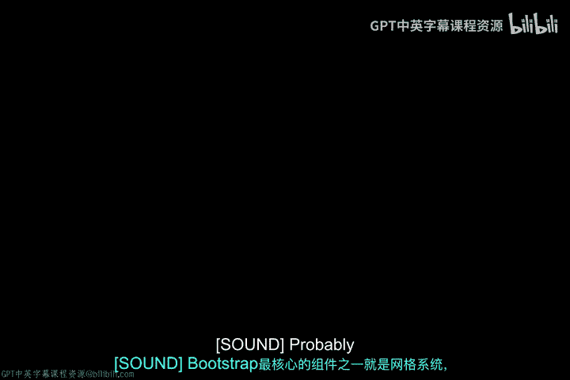
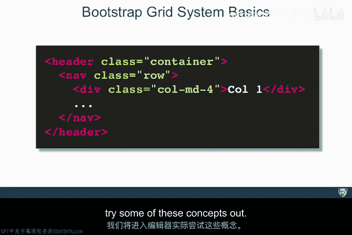

# Bootstrap网格系统：P40：23_第26讲 第1部分 Bootstrap网格系统

在本节课中，我们将要学习Bootstrap框架中一个最核心的组件——网格系统。它允许开发者轻松创建响应式布局。我们将详细拆解其组成部分和工作原理，并通过示意图帮助理解其设计思想。

---

Bootstrap网格系统是创建响应式布局的核心。它通过一套预定义的CSS类，将页面水平划分为最多12列，并允许内容根据屏幕尺寸自动调整排列方式。任何Bootstrap网格布局都包含几个基本的结构组件。

## 容器 (Container)

首先，Bootstrap网格必须包裹在一个容器元素内。容器有两种主要类型：

*   **`.container-fluid`**：此类使布局拉伸至浏览器的全部宽度，并在网格和其他内容周围提供一致的填充（padding）。
*   **`.container`**：此类使用预定的固定宽度，该宽度会根据浏览器宽度（即不同的断点）进行响应式调整。

容器内不仅可以放置网格，也可以放置其他内容。但网格要求必须位于某个容器包装器内。

## 行 (Row)

上一节我们介绍了容器，本节中我们来看看行。`.row`类用于创建列的水平分组。

这意味着同一行内的列会作为一个整体进行折叠和交互，而独立于其他行中的列。`.row`类还会创建一个负外边距（negative margin），用以抵消容器类所设置的填充（padding）。

为什么要这样做呢？因为每一列本身已有内边距（padding）以实现视觉分隔。如果不对行应用负外边距，容器的填充就会与边缘列的填充叠加，导致列的内容无法与网格外、但仍在容器内的其他内容完美对齐。

Bootstrap文档对此有解释，但为了更直观地理解，让我们通过一个示意图来展示。

以下是`.row`类通过负外边距实现对齐的示意图：

1.  **未使用负外边距时**：容器有填充，列也有填充。列内容的起始线与容器内其他常规内容的起始线不对齐。
2.  **使用`.row`类后**：行元素通过负外边距抵消了容器的填充，从而将列内容向外推，使其与容器内其他常规内容的边缘完美对齐。

这种对齐不同内容块边缘的概念是网页设计的基本原则。任何优秀的网站都遵循这一点。观察Facebook或Coursera等页面，你会发现图片、文本和按钮等元素都严格对齐，这使得页面结构清晰、视觉舒适且易于阅读。

## 列 (Columns)

理解了行如何组织列并实现对齐后，本节我们重点看列本身。你可以在之前的响应式设计讲座中见过类似的列类定义。Bootstrap的列类遵循一个特定的模板。

每个Bootstrap列类都使用以下模板定义：`col-{size}-{span}`。

让我们分解这个模板的两个部分：

1.  **尺寸 (Size)**：这是一个屏幕宽度范围的标识符，例如`md`代表中等（medium），`lg`代表大（large）等。具体数值可在Bootstrap文档中查询。例如，`lg`定义为**1200像素及以上**。
    *   这意味着，在指定宽度（如≥1200px）以上，列将按照你设定的`col-{size}-{span}`规则排列。
    *   如果屏幕宽度低于该阈值，此列类规则将不再适用，该行内的列将相互“折叠”，即垂直堆叠在一起。此时，除非有其他适用的规则（例如为更小屏幕`md`定义的列规则），否则所有内容将呈现为单列。

2.  **跨度 (Span)**：这定义了元素应横跨的列数，取值范围为**1到12**。
    *   Bootstrap采用12列网格布局。同一行内所有列的`span`值之和应等于12。例如，指定三个`col-md-4`，总和就是12。
    *   如果你指定的列跨度总和超过12，超出的列将自动换行到下一行（这并非Bootstrap中一个新的`.row`，而是自动换行）。这个过程每满12列就会重复一次。

最后，在网格中使用`
`元素并非强制。你可以根据设计需要自由使用任何语义化的HTML元素。例如，完全可以使用`<header>`和`<nav>`元素来定义容器和行组件。

---

本节课中我们一起学习了Bootstrap网格系统的三个核心组成部分：容器、行和列。我们了解了容器为布局提供基础宽度和填充，行通过负外边距实现内容的精确对齐以优化视觉体验，而列则通过`col-{size}-{span`}的类命名规则，让我们能够灵活地创建响应式布局。在下一部分，我们将进入编辑器，动手实践这些概念。