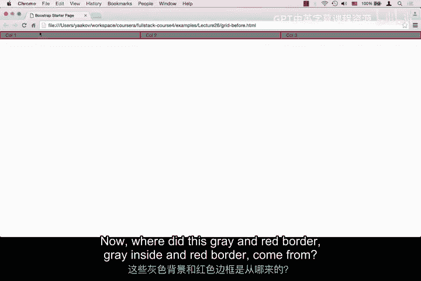
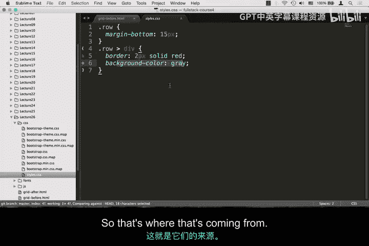
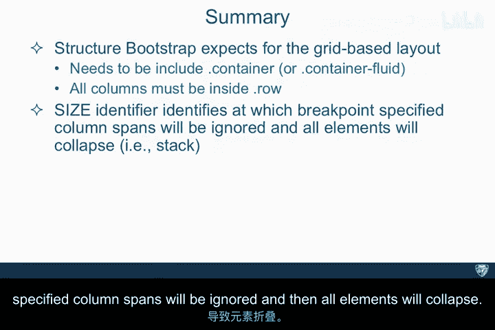

# 约翰霍普金斯大学《Web开发者的HTML, CSS, and Javascript》中英字幕 - P41：24_第26讲 第2部分 Bootstrap网格系统.zh_en - GPT中英字幕课程资源 - BV1WzY6z9EUd

Yeah。

Okay， so here I am sublime text and I'm looking at the file called gridd before that HTML。

 which is located in the Exs lecture 26 folder。The first thing I'm going to do is I'm going go ahead and remove this HTML 5 shim it's really only needed here as it says here for IE8 support and we really want to drop IE8 support at this point at such a minute number of people that actually are still using Ie8 we're going to go ahead and just disregard that but other than that our file is a regular HTML starter file for a bootstrap page it's got the CSS that we imported we have some custom styles imported as well and we have JQury bootstrap JS and again a scriptri JS which we might need further down the line。

Let's go ahead and examine our HTML it's very simple I just got a bunch of divbs and I already kind of prem made it so we'll be able to follow the bootstrap structure that it needs to have in order to have a bootstrap grid system and it's got just three column column1。

 column two column3 let's go ahead and save that and let's take a look as to what this looks like in the browser as you can see right now it's just they behaving just like regular divs they're stacking one upon the other column one column two column3。

So let's begin to build this out by first of all following the rule that we spoke about is that every grid system has to be inside a container class and in this case we're going ahead go ahead and go with container fluid what that should do is that should give us some padding on the side so if we go back to the browser and refresh you'll see that we got some padding here and it's actually 15 pixels to be precise。

😊，Next， we need to place our columns inside a row class， so we're going to say class and say row。

And once that's done， we can go ahead and now specify a class for each of one of our columns and in this case we'll go ahead and specify class equals to and we'll say column and we'll do MD and let's say dash4 and when we do that that will give us4。

4 and4 so a three columns across let's save that and let's go ahead and take a look what we have in the browser we'll refresh and voila we have three columns across now where did this gray and red border gray inside and red border come from well if we go back and we actually open up our CSS and look at the CSS styles that CSS you'll see that actually just premade some styles for row I gave it margin 15 pixels so between different rows that we're gonna have we have some spacing and row div I basically gave it a red border and a background color of gray so that's where that's coming from So as you hopefully remember from the first part。

of the lecture is MD is a sizing identifier that stands for some break point。

 let's go ahead and go to the browser and go to get Boottrap。

com and we'll go to CSss and we'll look at the gridit system。😊。

And scroll down and take a look at the table that they have here and it will tell you what MD stands for M stands for anything above 992 pixels。

 So according to this， it means that anything below this will cause our columns to stack upon the other one upon each other。

 So right now they're behaving like regular columns So if I open Chrome developer tools as I squeeze the browser in the top right corner will see how wide the browser is in pixels and I should be able to get to 992 pixels wide for the screen without anything collapsing or the columns not stacking one upon the other。

 So the second I get to 991 which will be one less So that means the M style set of styles will no longer apply and these columns will stack one upon the other。

 so let's go ahead and do that So we are right now at 99392 and then we'll go to 91。

Comes stacking one up on the other。So hopefully that kind of shows you what that MD really means。

 it means when the columns will start collapsing one up upon the other。So as I mentioned in part1。

 that's only because there's no other styles really that are specified here。 However。

 if we went ahead and specified a different style that will be in the range that we spoke about which is below 992 pixels。

 991 and below so for that we say small well make it6 so if we make the6 that means that column1 will take half the screen。

 column 2 will take half the screen and since we're still in the same row。

 column 3 will go ahead and wrap to the next line and it we'll still take half the screen so as go save that and go back to our browser will refresh and as we start squeezing the browser when we get to less than 992。

😊，What's going to happen is is the first column is going to take half the screen。

 the second column is going to take half the screen and the third one will also take half the screen。

 but it will wrap itself on the next slide。 however that's not the end of it if we go back to the documentation and take a look this small that we specified has a break point of 768 pixels so which means that these columns will still collapse and stack one upon the other if I squeeze the browser below 768 pixels so let's go ahead and try to do that。

And we'll go back here and 768 right around here， 768， 67， and therefore it starts collapsing。

 so the collapsing will still happen will just happen at a different break point。😊，Okay。

 so let's make the browser back up to the full screen。

 let's go back to our code and we'll go ahead and copy this whole row。And we'll paste it again。

 and if we do that now we visually separate it row number one from row number two。

 So if we go back to the browser and refresh， remember I created some margin below the row So now you see exactly the same thing and as we squeeze the browser will both sets of rows will behave exactly the same way so you can see the first set of rows is behaving one。

2 and3 on the second line and so the second set second rows behaving12 and the third column is on the line right below so there's one more variation that I should show you that you should really have to pay attention to let's go back to the the comm and let's take a look at this table one more time。

 you could see that the grid behavior is a little bit different for extra small the call at Xs versus the rest of them the grid behavior says here it's going to be horizontal at all times as opposed to the ones that are small mediumlar。

😊，They'll be collapse to start and they will be horizontal above breakpoint。

 so basically they'll be stacking below these numbers but anything above that they will actually be horizontal and try to lay themselves out which means that if you want to guarantee that there was always going to be a particular layout。

 you could just specify it in the call XS and it will stay no matter what the size of the screen that's the layout that will stay。

 let's go ahead and go back to the code editor and test this out。

 Let's scroll down a little bit here and well copy this row right here。

And we'll make another just like that， and what we'll do is we'll go ahead and remove。Actually。

 just about everything here and we'll say column。Exces extra small and6。

 So now what we're saying is is that we want the first column to take up half the screen。

 the second to the cap half the screen and the third to wrap around and take up half the screen。

 but we want that to always happen。 In other words。

 we don't want it to collapse at any point or do anything different at any point。

 So if we go back to the browser and we'll go ahead and refresh this page。

 you see that even above 1200 pixels， which is that's what it is right now。

 it is still staying in this particular layout。 And if I squeeze the browser more and more it will continue staying in this layout。

 So ats certain point， even those columns will collapse because they're specified as small let go back to our code editor。

 as you can see they're specified as small。 So the second we go below the small break point。

 this two will collapse。 However， since this is specified as XS that will never collapse。

 It will always stay exactly。😊，せん？So to summarize we spoke about the structure that the bootstrap expects for the grid based layout to work。

 in other words， the grid needs to be inside of the container class or container fluid class and also all columns must be inside an element with the row class。

We spoke about the bootsstrrap gridit system column classes and the fact that they have a size identifier that identifies at which breakpoint specified column spans will be ignored。

 and then all elements will collapse， in other words。

 the columns will start stacking one upon the other and as part of our demo。

 we spoke about the fact that if no other rules apply， specifying column XS will keep that layout。

 no matter what size of the screen。

Next we're going to switch gears a little bit and we're going to get into a little bit more of a business slash requirements。

 analysis and requirements gathering type of mode， and Ill try to go over some basic ideas as to what to expect when you visit with a real client。

