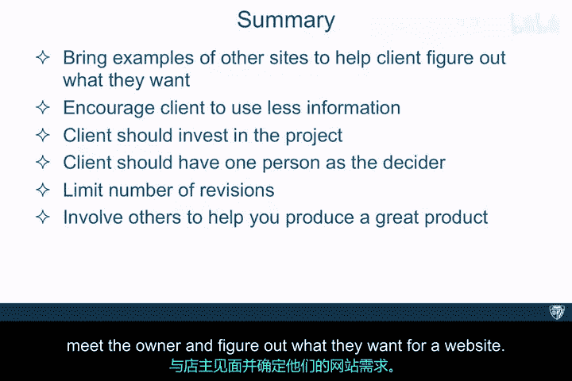

# 约翰霍普金斯大学《Web开发者的HTML, CSS, and Javascript》中英字幕 - P43：0_第27讲 第1部分 与客户会面.zh_en - GPT中英字幕课程资源 - BV1WzY6z9EUd

Yeah。

Okay， so now we're ready to embark on our adventure of creating a real site for a real client。

 In my case， I approached a local restaurant called David Chohu's China Bistro and we're gonna be building a restaurant website for them Now before we go and visit with the client let's go over some rules and just basic ideas so you're not completely in the dark Now obviously this is not going to be a comprehensive business strategies or comprehensive how to deal with clients but some basic ground rules just to understand where we're coming from And the first concept that you need to remember is that most clients have no idea what they want。

 It's not that they're ignorant， in fact they're very smart about their own business。

 but they certainly usually have no idea as to what they want on the website and how the whole thing works So it's really your job to ask questions and most importantly the right the right questions to help the client figure out what it is that they want and kind of communicate that back to you。

😊，A great way of doing is if you bring some website examples of similar businesses that already have websites and have the client react to those websites so you could show them a couple of websites and see do like this do like that what do you like about this what do you not like about that once you get enough of these examples in front of their eyes you'll start getting a feelings to what they will be satisfied with but also what they actually are looking for for website in their own product Now as a general rule every single client is going to want to put a lot of information on the page a lot of information about their business and it makes sense because there's a lot of things that you should know as a customer about their business a lot of it is very important and they'll tell you that this is also important I want this very much in bold and upfront and this is also important but I want an aside and some more things are important and this is important and that's important very important reminder it's all going to be very important and that's a pretty usual approach of clients。

😊，It's perfectly human The only problem is is that when everything is important。

 nothing is really important so again it's your job really to encourage the client to follow a very simple rule less is more right the less information you put up the more impact that information will get so point is you should encourage your client not to cram information on the website in fact what you should try to help the client do is identify that crucial information that most important information that has the most punch to it and not just cram every information there's possibly there is to know about the business。

😊，Another quick tip I would love to share with you is the fact that you should always try to find a way for the client to invest in the project and this is especially true if you're doing this for free just to build up your portfolio the client needs to feel like they have some skin in the game as well if they don't what it's going end up happening is that you're gonna to be some side project that they're really not gonna pay much attention to and you're gonna spend and invest all this time of your own and not necessarily get much of cooperation from their side so have them do something even if you're doing this for free。

 have them commit at least to pay for product photography if that makes sense or have them commit to provide products that you need in order to demo it or maybe if you find your own photographer that is willing to do this for free which I'm going talk to in a minute about at least they will provide the product and they will have some actual real investment some money investment in the game。

 even if it's not super huge amount but。As long as they actually are spending something。

 they have at least a little bit of an investment that they'll want to take the entire project much more seriously。

Another important rule is make sure that you have the client to designate one person responsible for decisions if you don't what's going to happen is that this person is going to tell you you know you know really what we want is this way and the other person in the business is going to tell you we want something else differently here if you have one person you could always tell the other people that are suggesting things that it's a great suggestion and I'm responsible to this particular one person and I'll bring that suggestion to that person and if that person you know approves I'll be more than happy to incorporate it。

 which brings me to another point， limit the number of revisions upfront。

 make sure you communicate to the client upfront， have them even sign a contract。

 have them signed that this is the number of revisions that I'm willing to make because obviously know the clients can go on forever and ever and ever and your time is limited。

Now if it's a paying job， don't limit revisions you know out of hand。

 but limit the number of free revisions， you know， if you say I will you know revise the site。

 you know， within reason， you know， not completely turn it upside down but within reason I'll revise it up to like three times free and from that on。

 I'll have to charge it per hour， you know you'll figure out how you want to structure it。

Now if for really comprehensive as to what to ask your client。

 I highly suggest you Google Web development client questionnaire。

 and you will see a whole bunch of resources that you could draw from to really find out how to ask these questions and what kind of answers to look for。

 just to learn a little bit about what this interaction is like if you've never done this before yourself。

Now another quick tip I'd like to share with you is you should try to involve others if you need it。

 so for example， if you're not a super du for graphic designer and we're really concentrating on coding things。

 not really designing per se you could contact the local college and see if a graphic designer student wants to join you and provide some free design services and put that on their resume you'll get to do the coding they'll get to do the design and so on if there's make sense for your website that you're trying to create that you need some photography like photography of product you could do the same thing you could find a photography that is a young budding photographer that is willing to do things for free as long as obviously he is mentioned and credited and he's able to put that on his resume。

 his or her resume and that way you'll be able to collect a couple of professional resources that you won't feel like you have to do everything by yourself in order to produce something that really looks pretty professional Now in my case for the David Choose China Bistro I got pretty lucky。

😊，My wife happens to be a graphic designer， so she will help me with the design。

 at least preliminary design of a layout of the site and my son happens to be a photographer at least starting photographer and he is more than willing to provide the food photography service now I'll follow my own advice I will still have the restaurant owner invest in this project and the way they will invest is they agree to provide every single item on the menu to provide for us just so we could take proper pictures of those items and that's a pretty hefty investment because they have to keep the staff after hours and cook basically every single item on the menu and provide it for us so it's hours and hours of their work but it's something that shows the client is involved and the client is committed and that's very important。

Now another thing is definitely don't go in into the meeting with the client without first finding out what does the client have right now。

 what kind of website do we have do they have what information is being displayed just to learn a little bit about the business In my case the David Choose China Bistro has the following website let's go ahead and take a look at it Okay so here's a site it's clearly put up on some free service of some maybe it's not free but right off of their phone number that's their domain name and you could see all it is is a picture actually if we take a look it looks like yeah it's a picture it's a picture of their their menu and I could see out of the bat that they have different categories in their menu which is I guess pretty standard。

But the website is definitely pretty horrible terms of you know in terms of user experience and certainly doesn't show you the business and it's all its glory。

 so we're going to go ahead and try to fix that。So let's summarize first of all。

 don't forget to bring some examples of other websites to help your client figure out what they want it's very often that the clients really don't understand what it is they want themselves and giving them some examples will help generate a discussion and kind of a direction as to where they really want to go。

😊，Also encourage your client to use less information。

 it's a knee jerk reaction just about everybody who is not in the industry to try to cram as much information as possible and it's almost always the wrong way to go。

 it's better to have less and more potent information to their customers than have tons of information where everything gets lost。

Figure out a way that a client， your client should invest in a project。

 whether they pay you a little bit， whether they upfront commit to paying for something， you know。

 whether it's photography or providing their product。

 but it's got to be something that they have as they call skinkin in the game。

 so they will take this project seriously as well， especially this is especially true。

 if you're doing this for free just to kind of build up your portfolio。

Very important thing to have is that the client should designate one person as the decider of what things to have in the website or what not thinks to have in the website and just really everything about the project if you have more than one person chaos will start and you're gonna spend way too much time dealing with things that have nothing to do with coding and nothing to do with the website but just managing these relationships that really shouldn't be there to begin with just have one person have the client designate one person to be the final decider Also limit the number of revisions。

 don't let the client keep constantly revising and revising and revising so if you're doing this for free。

 certainly limited to something reasonable like three times but if you're doing it for pay then limit it to three times for free and then anything additional the client will actually have to pay for。

And another thing is involve others to help produce a great product it's rare to have one person kind of have it know it all do the photography。

 do the product photography， do the layouts and designs。

 involve somebody else and have them help you and you'll get to concentrate on the coding Next let's go visit the actual restaurant。

 meet the owner and figure out what they want for a website What does that mean field trip。😊。

