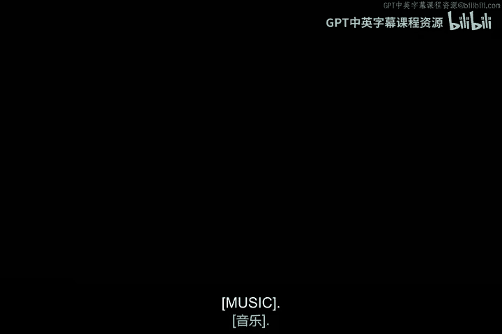
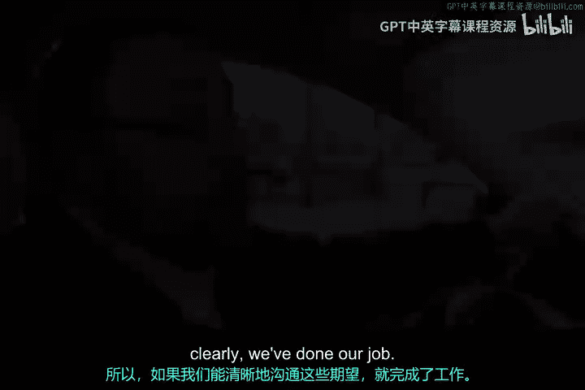

# 约翰霍普金斯大学《Web开发者的HTML, CSS, and Javascript》中英字幕 - P44：1_第27讲 第2部分 与客户的实地考察.zh_en - GPT中英字幕课程资源 - BV1WzY6z9EUd

Yeah。

Okay， we're ready to go on our field trip， we will meet Amy。

 the owner of the restaurant we will be creating a website for。

 get a sense of what she wants on a website and maybe even get lucky and interview some customers to get a unique customer perspective about their restaurant。

Let's go。When you get right down to it， this meeting is all about setting expectations。

 whether it's expectations about what the client is expecting from us or our expectations of what the client is going to provide so if we can achieve that of communicating those expectations very clearly。

 we've done our job。

Seriously， how many computer science courses do you have to take you on a field trip，huh？🎼。

Taking your job， difiri。🎼还你。よな。そね。🎼，🎼Thank Amy choose how can help see。

I come to the restaurant very often， usually about once a month or twice a month I would come here once a month with my wife。

 I always enjoy the atmosphere and I enjoy the service like the fact that it's kosher。

And the fact that the food is very good all the time and consistently good。

 because that's why I like them come to this restaurant， you know。

 be presently I always eat as we take the outside of it dish and I can also when I don't finish。

 which is ample portions I can take home。🎼Taste good。I mean that's why I like it。

 It's the type of thing we try to expect any good Chinese dishes to have I love the chicken itself I just love the way it's made。

Have you ever heard of jos Hopkins Whiting School of Engineering， of course？

You think it's a good school？It's absolutely a good school。

 food is exceptional and I know they get rated so I get always trust that the food is getting refresh。

You know， ready to eat， and I always enjoyed it， Joseph Rosenblt， class love。

1964 Hopkins also he actually went to Hopkins。Hello， hi， ready for our meeting。So if you had to。

 you know， do a little self criticism， is there anything about the restaurant you would want to improve？

Yes to get up better website get up website that's a very good answer Thank you Okay so what I did was I prepared a few websites for you to look at。

And what I want you to do is I pulled them up on the sidead here what I want you to do is take a look at them and let me know these are all sides of Chinese restaurants and take a look and see if you like any of them and you know if you want your website to be you know kind of similar or something something like that and you could know could scroll back and forth over here and take a look and if you do like it's like do what do you like about it。

 what appeal to you about that website。Or what doesn't what do you not want it on that website what do you like about it the colors you like the colors you like the colors very clear。

 you know， you like the fact that it's clean it looking very looking very clean okay？🎼Okay， and。🎼Hい。

 comema。🎼Very user friendly user friendly looks very user friendly to okay so this site looks very user friendly to okay and it looks clean and practical very practical Okay very good good so you like this is the type of that's is this something like obviously we're not going do these colors for your website because your website is going to be more with the colors or but you like the setup so we're gonna have some decisions to make as we go and develop the website know where to put things something like that can you design one person who's going to be responsible for all decisions regarding this project and who that person be it be so you decide so we and you'll be pretty much available so we could call you and there's something going on that you know shouldn't be like a twoweek type of you wait before we hear of an answer if we need something for a decision you'll be able to decide okay great we could do that it's only explain like a couple where the process is going be like basically we're gonna create a mockup of the website not the real website just a mock up like a drawing of the website and we're gonna show to you。

And basically see if you approve the way it's going and we'll give you we'll give you three like three revisions three three times that you could update the thing and say you know youall want something different a little bit and after that and then you will try to finalize it so you're okay with that you're okay with that I set up okay great okay you saw the pictures on that website and you really like the fact that there's pictures on there right？

🎼So pictures that you know usually especially have website like this are very important Would you be able to commit to providing the entire menu of the restaurant so we could come and bring a photographer and actually take a picture of every single item in the menu would you be okay with as long as still be kosher menu still you'll still beher absolutely very we'll bring a photographer and and then you will basically have to cook every single item in the menu and we'll bring it out then the photographer will take so this is a kher restaurant is that correct so what does that know like you know in terms of cooking and dealing with stuff what does that mean for you we have a basically somebody who's a supervisor nowaday people start you know making a lot of ingredient with aosher know that means we have a lot choices So spoke to a number of customers that you have here and not everybody wanted to be on camera。

Everybody loves your food。🎼嗯。🎼Do do you like Chinese food yourself Of course Do you eat all Chinese food a lot Of course really okay So you not you're not sick of it。

 So you're not of it No not at all so you eat it even though you see it every day in the restaurant and you're not sick of it not at never get tired of Chinese food this restaurant is actually pretty cozy it's small but at the same time you know it feels kind of cozy。

 it's relaxing right that is that kind of the feel you're trying to go for on purpose。Okay。

 so now we're ready to leave the restaurant and start designing and coding our website。

 but before we do， one of the most important rules is don't ever code on an empty stomach。Oh。

 I know you're really anxious to start coding the website but。I'm a little busy。

 so I'll be right back。We'll do the website after this。We got to both my language ones。

I'm going to put the same move first。う。😊，Okay， you're line off I don't know why I got at the computers。

Food tasting seems like a much better job。没了。啊。😀あ。😊，受けよそ。😊，嗯。You dude like this？

It's hard to do it this way。It two fingers， two fingers instead the 10 fingers。

 two fingers out of1 fingers， yes， okay， just hold it with two fingers like this。

This is very hard in just finger here put the middle finger in between those two fingers。Like this。

And then try to you have to grab a like that Yep， exactly， you're good。哈哈。😊，Yeah， messy question。

 do you have a fork？This is much better than a fork is much better than porkk Can you pick up a rice with a fork？

No what I could do with a spoon see， I can't pick up rice with astick you can pick up rice with a chastick。

 let's see it。Wow， that's some skill。Let's see if I could do it。

 I pick up a carrot that's much bigger。Good job。ow go。I'm learning， this is incredible okay。

 next I'm going to do the rice ready。Good oh my goodness at the same time I have to eat this right。

 so it's very hard to balance and eat at the same time take some skill。Good job。 Here you go。

 better the。 You're good student。😊。

