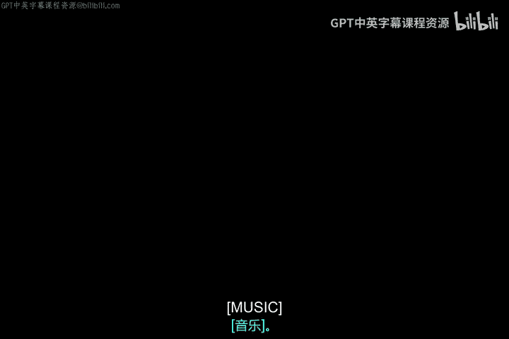
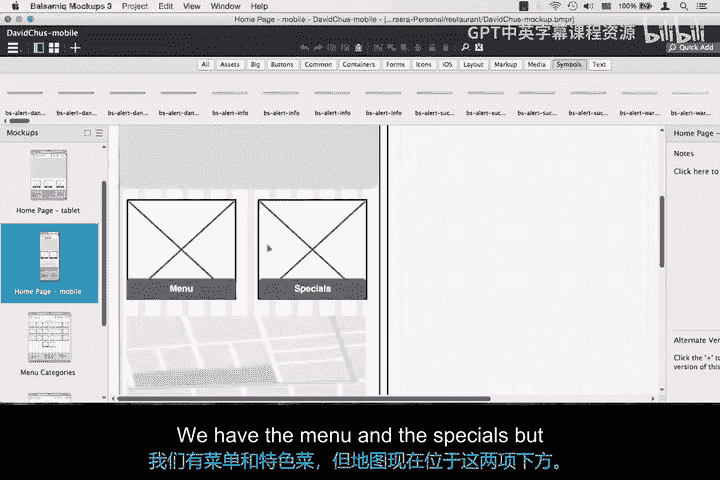
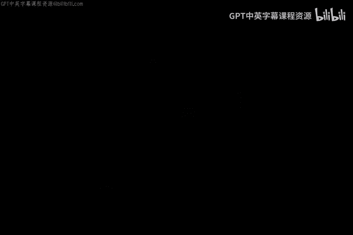

# 约翰霍普金斯大学《Web开发者的HTML, CSS, and Javascript》中英字幕 - P45：2_第28讲 设计概述.zh_en - GPT中英字幕课程资源 - BV1WzY6z9EUd

Yeah。

Okay， so now we're back from a restaurant and I really feel that I was able to get a taste of this project up close and personal Now what we're going to do now is we're going to go over our design overview and this is a combination of work that the graphic designer I。

e。 my wife did for us and we're going to see how this going to evolve into a real website so let's go ahead and jump into it。

😊，So when you first starting to design a website， the worst thing that you could possibly do is start coding right away。

 you don't want to do that you don't want to design a website coding it at the same time which you do want to do is you want to have some mockup some layout mockups that you present to the client that take little to no time to design and to put together and present to the client and once they approve and you know exactly what you're coding what you're trying to strive for then you turn to the coder and you start coding the website so what we're going to do is going to design the mockups first so the tool we're going to use is called balsamonic。

com it's a balsamonic mockup tool and it lets us put together a mockups for websites for other different UIs very very quickly and I'll show you the cool part about it in a minute so let's go ahead and switch to balsamonic mockup I'll provide you the link to them in the resources So here's our balsamonic mockup and we finished the website layout already with the help of the。

Deigner Ie my wife and before we want to actually design let me just say a couple of words about this tool The tool is not free。

 but it's really not that expensive。 however， what's really cool about the tool besides for the fact that it has components for different platforms that you're able to kind of natively lay them out you also have integration of components from bootstap which is exactly what we're going to use so it's really convenient but I think one of the coolest features of the tool for us as coders is that these all these mockups are based upon a file that is really nothing more than HTML looking like text file it means that you could check things in into a code repository and when things get updated it's just a text that gets updated so unlike you know images and things that really are impossible to deal with inside repositories and there's no way to tell what the difference is because it's not text it's binary this is all textbased and therefore you could take and create a difference。

what was checkeded in in the repository yesterday versus today versus you know。

 is going to be tomorrow and it's a huge huge advantage when you're working especially within a team and in a professional environment。

Okay so let's take a look at our website here that we the mockup of the website So the mockup is it's going to have a logo with some text underneath and this is going to be basically our menu and I'm not sure 100% yet if that's what the menu items will be definitely there will be a menu item right the menu menu for the food menu that we're gonna have and there's the phone number with a little thing we deliver Now this big area is what's planned for this is some kind of a picture of the inside of the restaurant it's going to be what's called the jammotron and bootstrap So when the user first gets in here he sees a very nice picture of the restaurant and it's inviting and they want to kind proceed what's going to be underneath is three giant buttons menu specials and a map and it's selfexplanatory what it stands for and these are kind of the key things that we want the user of this website to see right away which is they want to see the menu perhaps specials and certainly where this is located at the bottom we're gonna have ours。

Some bunch of quotes or a couple of quotes about the restaurant。

 and we're gonna have the actual address of the restaurant as well。 Now remember。

 this is gonna be a responsive website。 So we need to design what the site will look like when the browser page gets a little more narrow So the first one is going to be a tablet So what happens when you're in a tablet not much happens when you're in a tablet in this particular design because we're just going to squeeze different items as opposed to before that's going kind of spread out and now we're just going squeeze them a little bit more and still have the jamotron and still have the specials they might be a little bit squeeze in terms of size and everything else basically stays the same Now however。

 when we jump to go into a mobile page that becomes very different Now we're not going to have these buttons anymore we're going have a kind of a menu user can click and the menu will slide down which is a very common feature you also notice that we moved the telephone number in the middle。

😊，Of the page now because supposedly on the mobile web page right you would want to have the phone number just a click away or tap away and we're gonna have this phone number tapable such that they can make a phone call straight from the page or it will at least trigger their phone to try to call the restaurant and we'll still have the Jabo drum but it's going to be a much smaller one because we don't want to overwhelm the phone and the cell network we don't want it to be too slow and you could see here that now this thing is a little bit rearranged we have the menu in the specials but the map is now on the bottom of those two things。

So we're gonna to have to figure out how to have the map automatically slide underneath of that and we're still going to have some testimonials about the restaurant。

 the hours and the address now that's really not all we need to design we also need to design another page and we know upfront we're going to have this menu categories page well the menu categories page and this is showing us the full one is going to basically have a bunch of different things and here it looks like we're going to have six menu categories across and it's basically going to continue until we're run out of these menu categories so that's basically what we're going have we're not going to have a jumotron here because at this point they're already a little bit deeper into the website。

😊，And the other one is a menu list so we're going to have supposedly they will click on one of the menu categories and they will see every item inside that menu category and this is basically what we have so we're going to have a couple of items across with their name with their description and we're also going to have a ID for every single item and that ID if you look if you remember。

 let me go back to the restaurant。David Cho China Bistro。

And that ID really comes from right here every menu item has this ID that is already on their menu so we don't want to switch that back and forth。

 we want to keep that set so the menu will correspond to something that's on the website Okay。

 so that's our layout next let's take a look at some design that has already some colors and some more concrete layout。

So here's what our designer came up with and this is just basic idea and this is what you're usually gonna get back from a designer。

 you're gonna add some kind of a color scheme some photography and a photography app is not from this particular restaurant is just some stock photography that you can certainly use in order to kind enhance the site to see what it looks like and here's our menu again this is not the menu from this particular restaurant or that not the picture from a particular restaurant but actually the map is So this is what we're going for and designer will typically provide the hexademal color values for different components within your website and it will also tell you which font that they used inside inside this design now depending on your budget and if you're trying to do things for free or certainly if you're trying to find free resources I will recommend a prompt that you try to stick with Google fonts there's a website Googlecom fonts and which will be using for our website ourselves so if you can ask your designer to。

😊，Tick to the fonts that are available on that website。

 it will make your job down the line a little bit easier Now don't worry about making minor mistakes at least with the color scheme and other things like that。

 for example we messed up on this site by not providing the designer the photography upfront because we just couldn't we didn't really arrange it that way we only did the photography after the design was produced。

 which was not really under our control simply because that's the way the schedules worked out but when we started comparing the photos that we were able to get from the food photography realized that the color scheme。

 especially for this color right here， the reddish color is really the wrong one so we had two choices we could colorize every single picture that we took with this red and you were able to do something less in Photoshop or just adjust our color this particular color slightly so that it will fit the color scheme that the restaurant actually presents in real life and in this case our color scheme kind of went close together with a color of。

napkins in the restaurant now what tool do you use to design this Well professional designers usually use Photoshop Adobe Photoshop to design this。

 but you don't really have to use something so fancy you can use something as simple as PowerPoint or any drawing tool because the idea here is really not to come up with a complete 100% design the idea here is really to come up with enough detail So when you code you will know what you're trying to achieve and this is what basically this is about so we have our mockups we have our design with the colors and the fonts it's time to start coding the website let's do it。

