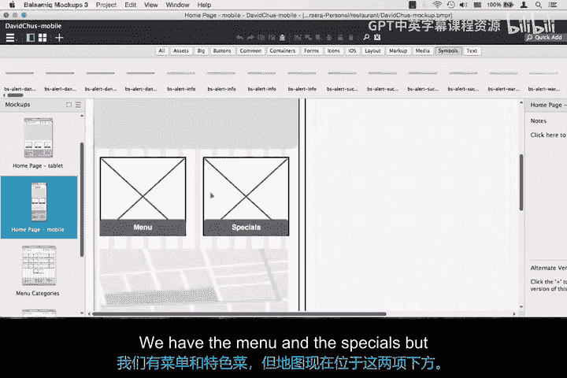

# Web开发者的HTML, CSS, and Javascript：2：第28讲 设计概述

在本节课中，我们将学习网站开发流程中至关重要的设计规划阶段。我们将了解如何从零开始为一个餐厅网站创建设计稿，包括布局、响应式设计以及从设计到代码的过渡。

## 从构思到设计稿

上一节我们介绍了项目背景，本节中我们来看看如何将餐厅的初步想法转化为具体的设计方案。直接开始编码是网站设计中最糟糕的做法。正确的方法是先创建一些布局原型图，向客户展示并获得批准，明确开发目标后，再开始编码。

我们将使用一个名为Balsamiq Mockups的工具来快速创建网站原型。这个工具的优势在于它拥有针对不同平台的组件库，并且集成了Bootstrap的组件，这对我们后续的开发非常方便。此外，所有原型都基于一个类似HTML的文本文件，这意味着它可以轻松地纳入代码版本管理系统（如Git）中进行差异对比和团队协作，这在专业环境中是一个巨大的优势。

## 网站布局设计

以下是我们的餐厅网站主页在不同设备上的布局设计：

*   **桌面版布局**：页面顶部包含Logo、下方的文字菜单以及一个“我们提供外卖”的电话号码。主体部分是一个展示餐厅内部环境的大型图片区域（在Bootstrap中称为“Jumbotron”）。其下方是三个醒目的大按钮，分别对应“菜单”、“特价菜”和“地图”。页面底部计划展示一些顾客评价和餐厅的实际地址。
*   **平板电脑布局**：当浏览器变窄时，布局变化不大，主要是各个组件被适度压缩，但整体结构保持不变，依然包含Jumbotron和功能按钮。
*   **手机布局**：布局发生显著变化。顶部菜单将变为一个可点击下拉的汉堡菜单。电话号码被移到页面更显眼的位置，并设计为可点击直接拨打电话。Jumbotron区域会缩小以避免加载过慢。原来的三个大按钮将重新排列，“地图”会移动到“菜单”和“特价菜”的下方。底部依然保留评价和地址信息。

除了主页，我们还需要设计其他页面。

*   **菜单分类页面**：这个页面将展示所有的菜单分类（例如开胃菜、主菜、甜点），初步设计为每行展示六个分类，并向下滚动直至展示完全部分类。此页面不再使用Jumbotron。
*   **具体菜单列表页面**：当用户点击某个分类后，将进入此页面。它会列出该分类下的所有菜品，每项包含名称、描述以及一个**唯一的ID**。这个ID需要与餐厅实际菜单上的菜品编号保持一致，以确保线上线下数据对应。

## 视觉设计与实现考量

在布局确定后，设计师会提供更具体的视觉设计稿。这份稿子会定义网站的色彩方案、使用的图片以及字体。

设计师通常会提供网站各部分的十六进制颜色值（例如主色可能是 `#FF5733`）和指定的字体名称。如果预算有限或希望使用免费资源，建议要求设计师使用**Google Fonts**上的字体，这将使后续的网页实现更加容易。

在实际操作中，设计稿和最终素材可能出现偏差。例如，我们可能在设计完成后才进行食物摄影，然后发现照片的色调与设计稿中的主色不匹配。这时有两种选择：使用图像处理软件调整所有照片的色调以匹配设计，或者微调网站的主色以更好地配合实际照片和餐厅环境（例如，调整为与餐厅餐巾颜色相近的色调）。

关于设计工具，专业设计师通常使用Adobe Photoshop，但你也可以使用更简单的工具，如PowerPoint或任何绘图软件。此阶段的目标并非完成一个100%完美的最终设计，而是提供足够的细节，让开发者在编码时清楚地知道要达成什么样的视觉效果。

本节课中我们一起学习了网站开发前期的设计规划流程。我们了解了使用Balsamiq创建原型图的重要性，设计了主页及其响应式布局，规划了菜单分类和列表页面，并讨论了从视觉设计稿到代码实现过程中需要考虑的实际问题，如颜色调整和字体选择。现在，我们拥有了清晰的设计蓝图，可以开始动手编写网站代码了。