# 约翰霍普金斯大学《Web开发者的HTML, CSS, and Javascript》中英字幕 - P46：3_第29讲 基本规则与开发环境配置概述.zh_en - GPT中英字幕课程资源 - BV1WzY6z9EUd

Yeah。

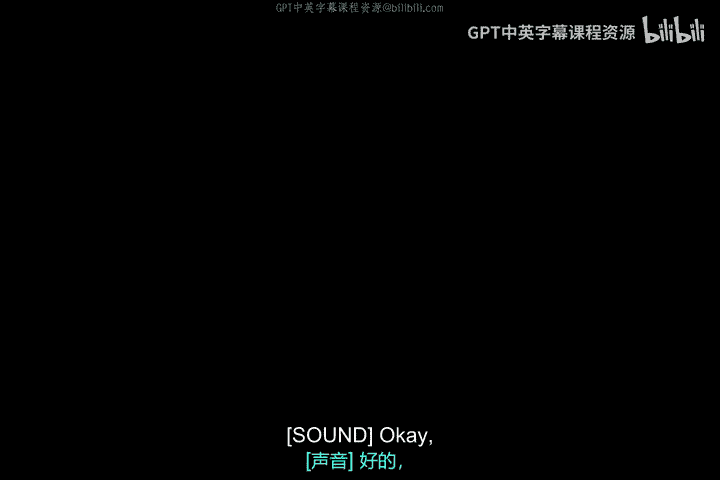

Okay， before we begin， let me go over some ground rules and we'll also give a very quick overview of our development environment setup。

First of all， remember that it's a video so use it like one， so if you feel like I'm going too fast。

 pause it and rewind it a bit if you want to hear something again， if it's too slow。

 you know feel free to increase the playback speed and make me sound like a chipmunk so go ahead and try to use the video for what it's good for which is adjusting to your own pace。

Now remember that source code is available， so if you miss something or you want to look something up later。

 it's there for you， so don't have to worry about missing something on the screen。

 the source code is definitely 100% will be available to you even though it's going to be a real commercial website。

Now what we're going to do is we're going build up the site piece by piece which will mean that the current lectures before folder will contain the previous lectures after content as a starting point that way you could jump into any lecture and see where we started and see kind of where we end as well and that keeps going now certain things will have to be done off screen to save time so sometimes I also have times when I just need to pause and think for a second where we're going next I certainly don't think you wantna sit there and wait with me while I think so certain things will have to be paused done off screen and then put back on but certainly once I put it on screen。

 I will go ahead and go over and explain it so to avoid having you watch me type which could be pretty boring I will go ahead and try to do some things off screen and then we'll just explain them as we go along but some on screen typing will probably won't be able to be avoided anyway another thing is I would love to have recorded both screens I usually try to。

😊，Develop have two monitors in front of me that way。

 especially if we use something like browser sync， which we're gonna go over over in a minute。

 it's so much easier to have a code editor in one screen on one monitor and then the display or the browser and another monitor that way whenever you change something in you code it immediately appears on your monitor however this is unfortunately a luxury we can't have since there's only a one screen type of video on top of which I can't even put both the browser and the code editor in the same window like I did before since we're going to need to actually code things as they stretch so when the browser gets really big it's going to be a different layout and when the browser is halfsize simply because my screen is zoomed in so you could see everything much better so unfortunately we will have to be switching a lot between the code editor and the browser screens so I apologize for that but there's nothing I could do without having you not be able to see very well as to what I type so let's jump。

Into the code editor and see what our starting point is。

Okay so I'm right now in my terminal window and if I do Pwd。

 which gives us the current director I'm in you'll see that I'm in examples lecture 29 before folder and if we do Nls on it。

 you'll see that I have CSs fonts Js folder and a starter index HTML So the first thing we want to do is we want to start using browser sync and the way want to do it is if you actually go up one folder and do Nls you'll see it before and after and we're going to be kind living in the after all the time so let's go back to after because that's what we're going to be developing and this is the place where we want to actually start up our browser sync so whenever we edit anything this is going to automatically appear in a browser so let's go ahead let me recall my browser command and we'll go over it So hopefully in the welcome videos I went over how to install browser sync and if you haven't done that please go back to that video and go through how to install it you will need to install no Gs for example and so on go ahead and review those videos So browser is。

Brower dash sync， we're going to say start we're going to start a browser syncnc is going to be a server for us。

 in other words， browser syncnc will itself serve our website from the directory that we're in。

 which is right now in the lecture 29 after directory。😊，And we're also gonna say directory。

 which basically tells browser sync to go ahead and list the directory structure instead of trying to serve up a file so it will go ahead and show us all these files as the starting point and the last thing is I want to see which files do I need to watch for modificationification so that the browser sync can go ahead and reload my page automatically and immediately the second any of those files that match this criteria change in this case I'll just put star because I want any files in this directory to change to immediately be reloaded in the browser so I'll go ahead and press enter and start my browser and go ahead you'll see that I'm now in the browser it jumped me straight to it and let's actually go back to take a look what it's telling me that here my access URLs and went ahead and jump me straight to this page but if you take a look here there's another page called HP local host with a different port 3001 and that's a UI of the browser sync which I haven't show you before。

So let's go ahead and jump into that Ui and you'll see that's a whole configuration Ui4。😊。

For our browser sync and I encourage you to go ahead and explore it a little bit。 Meanwhile。

 this is our directory right here and if we click on this。

 we really are going to have see absolutely nothing because in our code we have absolutely nothing so far so let's go to our code。

😊。

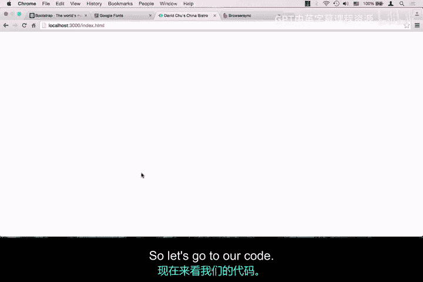

So what we have here is a standard bootstrap starter page and if you notice we kind of dropped support for Internet Exp explore9 so you don't see the shims here and you don't see that we're using jQury 1。

 something we're actually using jQury 2。1。4 so we're dropping support for ie9 hopefully the very very little number of people that still have it won't even be on the site at all so we don't want to support that so the only thing we really have here is the standard setup of the meta tagags and we put out title as David Choose China Bistro that's the restaurant name and the only thing we want to do here is we want to try to at least set up the first thing is our styles css if we go to CSs folder and there's a whole bunch of files here we really don't need we really just need the Minified Botrapmincss and that is in fact what we're including right here but just for reference if we wanted to look into them later I left all of them here probably right。

And before we deploy and what's important is that you see styles that CSS that's sitting right in this folder and we'll go ahead and open that file so the first thing we want to do here is set up some global styles that the entire page and really cross all pages will be true so we'll do that using body and we'll set up first of all the font size will set up a standard font size will go ahead and use16 pixels will set up the color and the color will be FFF。

😊，And that will give us white So it means any text that we have is going to be white and the background color that we'll set up is going to be and this is something that we actually have to look at our design。

 So let's take a look here。 So the design of the background color was this particular reddish color。

 but what we're going to do instead is use 61，1，22 f and that's going to match kind of the napkin style and the different restaurant prophernalia that we have seen in the restaurant。

 So we'll go ahead and use。😊，6，1，122 F。 and we'll give it a semicol。

 so now if we go ahead and look at our browser and for some reason didn't refresh here we go。

 now it's refreshed again should of refreshed automatically I'm not really sure what happened。

 We see now we have this kind of maroon color in the background。

 So that's our background And the last thing we want to do is take a look as to the general font and the general font here it says oxygen well let's go ahead and put the general font。

 So font font family and we'll say oxygen。😊。

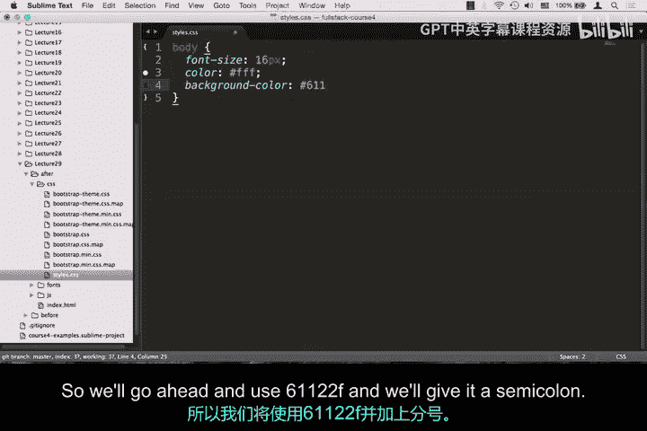

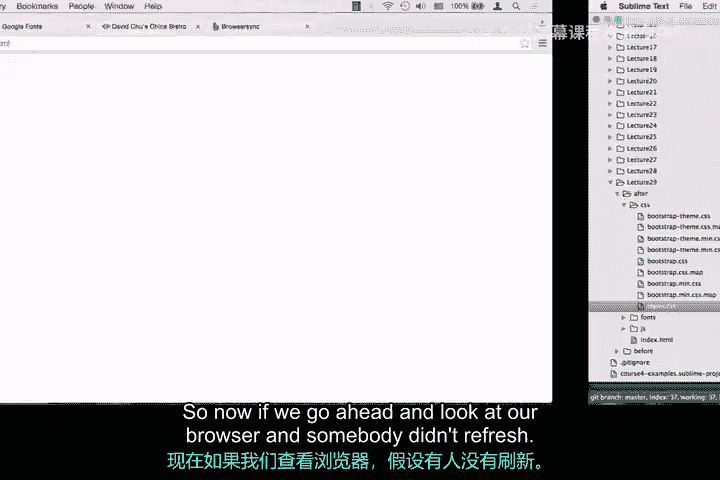

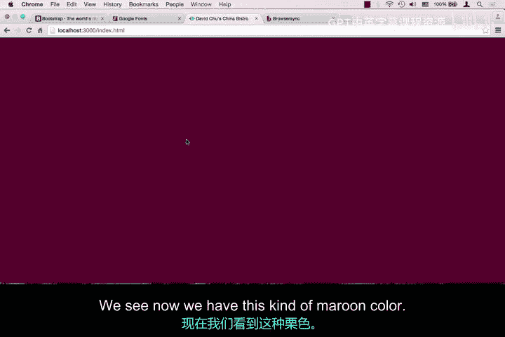

And this is really not going to work and let's take a look here and we'll just go ahead and put a simple paragraph here and we'll say hello world。

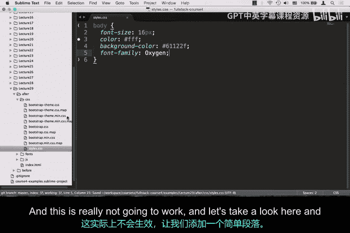

And this is not going to work。The hello world and the reason it's not going to work is because we don't really have oxygen on my machine as a font now it's very possible that actually imported it because this looks very close to what oxygen actually looks like so it's possible that imported on my machine but on regular machines you're not going have this font so how do we get this font Well the way we get this font is we could go to Google docom slash fonts and search for this oxygen。

😊。

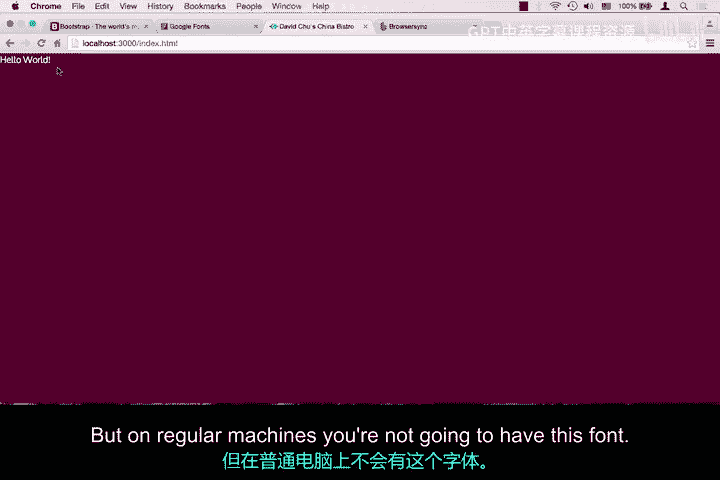

Oops， oxygen oxygen font and you'll see the first one is oxygen the second one is called oxygen monos that's a different one and a way to get that font into our page is to go to this button right here that says quick use we'll go ahead and click that and it tells us ask us well what kind of font they want't just normally want the light and the bolt we're gonna go ahead and take both and you could see that Google is telling you also how much of a load on the pages is gonna give you if sometimes these font have lots of different options and you could load it so much it will go in the red and which will mean that every page will download a lot of different kind of things about this font that will make the page load slower we don't want that but we certainly O since it's sitting in the green Now if we scroll back down a little bit here。

😊，You'll see that here's a code to add to your website while it seems pretty simple。

 we'll go ahead and select that。😊，And'll go ahead and copy。

 go back to our page and we just need to paste this link right here。And now our page has that font。

 the only thing is if you go back to the page， it tells you here's actually how you should specify it。

 we'll go ahead and use that too。 we'll copy that。 we'll go back to our code editor and we'll replace this font family with what they tell us to specify it as which is this line oxygen and sensorif in case oxygen is not available which it should be now that we've imported it from Google so now we could go to our web page let's go ahead take a look at our web page'll refresh just in case yeah and the font basically probably wasn on my machine because it's exactly the same font that's showing up So let's go back to the code editor。

 we'll go ahead and erase this we don't need that and we're basically ready to go so now we've set up our background color our default font size and we even imported a font from Google fonts we're good to go and we're ready to move on to the next thing which is going to be the header of our website。

😊。

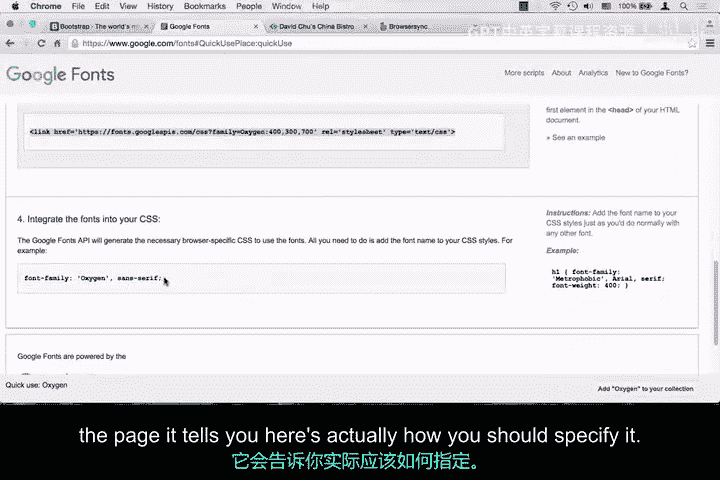

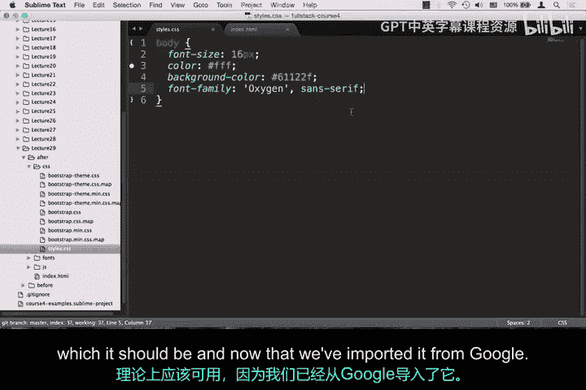

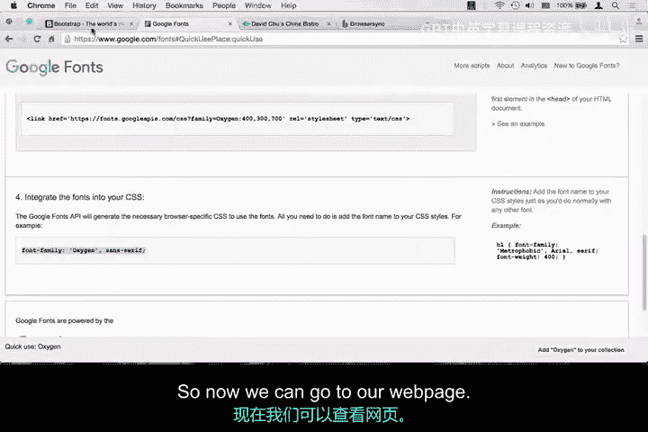

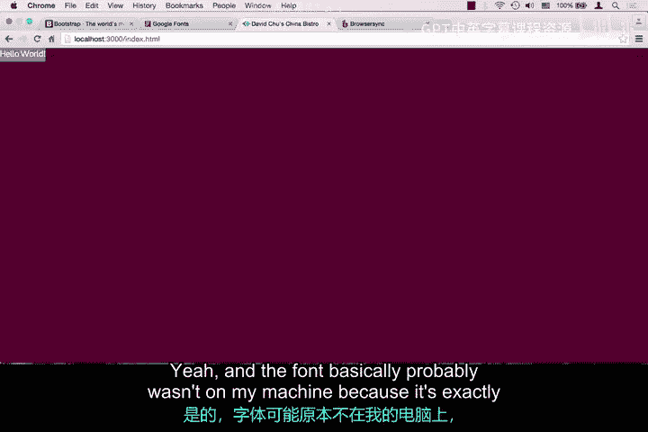

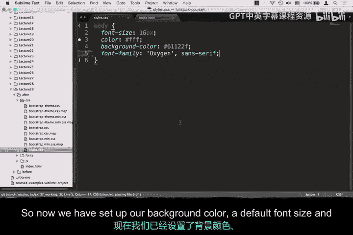

