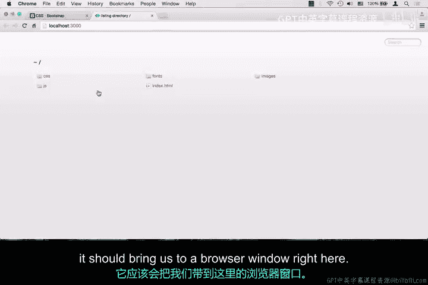
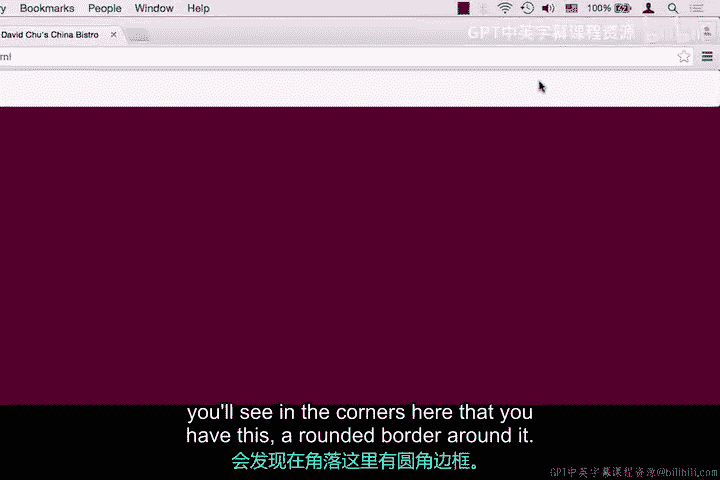
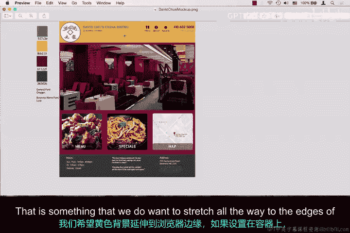
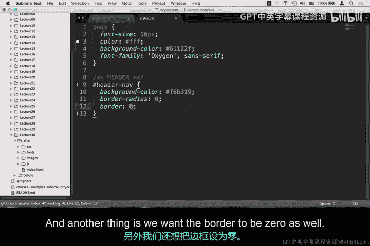
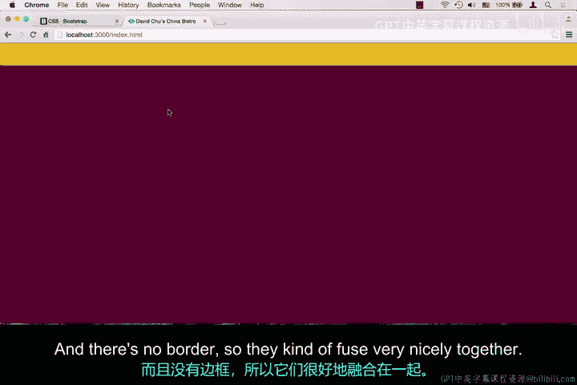
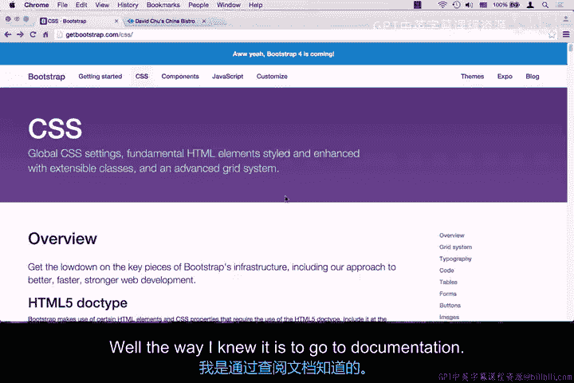
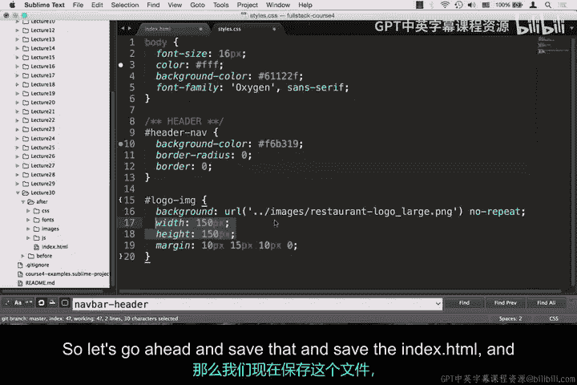
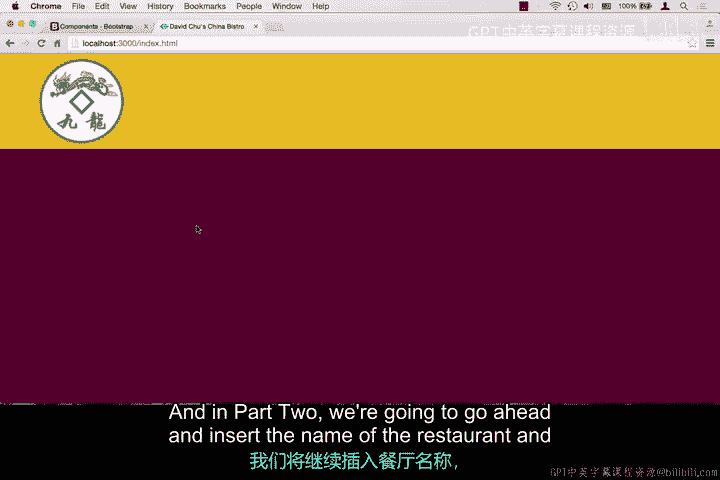

# 约翰霍普金斯大学《Web开发者的HTML, CSS, and Javascript》中英字幕 - P47：4_第30讲 第1部分 导航栏头部编码基础.zh_en - GPT中英字幕课程资源 - BV1WzY6z9EUd

Yeah。

Okay， so let's start building out our restaurant website and what I have in front of me is a mockup of the site again。

 and what we're going to start with is building out the header element of our website and you can see it right here in the top part。

Okay so let's go back to the code editor and actually before we even start coding。

 let's go back to our terminal window and start the browser sync so we can work and at the same time look at the results of our work almost immediately the first thing we want to do is want to make sure we're in the right folder let's do PwD the current directory and you could see I am in the full stack course four examples lecture 30 after folder and it's important that we're in the after folder because as you remember our entire website is going to be sitting in the either after folder or before folder depending on where where you start So let's go ahead and do a recall of our browser sync and here's our browser sync and actually there's the first onscreen mess up right here well it's not the first but it's the first one and I'll leave alone without editing it out is that this is really not going work let me show you why not this here the star part is really not going to work for us and the reason it's not going to work because if you do in L you'll see that we're going to be actually editing stuff inside the CSS folder Yeah we're gonna edit。

html file right here in this folder， but we're going to edit the inside of of the CSsS folder and eventually we'll edit inside of a JavaScript folder so what we really need actually is。

😊，Let's do the browser sync again is we need to tell browser sync that you should watch out for any folder。

 not just the one we're in， but any folder within other folders and anything inside those folders so just watch out every directory you know for the entire structure all the way down and let's go ahead and start that up。

And it should bring us to a browser window right here， so if we click indexex@ HTML。

 we should get our connected to browser sync and here's our maroon background。

Okay so let's go back to the code editor now and as you remember there is a semantic HTML5 tag called header that we could actually use for this and there it is and now let me quickly cut and paste some of the code that I prepared and we'll go overt So the first thing we're going do is create our navbar basically the navigation bar and this is going to be done by the naav element and we're gonna to give it an I called header naav and we'll see in a minute why we're gonna need that and we're going give it some classes that bootstrap provides for us and it's going to be two classes one is naavbar another one is naavbar default Now Boottrap does this a lot it will give you like a base class and it will give you then a subclass that basically uses the base class plus add something to it So there's naavbar default there's naavbar invert there's different classes that really share some of the properties of the navbar so you should really just get used to that let's go ahead and take a look as to what's going on in our browser and you can see here now on top we have this naavbar。

Defined the only couple of problems with it number one is it's the wrong color。

 we don't want this color。 We want that yellowish color。 and number two is if you look closely。

 you'll see in the corners here that you have this rounded border around it So that's something we need to put on our kind of mental to do list is still we need to fix Let's go ahead and take a look at the next inside element of that is container The container element is something you should be pretty familiar with and remember there's two types of containers there's a container dash fluid and that's the one that stretches all the way to the edges of the browser and has a bit of a padding on both sides about 15 pixels of padding on both sides and then there's the regular container that actually changes its width based on the width of the browser so it're actually not going stretch all the way to the sides of of the browser but we're kind of constrain itself to be a little bit closer to the middle and basically our entire content of our website is going to sit inside of that container or at least be aligned with this container this is going to be our header container and we're gonna have another one that's going be for the main content。

And the reason we're doing this instead of using container fluid is because our website doesn't have that much information on it。

 it doesn't have so many different things going on here。

 so if we were to let the content stretch and reposition itself all the way to the widest point。

 the width of the browser， this website would look a little bit weird。

 therefore we're going to sort of constrain the width of our content to be a particular width and know more and that way we can control it a little bit easier。

Also noticed another other thing is that the container class is sitting the dip with the container class is sitting inside of the nav element。

 Well the reason that is is because that yellow right here that is the background of our header that is something that we do want to stretch all the way to the edges of the browser and if we do that if we set the yellow on the container that means the yellow is also going stop where the container styles which is going to be really far away from from the edges of the browser at least potentially so point is that's kind of a trick is to first have a nab that you actually define the color on and then all of your content will actually sit in a container it will be much more constrained to the middle of the screen so speaking of this background color let's go ahead and go to our styles that CSS and define this header nav to be what we want I already have some code I'm going go ahead and copy and paste and there our ID header nav is going have a background color of this yellows background color and we're going to make the border radius remember the borders were a little bit around。

😊。

' gonna make it zero and I know I haven't really covered border rad。

 but feel free to go online and actually research how that works。

 We're not gonna to use it too much here。 but it's not something that's gonna take you too long to figure out。

 and another thing is we want the border to be zero as well we want to just to be a yellow color So now we're gonna save this go back to our browser and you can see the browser sync is gonna tell you that injected the styles that CSs and now we have a nice yellow background stretching all the way to the width of the browser and there's no border。

 so they kind few very nicely together。 next let's go ahead and try to place our logo in the top left of that header element let's go to our index that HTML and I have some code prepared a little bit here and let me go over it real quick So number one is we have this new element new div and has a class called naFbar header and basically if you look up the bootstrap documentation it's kind of a wrap wrappper class that a lot of other classes will depend on。

😊。

In this position in order to work properly and there's some padding that's involved。

 sometimes it floats and sometimes depending on the size of the screen， it will do other things。

 Now it's a good idea to not be scared and actually open bootstrap that css and take a look as to where this navbar header appears in what it's supposed to do However。

 obviously most of the time you're not going to be going through bootstrap that cs in order to figure out where to put which classes So how did I know to put navbar header here and wrap some items in it well the way I knew it is to go to documentation So if we look here and go under components because a navbar as a component and I'll scroll down and click on the navbar right here and scroll down a little bit more it gives you a whole bunch of different examples and it actually will tell you what to use So here you could see here that brand and toggle group together for better mobile display Well navbar header is something that is grouping this dropdown which we actually we haven't talked about yet。

😊。

And it's grouping a brand which is something we're about to work on and brand is part of your you know the branding name。

 which is what it says here and the logo of the company So it's part of the same thing so it's telling you basically this is how you should do it if you want better mobile display and that's basically how we arrived that having this content inside of a div with the class Nber header okay so moving on to implementing our logo well we're going surround our logo with the a element so the logo itself will become clickable and the logo is gonna to be nothing more than a div with an ID called a logo image because we're going to insert it as a background image in there and we'll give it an al tag logo image so the screen readers will know what that is okay so at this point we're really not going to see anything simply because we don't have any kind of image pointing to this tag yet so let's go to our styles that CSS and I'll cut and paste some code that I prepared here and we'll create this logo image and the logo image is that I that we just gave to the div and the way we're going to have the image。

We're going have a background URL which is going to point our images folder restaurant logo large do PG and we're going to make it that it's no repeat and I also know how large the images I know it's 150 pixels by 150 pixels and I need to style my div to be that wide because otherwise the image is gonna get clipped and I gave it some nice margins around so let's go ahead and save that and save the in HTML and we'll go to our browser we'll take a look as to what we have over here so there we go there's our image right there okay so this is the end of part one of the lecture and in part two we're going to go ahead and insert the name of the restaurant and position and style it nicely to the right of the logo。

