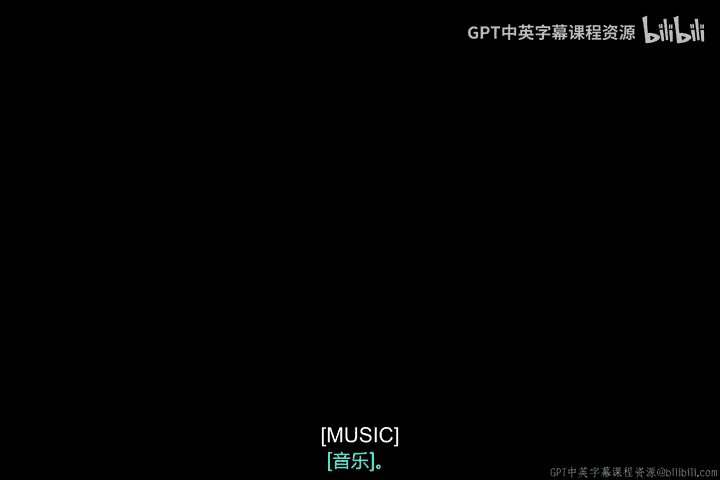
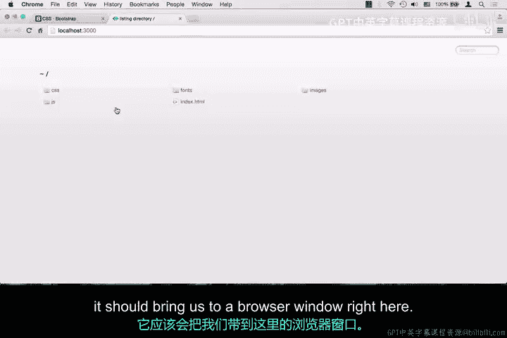
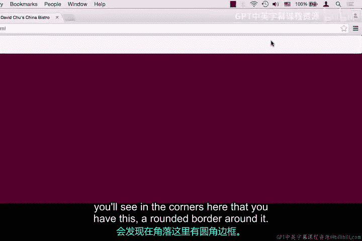
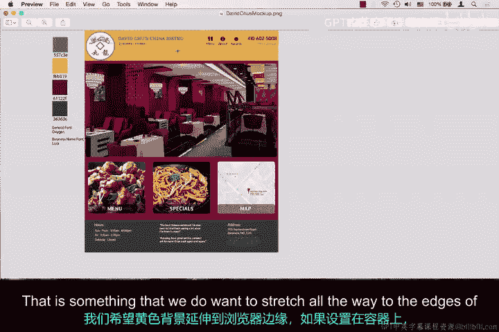
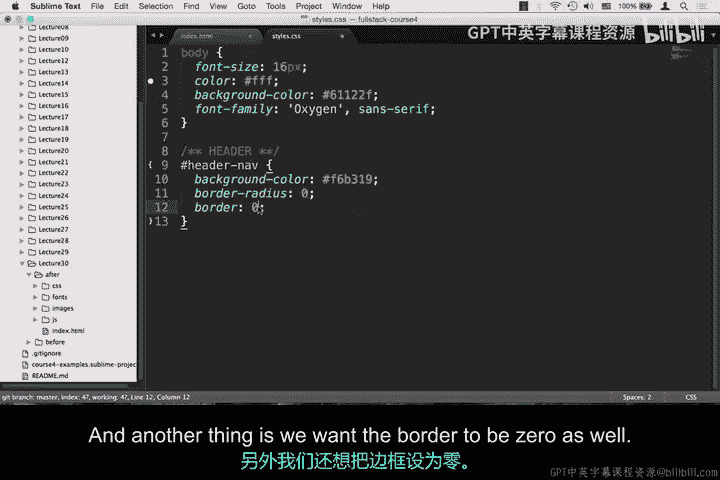
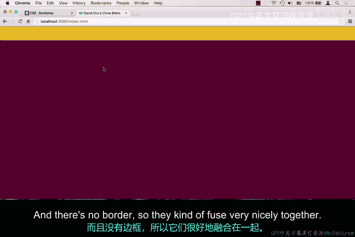
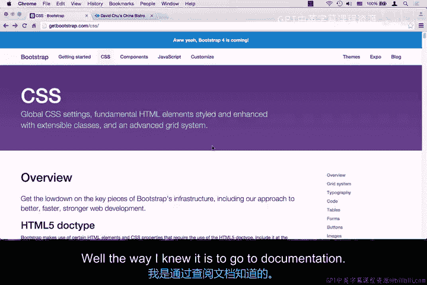
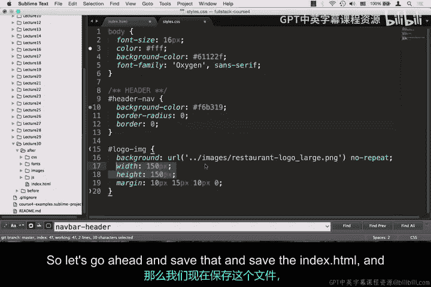
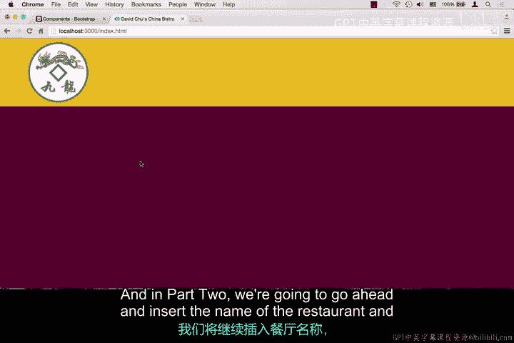
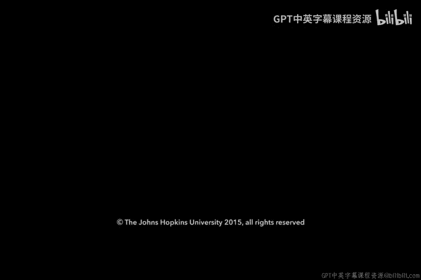

# 餐厅网站开发：第30讲：第1部分 导航栏头部编码基础 🏗️



在本节课中，我们将开始构建餐厅网站的头部导航栏。我们将使用HTML5语义标签和Bootstrap框架来创建结构，并通过自定义CSS进行样式调整。

---

## 概述

我们将从网站的头部元素开始构建。头部包含导航栏、Logo和品牌名称。我们将使用Bootstrap的`navbar`组件作为基础，并应用自定义样式以达到设计稿中的效果。

## 开始编码



首先，我们需要确保在正确的项目目录中，并启动Browser Sync以便实时查看代码更改的效果。

### 启动开发环境

在终端中，我们使用以下命令启动Browser Sync，并让其监视项目中的所有文件夹和文件：

```bash
browser-sync start --server --directory --files "**/*"
```

这个命令会启动一个本地服务器，并自动刷新浏览器以显示最新的更改。

### 构建导航栏结构

现在，让我们回到代码编辑器，开始编写HTML结构。我们将使用`<header>`和`<nav>`等语义化标签。



```html
<header>
  <nav id="header-nav" class="navbar navbar-default">
    <div class="container">
      <!-- 导航栏内容将放在这里 -->
    </div>
  </nav>
</header>
```

在上面的代码中：
*   `<nav>`元素被赋予了ID `header-nav`和Bootstrap类`navbar`与`navbar-default`。
*   内部使用了一个`container`类来约束内容的宽度，使其不会拉伸到浏览器边缘。

### 应用自定义样式

接下来，我们需要为导航栏应用设计稿中的黄色背景，并移除默认的圆角边框。这通过自定义CSS来实现。



我们打开`styles.css`文件，为`#header-nav`添加样式：

```css
#header-nav {
  background-color: #f8b400; /* 黄色背景 */
  border-radius: 0; /* 移除圆角 */
  border: 0; /* 移除边框 */
}
```

保存后，Browser Sync会自动更新页面，导航栏现在应该显示为纯黄色背景。



### 添加Logo



Logo将作为可点击的链接放置在导航栏的左上角。我们使用一个`<a>`标签包裹一个`<div>`，并将Logo设置为这个`<div>`的背景图片。

以下是HTML代码：

```html
<div class="navbar-header">
  <a href="index.html">
    <div id="logo-img" alt="Logo image"></div>
  </a>
</div>
```



然后，在CSS中定义`#logo-img`的样式，指定背景图片和尺寸：

```css
#logo-img {
  background: url('../images/restaurant-logo_large.png') no-repeat;
  width: 150px;
  height: 150px;
  margin: 10px 15px 10px 0; /* 添加一些外边距 */
}
```

保存后，Logo图片就会显示在导航栏中。

## 总结

在本节中，我们一起学习了如何构建网站导航栏的基础框架。我们完成了以下步骤：
1.  设置了开发环境，使用Browser Sync实现实时预览。
2.  使用Bootstrap的`navbar`和`container`类创建了导航栏的基本HTML结构。
3.  通过自定义CSS覆盖了Bootstrap的默认样式，设置了正确的背景色和边框。
4.  在导航栏内添加了Logo图片。







在下一部分，我们将继续完善导航栏，添加餐厅名称并对其进行排版和样式设计。