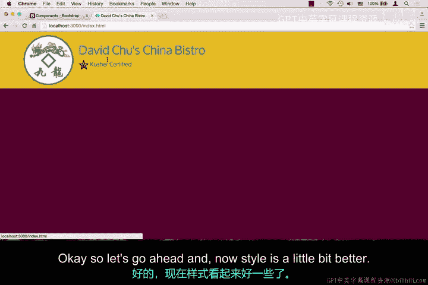
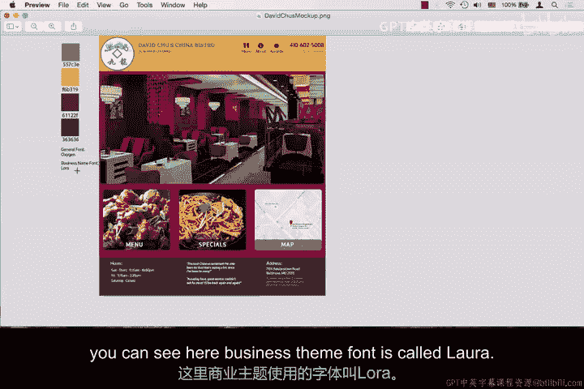
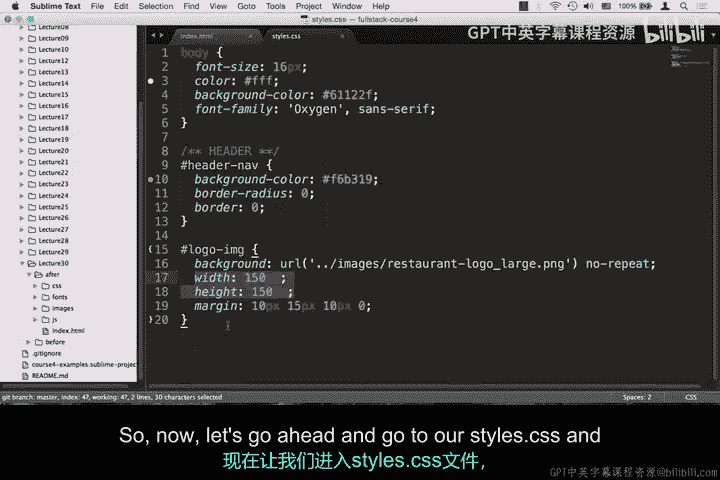
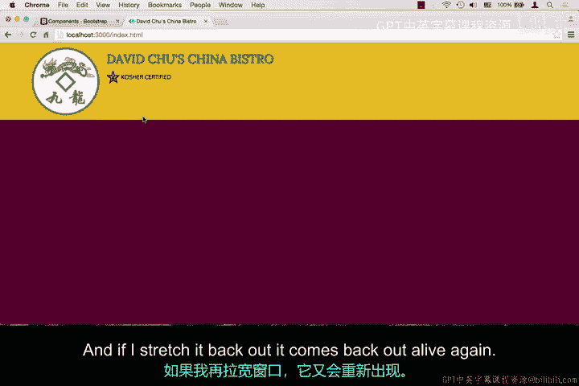
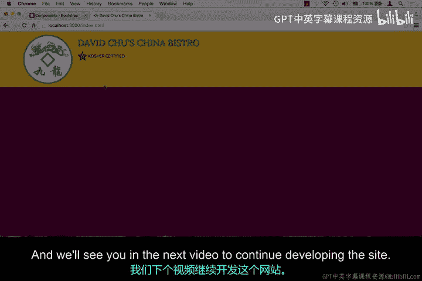

# 约翰霍普金斯大学《Web开发者的HTML, CSS, and Javascript》中英字幕 - P48：5_第30讲 第2部分 导航栏头部编码基础.zh_en - GPT中英字幕课程资源 - BV1WzY6z9EUd

Yeah。

Okay， so let's go back to the code editor and I'll cut and paste some code I prepared for the name of the restaurant and this kosher certified sign right here underneath of it。

So if I just place it the way it is now， first let me explain what's going on here。

 The first thing is this Navbar brand and this is something again。

 the bootstrap documentation will tell you that any branding like the name of the company should go into this Navbar brand under this Navbar brand class and what we're doing here is we again putting it inside of an AHR so this David Cho David Choose China Bistro will be a clickable clickable region and we're also putting it inside of H1 because this is the most important thing about the page that is the name of the restaurant so that's as far as the name of the restaurant is concerned the next thing is this little star this starcade this kosher sign and this is just a logo it's just an image and it's very small so we don't really care about responsiveness for this particular one because it is that small and then we just have a span inside of it it just says kosher certified let's save this lets go ahead and go to back to our browser and。

Quite exactly what we expected。 It's kind of pushed down here and this is kind of ugly looking But the first thing is we need to kind take this and move it right here in this region。

 The reason this going down is because this is nothing more than a div so this is a div and this is a div so obviously they're stacking one upon the other Well since David Cho China Bistro is wrapped around with a class Nava brand and that already is floated left as long as we make the logo float left we'll have nicely David Cho China Bistro aligned to the right of the logo let's go back and do that but we're going do that in a bootstrap way and the way you do it in a bootstrap is you apply in this case to this region right here。

 which is our logo and we'll apply class called pull left and pull left is basically float left and obviously we could split a style attribute here and say float left but that would make this whole thing a little bit dirty looking so which is。

stick with the bootstrap class names that they came up with。

 So if we go back to the browser look at that now everything is to the right of that because we're now floating the element with the logo Okay so let's go ahead and now style this little bit better。

 we certainly don't want this underlying link on here that's number one number two is if you look at our design the font is different and you could see here business name font is called Laura So the really first thing we should do is we should go back to our code editor and import this Laura font and I'm going impose the video real quick and import the font the same way we imported the Google fonts for the oxygen font so here's our Laura font and I went through exactly same procedure and Google co fonts in order to pull it out So now let's go ahead and go to our styles that c and we'll cut and paste some code I prebaked for our navbar brand So the first thing we're gonna do is we're gonna give it some padding。

 guess basically push it down a little bit So we'll give it。

padding top about 25 pixels and the other thing we're going to do is we're gonna style the actual name right the brand the brand name and we're gonna say Nava brand H1 that's the restaurant name and here's our lower family font。

 we're going give it a little bit of a different color the color is gonna be green This is what we are basically doing according to our design and we'll increase the font size just to Ted we'll increase it 1。

5 Ms。 and what we'll do is we'll make the text uppercase。

 so we'll all stay uppercase the entire time。 we'll bold it。

 we'll put some text shadow on it and this is something we haven't really seen before but I'll let you go ahead and research how to do this yourself。

 This is not really so hard and we'll do margin top0 margin bottom 0 and we'll decrease the line high just a little bit to kind of tighten up the whole thing。

 If you remember we also had like an underline like a link thing going on there and we really want to disable that and that's called text decoration So we're gonna do is we're going say nava brand a hover。

😊，And have brand a focus， either one， we want them not to have any underlying type of link decoration。

 we just want it to be clickable， but not look like a regular link。😊。

The other thing that's left here is to style this kosher C thing and all we're doing here is just basically giving it a color transforming the case everything to uppercase and decreasing its font size jazzat that to 1。

20。7 ms and again keeping the margin top 15 just to separate it from the actual brand that David Cho China Bistro it'll get separated a little bit more by 15 pixels and the last thing is we want to vertically align our stark span so if we look at the index that HTML there's a span here that says kosher certified so what we're doing here is we're saying that when you get to that span just vertically align that text and the reason we're doing this is because we want those words kosher certified to align in the center of that star image that' stark logo PG so let's take a look at our browser and see what we came up with not quite what I expected over here。

 you could see that this is working just nicely。And it has a nice shadow here。

 text shadow and you can see it's clickable。 but this is kind of sticking right up there。

 So let's go back to our CSs and take a look as to what we might have messed up here I can see what's going on here there's a little typo here that we need to remove was the ending of a comment that got left there let's take that out of here and see if anything else and I think that's good we'll go back and now sure enough it's displaying how we actually wanted it to begin with so that's pretty good so we're good to go here and I just want to do one last thing we don't always want to display this logo as we squeeze the browser if it's maybe a medium screen a large screen we want to keep this logo but then we're gonna if it's smaller than that we're gonna to start fighting for real estate and don't want to do that I want to remove this logo and only leave the name of the business so only when it's so let's take a look at what we could do in order to achieve that in bootstrap so if we go to index that HTML there are a couple of classes that bootstrap defines that。

You basically say that this element should only be visible at a particular breakpoint and they're called visible visible MD and what I'm saying is if the screen size is medium。

 I want this element， this AHR element to be visible but if it's anything other than at this point medium sized screen I don't want this element to be displayed well if I put that plus I also want it to be displayed when it's large so now this element will be visible when the screen is large or when the screen is medium size well let's try this out let's go back to the browser and our new styles should have already been injected so at this point if I just squeeze the browser。

😊，I make it it's medium you could see by the way how the container jumped so now it's a little bit more space here so it's going to keep our site centered here and if I squeeze it a little bit more boom it's gone and we still have to fix that at least at this particular break point but you could see now that the logo is gone and it's gone because of those responsive elements and if I stretch it back out it comes back out to life again so this is pretty good start to a header and we'll see you in the next video to continue developing the site。

😊。

