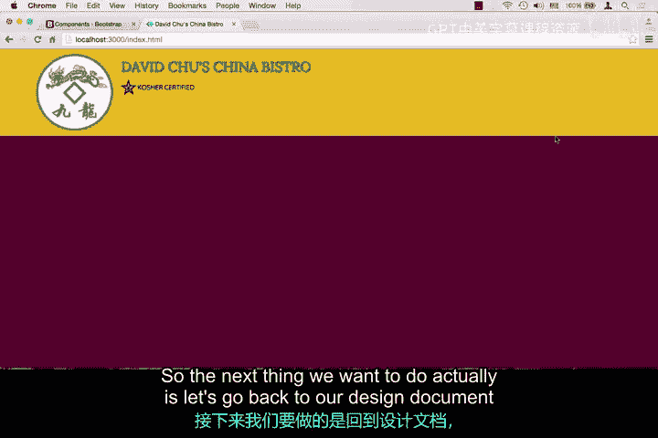
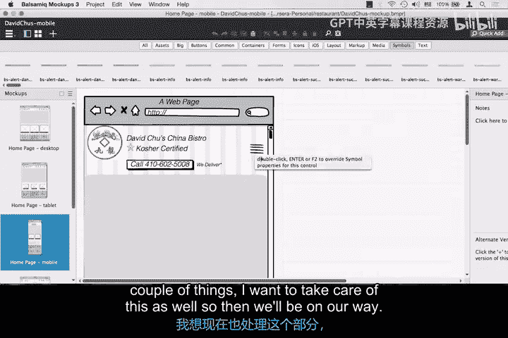
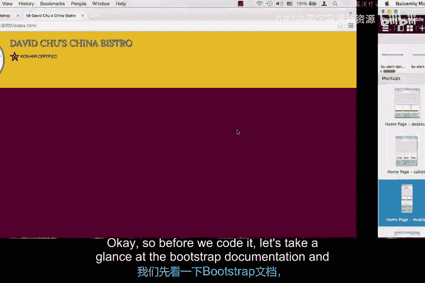
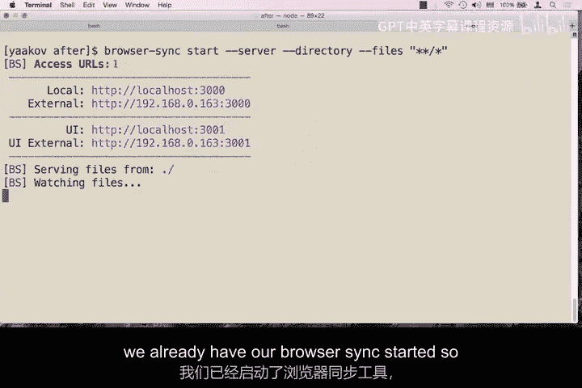
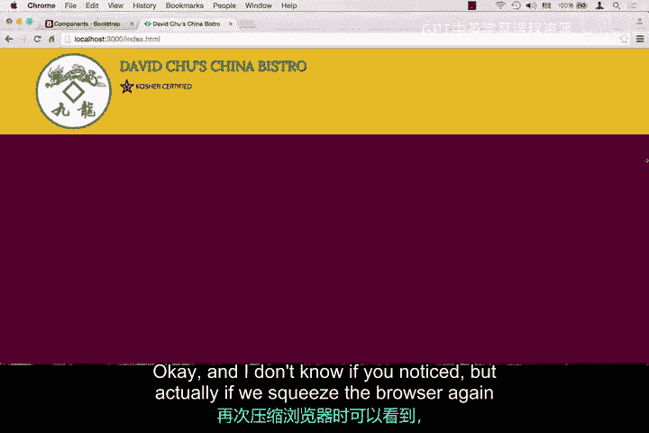

# 约翰霍普金斯大学《Web开发者的HTML, CSS, and Javascript》中英字幕 - P49：6_第31讲 可折叠菜单按钮编码.zh_en - GPT中英字幕课程资源 - BV1WzY6z9EUd

Yeah。

Okay so let's continue building out the site as a quick review here where we are so far。

 we have the logo， the name of the restaurant and this kosher certified sign and we have the logo disappearing when we squeeze the browser to be a little bit smaller right around I think medium a little bit below medium so medium and large the logo will show up but the second it becomes less the mediums and that is small the logo will disappear。

 So the next thing we want to do actually is let's go back to our design document and before we start coding the menu buttons that will show up in the header。

 these menu about awards and so on。 let's go ahead and try to take care of the mobile view of our site where those menu items will not be there and they'll be collapsed and what will be here is this button right here that will let us open up the navigation and choose one of the menu items and the reason I want to jump straight to this is because our navbar header can includes everything that will be in the mobile view So I want to kind take care。

Right now since we already took care of these couple of things。

 I want to take care of this as well so then we'll be on our way Okay so before we code it let's take a glance at the bootstrap documentation and the bootstrap documentation is really actually right here and for us to really see that that button we would have to squeeze the browser ourselves。

😊。

Let's squeeze about here and let's kind refresh it again to go to menu or to the nav bar。

 And when we scroll down， we'll see that's the same example。 And all those menu now。

 all those menu items are now below。 when you click。

 they kind of show up And here's the code that shows you the code in order to achieve that same effect。

 So we're going go ahead and do that in our own code， let's put the browser back to the max。😊。

And we'll refresh that here we already have our browser sync started so what we need to do here is I have some code that I've prepared and we need to paste it right in here where it be inside the navbar header note that I'm working in the after folder that's located inside of the lecture 31 folder so let's go ahead and paste it right here。

And here's that same code this is same code you saw on that website on the bootstrap documentation website so let me go over what we're looking at right now。

 The first thing is the class navbar toggle and that is the class that is actually controlling the positioning of this whole button and if actually well go ahead and let's go ahead and let's copy that real quick let's look at it in our bootstrap itself let's go search for it over okay so you see navbar toggle and you see that a position it's relative and it's floating to the right but if we keep looking for oops I mess that up if we keep looking for navbar toggle you'll see in a minute that at a certain media with it will be display none in other words it will only display when it is less than I believe less than medium or maybe it's small or something like that but it's all automatic I don't really remember 100% but you'll see that it will work so the navbar toggle is basically giving us our positioning and kind of styling at the same time。

The collapse class actually does not exist in Botrap if you take a look and we actually will search for go ahead and let's search for collapsed and you'll see that there's really nothing there now so what is this collapse class doing well what it's doing is signifying to a plugin a bootstrap plugin that this button isnt a collapsed state that is nobody's clicked on it yet and once somebody clicks on it this collapse class will go away but all of that is done automatically by the Botrap plugin。

 the collapse plugin and you can actually see the name of this plugin right here under data tuggle now this data dash and this data dash are HTML5 API attributes that allow jascript plugins or ja code in general to get these attributes very very easily in a standardized way now if we actually take this collapsed or collapse word and go to our not CSs but actually ja。

we'll open up bootstrapgs。 we can actually go ahead and search for collapse and you'll see here there is a plugin called collapse collapsellabgs and that is actually what's taking care of that whole pulling the menu down and pulling it back up but actually to us it doesn't make any difference We're just users of this plugin so we really don't need to know all of its gory details on the inside Now this area or arearia expand equals false that is really for screen readers and we're not really covering this course screen reader specific attributes but it's kind of got swept up in here because it is part of the documentationation to put it here and it's a good idea to leave it Now the rest of them are span and that's really again for screen reader to say toggle navigation。

 those words toggle navigation will actually never show up and it says here you could see Sr screen reader only meaning this will not show up on the actual browser screen and then we have three spans icon bar icon bar icon bar and all it's doing is putting those。

😊，Icons， those horizontal lines inside of our button。

 Let's go ahead and save that and go back to the browser and you don't see anything。 well。

 the reason you don't see anything is because our page isn't squeezed enough yet。

 so let's go ahead and squeeze and see if that button will show up。

Bm and that button shows up right around here right I don't know what that is in terms of the sizing。

 I guess we could find out real quick by opening that up So it's around it's around 700 something pixel 768767 that this button show up now few you see it the hover works but if you click it nothing is actually going on yet Well the reason nothing is going on is because we haven't really enabled that behavior in our HTMLl and we haven't hooked up the ja to it yet。

 but we will and when we do this data target is going to be very important because its value is collapsible map and that is totally a name that I made up and that name is going to be used for an ID of an element that is going to be lower down and it's going to include all of those navigation menus that will be kind of disappearing and collapsing and again expanding and so on and I don't know if you noticed。

 but actually if we squeeze the browser again， you'll see it is that our button。

It's not really styled to the rest of the site， it's kind of you know got the default Botrap styles and we're going to not leave it alone like this。

 we're going to fix that， but we're going to do that in a different video。😊。

