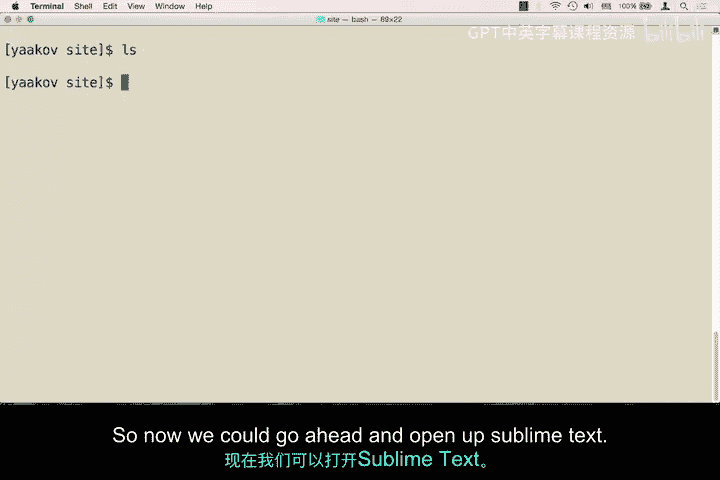
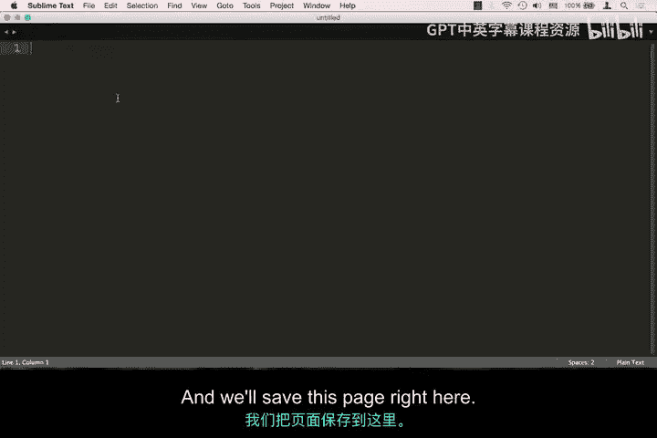
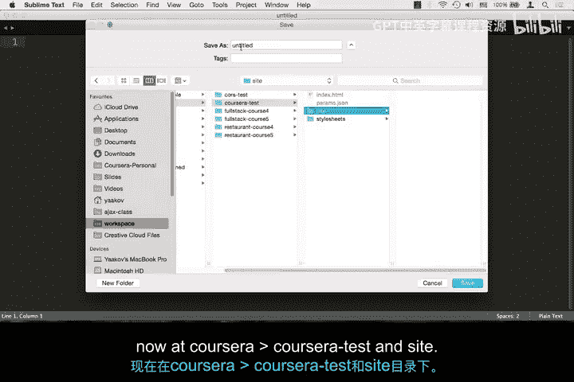
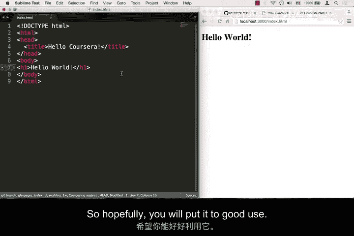
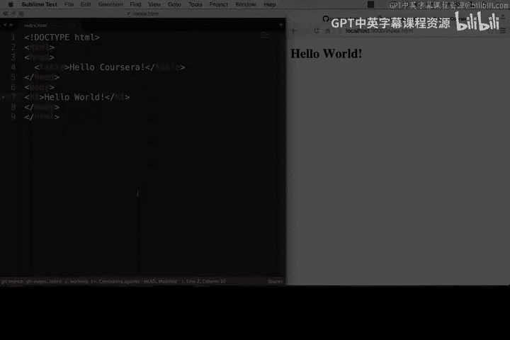

# 约翰霍普金斯大学《Web开发者的HTML, CSS, and Javascript》中英字幕 - P4：3_开发环境配置 第3部分 GitHub与浏览器同步.zh_en - GPT中英字幕课程资源 - BV1WzY6z9EUd

Yeah。

Okay so I'm back in my Mac and I'm actually looking at Github。

com and I'm already logged in into Github So the first thing we're going to do is we're going to go over how to create your own repository on Gitthub and then how to turn that repository into something you could store your code in your website code in and then have that same repository turnaround and host your website for you as part of this demonstration I'm obviously going to use some Git commands in order to commit in order to save and in order to upload our code that is local in our machine to Githubcom Now I highly encourage you to actually learn Git pretty in depth I'm not going to have a whole course here in just a lecture or so on Git I will however give you enough of the command so you'll be able to be functional but I would very encourage you to go and read at least through the branches chapter of the Gitbook and the way you could do that is it's free online you could just say Gitbook if you say Gitbook the very first。

T should come up is this Gitbook link and this is a book thing if you wanted to actually you could get a Pf or you could read the entire thing online and I strongly suggest that you read the first three chapters it's really not that complicated but for our purposes as long as you know the commands that I'm going to give you you should be okay but if you want to become a fullt developer or even just a frontend developer you should definitely try to learn Git and it's basic commands okay so I am in my account right now this is my white hike and this's my account and probably you're going to see something very similar but you probably I'm going to have as many things going on possibly in your Github account So the first thing you want to do is create a Github repository This is how you're going to basically submit your assignments as well So you could go to your picture your icon whatever it is and there's a little icon next to it to the left of it and it's a plus and if you click on it click on the down arrow you could say new repository and I'm go ahead and create a new repository we'll call it core。

Sarah。Test， and this is like I already tried that before。 So it's already knows that I've tried that。

 So Courra test， and I'll give you a green check mark saying， yes， it's available。

 And I'll just say that this is a Coursera。Coursera test repository and it's going to be public。

 if you want to make it private， you have to pay， we're not going to want to pay。

 so we're going to just leave it public and we'll go ahead and initialize it with a readme file always always a good idea。

 And all you have to do now is click create repository。😊，Let's go ahead and do that。

 And while I have my own repository ready to go。 So once I have this repository。

 I can start interacting with it not only online here。

 but also through my command line prompt and upload code to this repository but before we do any of that。

 let's prepare this repository to host our actual website to the outside world in order to do that we have to do a couple of special things number one is we have to go to settings we'll go ahead and go right here on the top right we'll click on settings and if we scroll down you'll see here Github pages automatic page generator basically it says's create a beautiful website or site for your project with our automatic Github page generator Okay so all you really have to do is click this button launch automatic page generator。

😊，And it doesn't really matter what this says， you could certainly customize it later。

 you could scroll down all the way down and say continue the layouts and by default it's going to give you this pretty neatt layout actually。

 and you don't have to even check it out， you could just click publishub page。😊。

So the layout is not really what we're after。 So once we're done with that you'll see here that your project has been created at HP and you'll see your username。

 your Github username and then the URLs Github。 io slashcosera test that's where your page is located。

 So if I go right now。And copy this link right here and we'll go to a new tab。

 you're really going to see the entire website that we just saw right here right and that's all prefil for you already。

Now this link will not always stay here if you refresh the browser it's gone。

 so how do if you forget where that link is where do you find it。

 well you go back to settings and you scroll down and on the GiHub pages， you'll see that link again。

 you can actually click it， open it up and there it is again。Now when you created the Gitthub pages。

 let's go back to our repository we'll click on this Coursera test。

 So now when you created that link， what you actually did is you created a separate branch Now I'm not going go into again the explanation a whole big explanation about branches but the bottom line is the way Git workss is it can have several branches like several parallel streams almost of the same repository of the same kind of database of your code So the way you see what branches you have is right here branch and right it says it's master click on it you'll see that there's another branch here that actually wasn't there before if we opened up before we would have seen only master but now there's another one called GH pages if you click on that GH pages you'll see all this stuff here。

 you really didn't put in here before this stuff is is that website that was created for you So that index that HTML is that big page with a giant green banner that you've seen So now if you're an advanced Github。

😊，User feel free to use whatever branch you want and then go ahead and merge your stuff into the Gh pages branch but just know that whatever is in Gh pages branch that's the only thing that's going to show up on that special link that you create it nothing in the master nothing in the other branches will actually show up So for the beginners what I would suggest doing is that you should always use just gh pages and commit everything there but just remember that the base directory is that website that got created。

 So if I were you I'll probably create a subfold and put everything into that subfold and leave this front page alone or if you want you could wipe the whole thing out and just create your own page here right here in the root folder But for now it's time to go ahead and take this repository and bring it down to our local machine Well the way we could do that is we have this right here this URL this URL actually points to our repository you could see it has coursera test and we could copy this。

By just click simply clicking this link we'll go ahead and open the terminal So now what we'll do is we'll say git clone clone is to come in to actually take the repository that is somewhere remotely and just provide the URL to that repository and you could see we're done if we do L now you'll see that I have Coursera test that is our repository right there let's go ahead and Cd into it。

😊，And you'll see that the only thing there is to read me Okay。

 so really what's going on is if you do gi status。😊。

You'll see that we are on branchch master and nothing really is right now changed The thing is though we wouldn't really want to be on branchch master again again。

 unless you're you know a more advanced user really want to be on the branch GH pages and the way you could do that is to say get check out。

GH pages and we do that now we say gi status， we're going to be on GH pages and if you do LS。

 you'll see all that index that HTML that parameterss that JsonN and style sheetets folder。

 it's all there from if you switch back to the browser， it's all right here in that branch。

So now we have a couple of choices， if we want， we could just go ahead and wipe out this whole thing and we'll basically wipe out that auto generated website or we could leave it alone and just basically make a directory make a directory and then call it。

 let's say site。😊，And Cd into that site directory。 And there's nothing there。 Great。

 So now we could go ahead and open up sublime text。😊。

And we'll save this page right here。

We'll go ahead and save this page too now our Coursera Coursera test。

And site well save it and call it index at HTML。

And we could quickly do HTML and do control space for a quick little template， we'll say hello。

 Coursera。And we'll have H1 here。Also say hello， Gursera。Okay so we have a very quick page。

 we saved it。 Let's go back to our terminal。 We'll do LLS and we see this index at HTML。

 So now to check what's going on in our local Git， we'll say Git status again and we'll see that actually dot s or that's because we're inside the site directory we say that dot slash is not actually committed at all。

 Well we could go one directory up and then we'll do Git status and they'll tell you that the site directory is not even committed and it's not even marked to be committed。

 So the way Git works in order to be committed into kind your code database which actually resides locally in your machine。

 it is not the remote one， not the Github but the local in your machine is you first have to mark something for committing the way you mark something for committing is you say Gited and then you say what it is you want to commit or that is you want to mark for committing and this point I'll say dot and we'll just include everything。

😊，In my local folder。And that's done。 I'll say git status again and you'll see now what's marked for to be committed is that new file site slash index HTMLt and once again。

 we haven't committed anything yet。 we just marked it to be committed Well。

 in order to actually commit it we'll say git commit willll say dash and which is required which is required for message and we'll give it a message message say my first。

😊，Page。We'll press enter and we're done and the only thing where we need to do now is actually put this into our remote meaning into our Github into our remote repository right now everything is sitting in the local repository and if we say Git status again you'll see that everything is great except it will tell you that your branch meaning this origin that Gh pages don't worry about this origin thing just ignore it for now but Gh pages is ahead by one commit meaning our local version of our repository all of our code is actually ahead of the one that is remote。

 which is our Github repository So the way we actually do it it actually tells you right here is just issue a Git push meaning we'll take our repository take our database of our code will push it to the remote database which is residing at Gitthub co So we'll go ahead and say Gitpush and at this point after we enter your machine might ask you if we're using。

😊，Asword for Github， My machine has it already entered automatically and you could look up on the web how to do that。

 so it doesn't ask you again。 but we'll say gi push and it should give you something like this。

 willll tell you something about the fact that it wrote into this repository and you'll see GH pages our local GH pages on our local local machine has been transferred to the remote one GH pages。

 Okay， so now if we switch to our browser。😊，And we'll refresh this page。

 You'll see that this site folder showed up here if we click inside of it。

 you'll see index that HTML。 Well， let's see if it actually works。

 We'll go to settings again because I don't remember this URL anymore and we'll click on this URL open up in a separate tab and what we see here is that page made by Github for you but we remember that right underneath that folder is that folder called site and we'd say site slash。

😊，Here's our page。 Hello Cosera。 that's the page that we made。

 And the reason I don't actually have to specify index that HTML page itself is because most servers。

 when you say slash they will default to index that HTML。

 so don't have to explicitly say it and clearly GiHub server is one of those servers and the truth is most servers out there actually do this And if we created any more subfolds here we could certainly specify them。

 And if you wanted to， for example， do assignments for different modules and you could say module1 assignment slash something and so on。

 And this is the way for you to be able to submit your assignments to us to be graded。

 And then you could continue making your changes So we'll go ahead and open up sublime we could make another change Hello Cosera it's say。

😊，Great course。We'll save it again， we'll go back to our command line。

 we'll say git status and you'll see that now we have a modified page well again we haven't really marked it to be committed yet if we're done editing it we could go ahead and say git add and we could say it's explicitly if we want to。

 or we could just say dot it doesn't matter and we edit it we'll say git status again。

And you'll see now it is again marked to be committed to be committed to the repository to our local repository。

 well， we'll say again get commit。😊，Dash M for message and we'll say small addition to our page content and we'll say enter。

 and now we're committed a change that we just made committed that change into our local Git repository but our remote repository doesn't know anything about this。

 So in fact， if we switch the browser and we'll refresh it's still the same Well。

 the reason it's still the same is because nothing really has been uploaded to Github yet。

 and if we do Git status， it will tell us again that our local branch。

 the GH pages is ahead of the remote one by one commit because we committed something already。

 and we can have more than one commit here。 we can have more than one commit and then it at some point we'll go ahead and uploaded or publish our changes to our repository。

 So we'll say Git push to publish our changes。And we're done。

 so if we switch to the browser and refresh， it might take a little bit。

But eventually this will happen， so something probably got cache here we go。

 it just takes a little bit for it to propagate from its repository to its website。

 so it took a few seconds， but it's here。Okay so there's clearly many。

 many other commands that you could use， for example。

 use Git poolol if somebody else changed your repository。

 let's say you're collaborating with somebody and somebody updated something in the remote repository in the Github and you want to get those changes to your local machine you'll say Git space pool and so on and again I encourage you to go through the first couple of two three chapters of the book and it's definitely very helpful for you to understand what's really going on with Git However the commands I gave you should be good enough to be able to publish your code to Github and at the same time publish it to Github pages so they could be visible to the whole world and to the rest of your peers to be able to be graded。

 So the next thing I would like to show you is how to use browser sync Let's go ahead and clear our page and we are still here inside the Github repository or local folder we'll go ahead and go inside site and here's our index at HTML。

 So browser syncs sync as a command you could call from。

From the command line and here I am just pulled it out from my history and basically you say browser dash sync and you say start and you want to start the browser sync and you want to start it in server mode so itll become like a local HP server for you and you could say dash directory all that will do is it will actually give you a directory listing of the folder you're sitting in right now which is in this case the folder called site and then you say dash files meaning which files should browser sync watch for and if any of those files change the browser sync will go ahead and reload those things in the browser so you don't have to keep clicking reload over and over and over again so in this case with said star want to reload everything no matter what changes I want those changes reloaded right away so I'll go ahead and start it and once I start that it will go ahead and open up a browser window for me and in this case you see it's local host on port 3000 and since with the directory it's showing me directory listing。

Of that folder， which is right now is the site folder。 So I could click an index right here。

 and I could see that it connected to browser sync。 And here's this。 It's a great course。

 So now what would be really neat is if I could now pull this asideness for a second and open up my。

😊，My sublime text and just show you what happens when you actually edit this。

 So now I could go ahead and say， you know what， let me remove this and I'll remove it。

 And the second I save it。 take a look at what happens when I save the file when I save the file all of a sudden this gets updated as well。

 So this is extremely convenient。 So that means whenever what is going on here the cascading style sheets。

 new content whatever it always becomes immediately available right there in the page。

 so you don't have to keep coming over here and clicking refresh that is a huge time saver when you're developing and trying to see immediately what's going on on the page without having to go on clicking refresh So that's browser sync。

 it actually has a million other options and I encourage you to go on their website Google for browser sync and you'll see all the options that options that it has it's a great development helper tool。

 So hopefully you will put it to good use。 at this point in your environment is all set up and you ready to move on。

😊。

