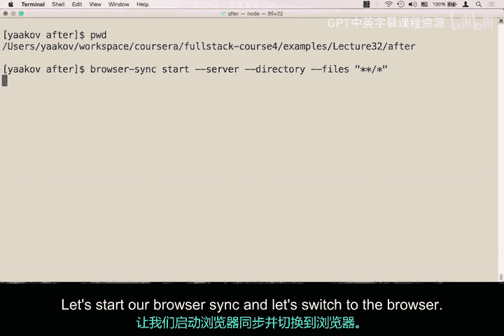
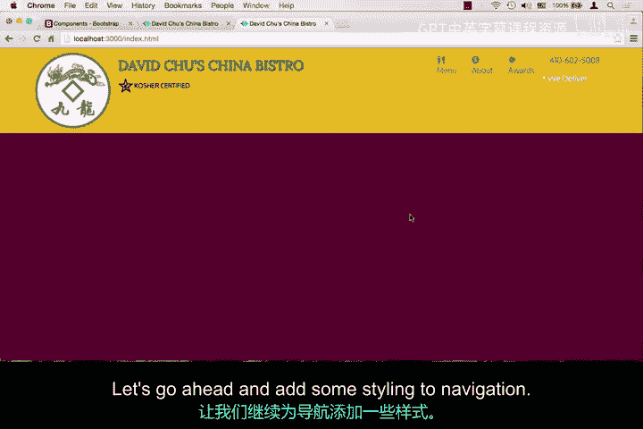
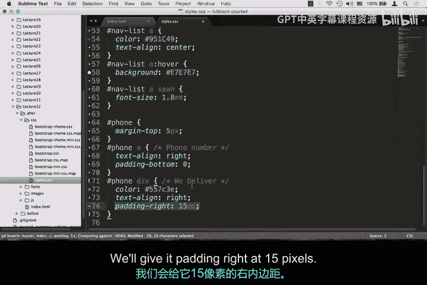
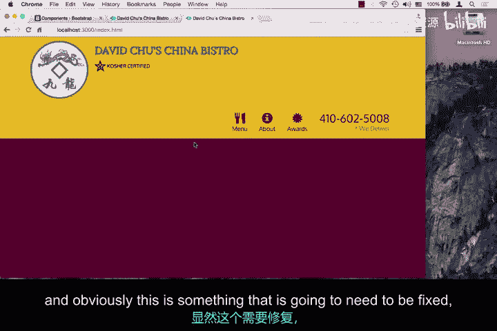

# 约翰霍普金斯大学《Web开发者的HTML, CSS, and Javascript》中英字幕 - P50：7_第32讲 第1部分 导航菜单按钮编码.zh_en - GPT中英字幕课程资源 - BV1WzY6z9EUd

Yeah。

Okay， so let's continue building our site。 And right now we're gonna concentrate on these buttons right here。

 these menu items。 So let me go back to the code editor and I'm right now located in lecture 32 after folder and I'm looking at index that HTML and I'm going go ahead and scroll down to right below where our navbar header this one right here。

 So let's let sublime text help me out here and show me where that ends right here is where it ends。

 I actually can remove this line and just put it right here So I need to put it right below where the navbar header ends because that's now not part of the navbar header that's going to show up when the main menu collapses and kind of disappears and only is accessible through this toggle button Okay so I'm going go ahead and paste some code that I prebaked and let's go over the code Okay so the first thing you see is this is the div that contains all of our menus。

 all of our navigation buttons and you see the idea that I gave this。

I collapsable naav well you've seen this before there it is collapsible nav and the way we specify or do a selector API type of ID is we put a pound sign in front of it so very much the same as CSS so here we're saying I want to select pound sign collapsible NAv which means ID that's collapsable nav well the ID collapsable nav is right here and the collapsell dojS the plugin from Boottrap will use this information right here to know where to target its collapsing kind of behavior functionality and it will know to target it right here。

There's a couple of required classes that I need to put in here。

 One is collapse another one is naavbar collapse and again。

 if you look at the bootstrap documentation， this is what they tell you to put on the collapsible menu okay so that's our container div it's going to contain all of our menu items next the way we're going to display the menu items which is very common practice to do is to create an unordered list and we're going to give this unored list an ID called naav list and we're going to target that later for styling and we're going to give it a few classes one is naav naavbar nav and naavbar right Well naav and naavbar naav is basically saying that I'm going to be a component of our navigation bar or navigation and these are the classes that basically turn our unored list into this nicely done menu right there in the navigation bar and the last class here is naavbar right Well that class is very similar to that those classes pool right pull left except this one is specifically。

For the navbar so this is naavbar right means I want it still in the navigation bar but I want it to be pulleded to the right I want it to float all the way to the right so if I actually look at our design these navigation menus they're not sitting next to the name of the restaurant they're sitting all the way to the right and actually theyre aligned to the right and the way that's done is through this naavbar right class okay so the next task is to start listing these La items and each item is going to have an a element a HR element that is going to point to some page usually within the website and not only is it going to point to it is going to say things like menu so that's going to be the actual name of the button but right next to is going to have the span with a special couple of classes Glyiccon Glyiccon cutlery and what these classes do is they are able to bring in what's called an icon font and an icon font is basically a vector based image that is able。

😊，To behave in the same way that a font would behave。 In other words， you could size it。

 you could colorize it， give it a color， basically use it the same way you use a font。

 except it's usually some sort of vector based shape。 Well， in this case。

 Glyph icon or gly icon and gly icon cutlery will give us kind of a fork and a knife and that will be our menu Also notice we're putting a break between the actual icon and the word menu。

 But we're not just putting a break。 we're putting a class on it and we're saying hidden X S which means I want this break to go away when the screen size is extra small And the reason that is is is if you could take a look right now。

 the cutle is on top and the menus right in the bottom。 Well。

 the way it's achieve this through that brake element。

 when we actually do the expending of the menu when you use the toggle button。

 I don't want the icon to be on top and make this button super thick。 instead。

 I want them to laid out the。😊，Ion and the menu or the words for the menu。 I want them to be flat。

 I want to be horizontal。 so therefore I'm going to go ahead and hide the break element at that screen size。

 and basically the same code is done for about in awards and this is again a glyph icon Now where do you get these glyph icons。

 well， actually a whole bunch of them already come by default with bootstrap and if you look at the bootstrap documentation you can actually look at these glyph icons right here。

 if you go to components and Glyph icons and you can have a whole bunch of different Gly icons。

 and it will tell you exactly how to specify it。 So in this case， for example。

 it's Glyph icon space Glyph icon star and it's the gly icon that you're going get and you are able to again style and however you want in terms of color in terms of sizing and so on just like a regular font even if you make it super big the shape of it is still going to be very sharp and clear。

😊，The one last item here that I want you to take a look at is this last L which contains our phone number and there are a couple of things here。

 number one is I'm telling it tell with a call and the phone number and what that's gonna do is that if actually somebody clicks on it or taps on it they will trigger the phone to try to call it。

 So if let's say you have calling program installed on your computer in the regular desktop。

 they'll trigger that or if you're in a mobile phone this type of setup will trigger the phone to try to call or use its phone feature to call Now notice what we're doing here we're setting up this li to be hidden XS。

 meaning when the screen size is gonna be super small I want this phone number hidden phone number together with the words we deliver just the whole thing I want the whole thing hidden So why would we want to hide this element when the screen is extra small Well let me show you when the size of my browser is mobile。

 meaning I'm on a mobile phone I don't want the phone number。

Show up as part of this menu I actually wanted to show up right across the entire width of the browser the mobile browser and I want to have actually pretty drastically different styling for it and that is why I want to hide this element altogether when we're at the screen size of extra small okay so time to save the page and make sure that we have our browser sync started let's start our browser sync。

And let's switch to the browser， we'll go through the HTML and now we see that we have some work to do in terms of styling。

 but the menu about an awards and we deliver and the phone number are all showing up just nicely let's go ahead and add some styling to the navigation we'll go to our CSS folder and we'll open up the styles that CSS。

And we'll scroll down to the available space here and I already have some code that I've prebaked especially for this。

 so let's go ahead and paste that and I'll go over this code right now so the styling starts with targeting this navlist which is an element with an ID navlist let's go ahead and orient ourselves a little bit where's this ID navlist Well the ID navlist is this UL so the entire UL is the navlist and that's kind of our anchor from where we're starting to style the rest of them。

So here all we're doing is just giving the entire menu a bit of a margin on top so the whole entire menu will just move down。

Every link within the menu is going to have a color which is that maroon color that we basically are using throughout the entire site that's the color of the napkins of the restaurant and we're also going to center it if you remember the menu。

 the text at least of those menu items was a little bit shifted I think it was shifted to the left but or to the right but anyway we need to make sure it is aligned line center and we' also need to let the users know when they move the mouse over the menu that their mouse is in fact over the clickable region so therefore we're going to do this nav list a hover and we're going to give it a little bit of like a light close to white type of a color as a background。

And the text of those menu items was a little bit too small so we're gonna to increase it at about 1。

8 ms so that's about 80% increase so it'll stand out a little bit more than just a very small text for the phone here we're going to give it a margin top of5 pixels just to move it down a little bit and the actual phone number will again align to the right because we want to go all the way to the right of the edge of the design and we'll give the bottom padding of zero so it's actually right there at the bottom so it's not pushed up in any way right next to or right below the phone number I should say we have this we deliver message and it's going to be in green just to stand out and the text align will align it again to the right similar to the phone number the phone number and the words we deliver will align its right edges and just to align it with the phone number exactly we' go ahead and give the padding right for that we deliver message we'll give it patting right 15 pixels。

ahead and save that and take a look at what our website looks now well looks much better look at this now when we roll over we could see that there's a background color that shows up on every one of those things and so is the shop on the phone number which I'm actually not so crazy about but we'll probably fix that later and we deliver as you could see is also aligned very nicely with our phone number。

And you may or may not have realized， but since we put all the IDs in right places。

 this should now work then when we squeeze the browser and obviously this is still something that is going to need to be fixed that's way too low at this point but if we squeeze the browser and get to our collapsible menu state when we click in this the menu we show up and it's a real menu and selectable and we click on it again it will go away and all of that is really done completely out of the box。

 we really didn't write any code to do this this is something that Botrap already provides Now one thing besides this is obviously needs to be styled a little bit better but the one thing we do need to styled right away is this collapsell button and that's exactly where we're gonna pick it up in the Part two of this lecture。

