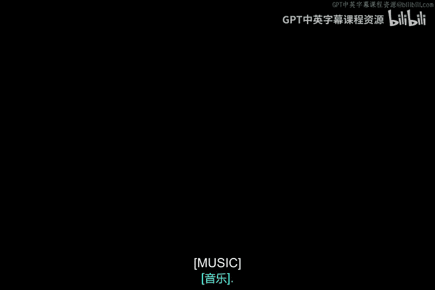
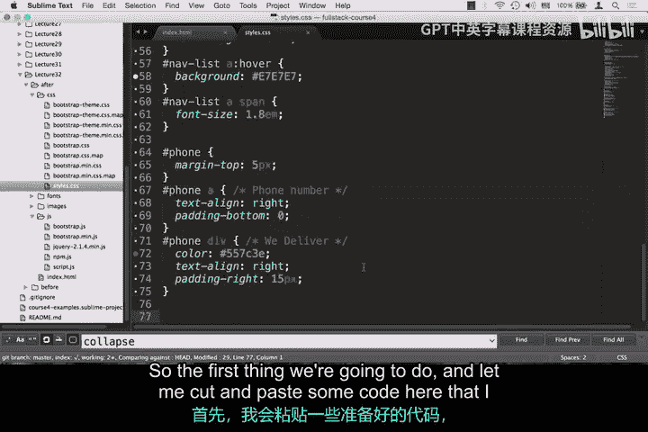
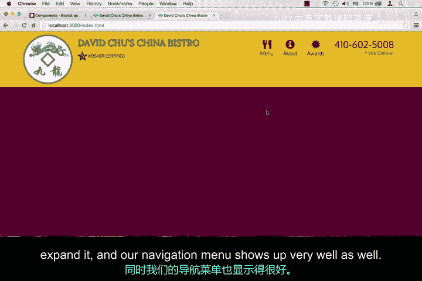
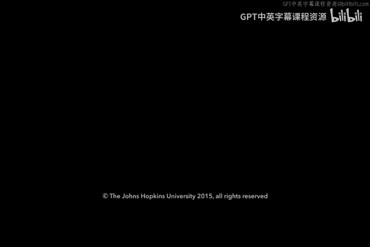

# 约翰霍普金斯大学《Web开发者的HTML, CSS, and Javascript》中英字幕 - P51：8_第32讲 第2部分 导航菜单按钮编码.zh_en - GPT中英字幕课程资源 - BV1WzY6z9EUd

Yeah。

In the last lecture we coded and styled the menu items for the main screen as well as the collapsed version in this lecture we're going to pick it up and start styling the button that opens up and closes the collapsed mobile menu。

Let's go ahead and go back to the code editor and we'll give it some more styles to fit into our overall theme。

 So the first thing we're going to do and let me cut and paste some code here that I prepared is we're going to change the color over the borders around the button。

 So you could see here we're targeting by saying navbar header that's where we want it inside of that。

 there's a button that has a class called navbar tuggle and also naavbar header when there's a class inside that's called icon bar all those lines we want to target with this border that's going to be a little bit more maroon。

 that's same background color that we have for the rest of the site。

 So if we actually take a look at the site now you could see that now the color is how we want it。

 It's the maroon or whatever it is kind a napkin color borders。

 Oh and the reason this is showing up as kind of a whitish color in the back is because it's currently selected。

 we haven't really written code to kind make it disselect automatically。 So if we actually click。😊。

Out of it。 you'll see that the button has a rollover effect and when you actually select it and leave it alone like that。

 it still stays selected。 if you click out of it， it will be yellow again。

 so that will fix a little bit later For now however。

 let's take a look at this yellow line here you could see that it's kind of right against the name of the restaurant and this is spilling over Well the reason it's happening is because as you know from the floating lecture from before is that since this is being floated everything else is kind of collapsing to the minimum height so we could fix that by just simply applying the clear property let's go ahead and do that right now let's go to our cs file and I'll cut and paste some code that I prepared for this and we'll close this。

😊，Currently brace。We'll save it and we'll go back。 and we could see it's no longer collapsing。

 It's actually now including all of those things together。 Now there's still a problem with this。

 I don't really think we want to keep the name of the restaurant in this gigantic font even on a small mobile browser。

 that's just not really going to work。 So what we really need to do is kind of squeeze both of those things together and make it much tighter and much smaller font and make this whole yellow section much smaller。

 Well， we could do that by simply applying a negative margin on this navbar header button navbar tagggle。

 And let's go ahead and do that。 and it's kind of going to undo a little bit as to what we just did。

 let's give it about negative 30 pixels。 and we'll go back to the site。

 And as you could see we made the height of this yellow region a bit smaller。 and unfortunately。

 it kind of has undone the things we did before with removing the collapsing of the floating element。

 Well， the real way to。😊，Fix it is actually to make these things smaller and make them fit into this region and not make this region any bigger and we're going to do that in a different lecture。

 but for now we have our toggle button and it's working just fine and we're able to squeeze the browser and expand it and our navigation menu shows up very well as well。

😊。

