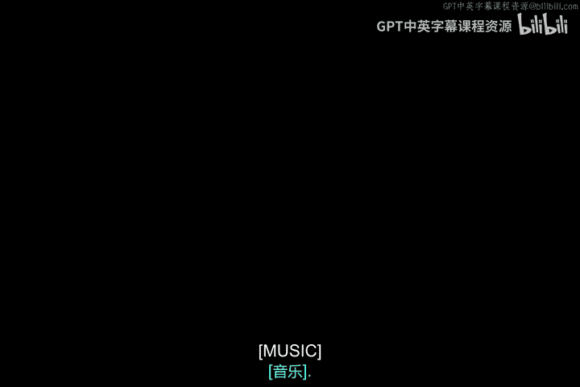
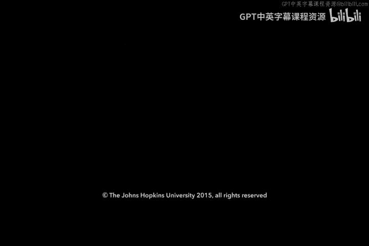

# 约翰霍普金斯大学《Web开发者的HTML, CSS, and Javascript》中英字幕 - P52：9_第33讲 第1部分 修正导航栏布局文本与下拉菜单.zh_en - GPT中英字幕课程资源 - BV1WzY6z9EUd

Yeah。

In a previous lecture， we saw that there was a bit of a problem with our layout when we went from the wide screen to a little bit more of a medium screen。

 So let me show you what's going on。 So if I go over here and I cross the 1200 pixel break point this thing jumps and it goes over here and that kind of looks unseemly we really want this a little bit higher up。

 the reason this is happening is because this div right here and this div they're both floated and since we kind of running out of room on this one row just like any other float element。

 it just gets pushed to the next row and it's still floated right。

 So that's why it's still over here and not moving over here。 So let's verify that。

 let's go ahead and select this right here and that's our header navbar header and if we decrease its width let's say 400 and you can see it jumps over here right so since we made this smaller it jumped over here Well let's refresh that for a second we really don't want to decrease the div entire。

😊，What we really want to do is actually make this logo a little bit smaller it's kind of a candidate to be made smaller anyway since we have a smaller screen and we want to make the image a little bit smaller and also kind of save a little bit on bandwidth as well so let's go back to our code editor and I'm located in lecture 33 in the after folder and I'm going to bring up my styles that CSS and obviously we are up to breakpoint which means we need to write our own media queries and I kind of wrote out some of the media queries we're going to need right here and we're gonna to have a media query for large devices with minimum width of 1200 pixels and it's going to be a medium device with a range of between 992 and 1199。

The small one is going to be between 768 and 991 and extra small will be basically max with is going to be6767 pixels Now I didn't make these up I actually took them verbatim from with bootstrap or how bootstrap subdivs and creates its breakpoint okay so what we're targeting at this point is the medium devices one and I already have some code that I could just copy and paste over here that would make our logo a little bit smaller and here it is so we're targeting our logo image and we're changing out the background URL the background image URL to a different logo it's a different file it's restaurant logo underscore medium that Png and it's smaller in size so before I think it was 150 pixels by 150 pixels and now it's a little bit smaller and the padding perhaps is a little bit smaller as well this is something you basically have to tweak a little bit yourself you there's no point of doing this on screen once it looks good。

Then you're good to go so let's go ahead and save that and let's go look at our browser and  whileila look at that。

 So now we're a much better shape we could see that this thing shrunk。

 this logo shrunk and therefore give us enough room here to have a few buttons and now if we squeeze it at certain point at the small breakpoint right here the logo will completely go away and this will at this point not fit here anymore and it will slide right under our brand name or the name of the restaurant and actually this looks pretty good so I'm okay with that and not really having to fix that because this to me looks nice and compact and as we go closer this something still needs to be fixed but at the medium and the small breakpoint we're now we're now good to go so in the large breakpoint we're also good you could see the image keep switching sizes at this point so we're good there。

Okay， so it seems like the only thing we need to start fixing here is when we get all the way to the small screen。

David Cho' Cha Bistro looks pretty good， but it's probably too big and certainly this spillover is not good either。

 So let's go ahead and go back to the code editor and we'll try to fix that。

 We'll scroll down to the extra small device。 Let's go back and recheck。

 We're now below 767 pixels So we're in a small in the extra small range and let me go ahead and cut and paste some code that I prebaake for this。

😊，Okay， so let me go over this code right now so the first thing is on the Navbar brand we want to do a couple of things number one is we want the padding to decrease a little bit I think it was 15 pixels before we're making it now 10 and also want to set a concrete height for it so we don't rely on the whole thing collapsing around it so we want to limit it to 80 pixels but at the same time set a concrete height number two is the restaurant padding is also going to decrease a little bit I believe it was larger before now it's padding top to be 10 pixels。

And the font size is something we haven't really seen this type of unit before it's5 VW what does VW stands for well VW stands for viewport width and one unit。

 so if let me create a little note here is one unit of VW VW is equals to1% of viewport width。

And the reason we're using these units is because these units are responsive， in other words。

 as the screen keeps us stretching and being squeezed。

 this is going to be the font size is going to be relative to the screen width and this is what we want here and five seems just about right for that and this is one of those responsive font size units that has been introduced a few years ago。

 but at the same time it is very widely supported among just about all the browsers。Next。

 what we're going to do is we're going to decrease the font of our kosher certification that kosher Cert and that's just the word kosher certified。

 and we're going to keep it all in uppercase and I believe we probably already have this before and we could check this real quick。

And I see that the restaurant， the naavba brandandt P already had the kosherer already had operacase。

 so if we scroll back down， we really don't need this anymore。

 we could just take that out so that's kind of duplicate and we're going to also give it a smaller margin top and just to constrain the stark that star that we saw over there that star image we're going to give it a height so we can actually center that kosher certified together with the star image and will'll align nicely So let's save that and go ahead and go to our web browser and we could see now that the name of the restaurant is bigger than before so now it's filling up a little bit more space since we removed the logo and this kosher certified is sitting nicely within the yellow region。

 So if we stretch this back out， this should switch back to the previous size of the restaurant name and you give it more content in the header and as we stretch all the way out。

It will now show the logo of the restaurant and obviously as we go beyond the 1200 pixels。

 the logo of the restaurant is going to become much bigger and let's go back to our small size and here's where our small size you could see the name of the restaurant is stretching depending on how wide the screen is Okay so that's it for part one of this lecture and in part two。

 we're going to turn our attention to styling the dropdown menus。

