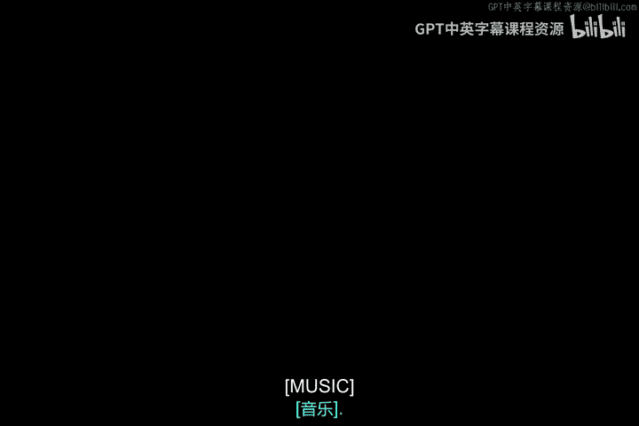
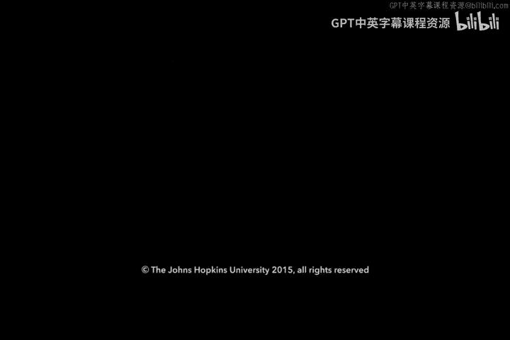

# Web开发者的HTML, CSS, and Javascript：P52：9_第33讲 第1部分 修正导航栏布局文本与下拉菜单



## 概述
在本节课中，我们将学习如何修复导航栏在不同屏幕尺寸下的布局问题。我们将通过编写媒体查询来调整Logo大小、优化文本样式，并确保导航栏在各种设备上都能良好显示。

---

在上一讲中，我们发现在屏幕从宽屏切换到中等尺寸时，布局出现了一点问题。

让我展示一下具体的情况。当我将屏幕宽度调整到1200像素的断点以下时，这个元素会突然跳到这里，这看起来不太美观。我们更希望它能保持在稍高一点的位置。

这个问题的原因是，这里的这个`div`和另一个`div`都设置了浮动。由于这一行的空间不足，就像其他浮动元素一样，它会被推到下一行，并且仍然保持右浮动。

这就是为什么它仍然在这里，而没有移动到那边。让我们验证一下。

让我们选中这里的元素，这是我们的`header-navbar-header`。如果我们减小它的宽度，比如设为400像素，你会看到它跳到了这里。因为我们把它变小了，所以它跳过来了。让我们刷新一下，我们实际上并不想减小整个`div`的宽度。

我们真正想做的是让这个Logo变小一点。在屏幕变小的情况下，Logo本身也是需要缩小的候选对象，这样既能适应小屏幕，也能节省一些带宽。

让我们回到代码编辑器。我位于第33讲的`after`文件夹中，我将打开`styles.css`文件。显然，我们现在需要处理断点，这意味着我们需要编写自己的媒体查询。我已经在这里写好了我们将需要的一些媒体查询。

我们将为大型设备（最小宽度1200像素）、中型设备（宽度在992到1199像素之间）、小型设备（宽度在768到991像素之间）以及超小型设备（最大宽度767像素）分别设置媒体查询。这些数值并非我随意编造，而是直接取自Bootstrap框架定义其断点的方式。

目前，我们针对的是中型设备。我已经准备好了一些代码，可以直接复制粘贴到这里，让我们的Logo变小。代码如下：

```css
@media (min-width: 992px) and (max-width: 1199px) {
    .navbar-header .navbar-brand .logo {
        background: url(../images/restaurant-logo_medium.png) no-repeat;
        padding: 0;
        width: 100px; /* 示例值，需调整 */
        height: 100px; /* 示例值，需调整 */
    }
}
```

我们针对`.logo`图像，将其背景图片URL更换为一个不同的文件：`restaurant-logo_medium.png`。这个文件尺寸更小。之前的尺寸可能是150x150像素，现在会小一些，内边距也可能相应调整。这需要你自己进行微调，直到看起来合适为止。

让我们保存代码，然后查看浏览器。现在情况好多了。我们可以看到Logo缩小了，从而为按钮腾出了足够的空间。

现在，如果我们将屏幕挤压到小型设备的断点，Logo会完全消失。此时，导航内容将无法完全容纳在这一行，它会滑到餐厅品牌名称的下方。实际上，这看起来相当不错，很紧凑，所以我暂时不打算修复它。

在大型和中型断点下，我们的布局现在都正常了。你可以看到图片会根据断点切换大小。

---

看起来，我们唯一需要开始修复的是当屏幕变得非常小（超小型设备）时的情况。

餐厅名称“David Chu‘s China Bistro”看起来还不错，但可能太大了，而且文字溢出的情况肯定也不好。

让我们回到代码编辑器，尝试修复这个问题。我们将滚动到针对超小型设备的媒体查询部分（`max-width: 767px`）。

让我粘贴一些预先准备好的代码：

```css
@media (max-width: 767px) {
    .navbar-brand {
        padding: 10px 15px;
        height: 80px;
    }
    .navbar-brand .restaurant-name {
        padding-top: 10px;
        font-size: 5vw;
    }
    .navbar-brand .kosher-cert {
        font-size: 0.8em;
        margin-top: 5px;
    }
    .navbar-brand .star-image {
        height: 20px; /* 示例值，用于垂直对齐 */
    }
}
```

现在让我解释一下这段代码。

首先，对于`.navbar-brand`，我们想做两件事：一是将内边距减小一点（之前可能是15像素，现在设为10像素）；二是为其设置一个具体的高度（80像素），这样我们就不会依赖周围元素的自动收缩来定义它的高度。

其次，餐厅名称的内边距也会减小一些（`padding-top`设为10像素）。字体大小单位我们使用了`5vw`。`vw`代表**视口宽度**。`1vw`等于**视口宽度的1%**。我们使用这个单位是因为它是响应式的，也就是说，随着屏幕被拉伸或挤压，字体大小会相对于屏幕宽度而变化，这正是我们想要的。`5vw`这个值看起来比较合适。这是一种几年前引入的响应式字体单位，并且得到了几乎所有浏览器的广泛支持。

接下来，我们将减小“Kosher Certified”（犹太洁食认证）文字的字体大小，并保持其大写。我们可能之前已经设置过大写，可以快速检查一下。如果`.restaurant-name p`已经设置了`text-transform: uppercase`，那么这里就是重复的，可以删除。我们还会给它一个较小的上边距。

最后，为了约束那个星形图标，我们将给它设置一个具体的高度，这样“Kosher Certified”文字就能和星形图标很好地垂直居中对齐。

让我们保存代码，然后回到浏览器。现在可以看到，餐厅名称比之前更大了，因为它填充了更多空间（Logo已隐藏）。同时，“Kosher Certified”也很好地放置在黄色区域里。

如果我们把屏幕拉宽，餐厅名称应该会切换回之前的大小，并且在头部显示更多内容。当屏幕宽度超过1200像素时，餐厅的Logo会再次显示出来，并且变得更大。

回到小尺寸屏幕，我们可以看到餐厅名称会根据屏幕的宽度进行拉伸。

---

## 总结
本节课的第一部分到此结束。我们一起学习了如何通过媒体查询响应式地调整导航栏的布局。我们修复了Logo在中型屏幕下的显示问题，并优化了超小型屏幕下的品牌文本样式，使用了`vw`单位来实现字体大小的自适应。



在第二部分，我们将把注意力转向如何为下拉菜单添加样式。