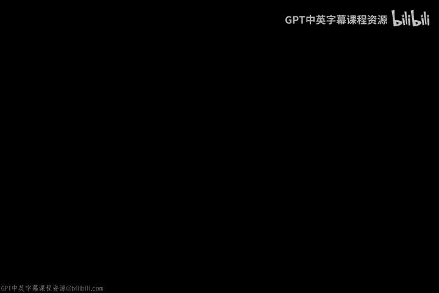
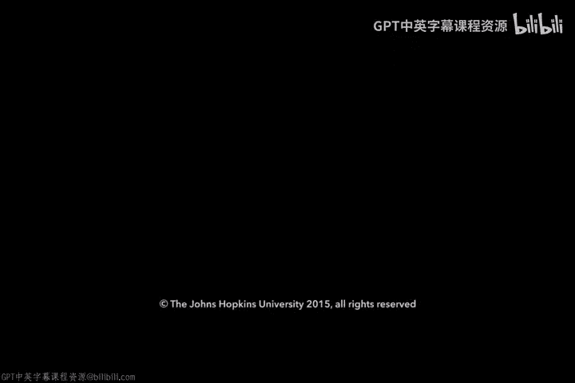

# 约翰霍普金斯大学《Web开发者的HTML, CSS, and Javascript》中英字幕 - P53：10_第33讲 第2部分 修正导航栏布局文本与下拉菜单.zh_en - GPT中英字幕课程资源 - BV1WzY6z9EUd

Yeah。

In part one of this lecture， we concentrated on styling the menu when the browser was in full screen desktop mode in this lecture。

 we're going to talk about styling the menus when they're in the drop down mobile mode。

 Let's take a look at our collapsed menu over here。 And you can see there's a bit of a problem。

 The Glyph icon looks way too big， especially comparatively to the menu。 So what we really want。

 especially given that this is a font icon is for both these things。

 the font icon and the word menu and the text over here to really be the same font size。First。

 let's go ahead and investigate why there are indeed two different font sizes。

 Let's right click on this menu text right here and click inspect。 So here we are on that a element。

 that link element。 let's go and click on the text itself and let's go ahead and try to scroll and find the first time that font size is mentioned right here。

 So it should be right around here somewhere and there it is the first time font size is being mentioned and it's not cross style which means it is applicable to our element right now。

 it's coming from styles that css that's our file and it's going for 16 pixels。

 So this menu item right now， the menu text， I should say it actually 16 pixels what about our Glyph icon。

 The Glyph icon is really just a span above it So or inside this ahf So let's go ahead and click on the Glyph icon and it'll scroll all the way up and let's take a look。

 the Glyph icon actually is getting its sizing from pound sign。😊。

A followed by a followed by span and it's also coming from styles that CSS。 Well。

 we kind of want to overwride that。 We want to overwride that and we'll overwrite and make our menu just a little bit bigger it's a little bit too small Let's go ahead and go to our code editor and already have a style here that we can apply and I'll go ahead and cut and pasteed right here and this style will take that 16 pixels that we're inheriting for that a element from the body element that's been defined and it's going to bump it up just a little bit。

 So we're bumping it up about 20% So 1。2 m So if we save that right now go back to our browser and you could see that the menu became a little bit bigger Well so did the Gly icon obviously because the Glyph icon is sitting inside right right now it's 1。

8 Well 1。8 became 1。8 of whatever the menu was because the menu is kind of sitting inside of the a element which encompasses。

😊，This Glyph icon so let's go ahead and change that and since we want the Glyph icon to be exactly the same size as the menu item well we just then want to inherit whatever the menu items font size is onto the Glyph icon well the way to do that is to make sure that the span has one m as its font size in other words I don't want you to change anything from whatever I'm inheriting。

 I want you to be 100% of whatever it is that I'm inheriting and I should be inheriting this point the font size from the a element Well the problem is at the moment I am actually overr it directly with having a and I don't want to obviously put anything new there but I'm overwriting right now with the ID followed by an element and followed by another element Well we know all about specificity in CSS so we could overwrideite that very easily by just specifying that let's copy that and so that's ID followed by an element followed by N。

😊，Ement so that would overwride that and all we need to do is just say font size1 m and that is basically instructing the browser to overwride whatever font size this specific selector had and overwrite it with 1 m which will in turn take whatever its parent element had and keep it exactly the same well itss parent element had 16 pixels times 01。

2 which is about 19 something 19 something pixels or 19。

2 or so and it will keep it right here so if we save this and go back to our browser。😊。

We should now see that they're both looking pretty good and just about the same。

 One last thing here is they look way too close。 And I think we need to put a margin on one of them。

 for example， we could put them on the actual glyph icon。 We could put margin right。

 I would say about five pixels or so。 So let's go back here and give it a margin。Right。

 five pixels will save that， go back to the browser。

And now the drop down menu is looking much better， and it seems like we're done with the menu。

 at least for this stage of the website development。

