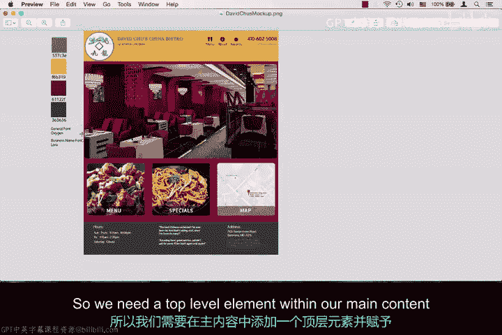
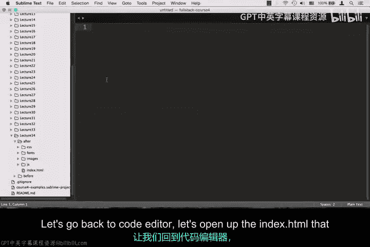
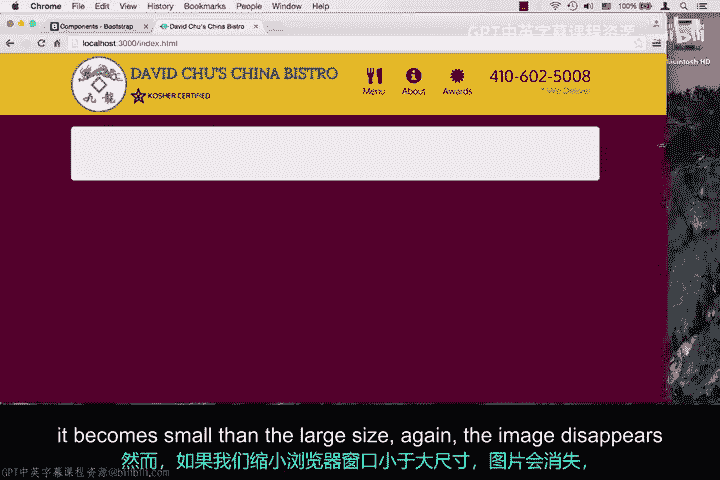
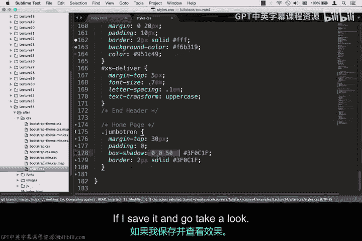

# 约翰霍普金斯大学《Web开发者的HTML, CSS, and Javascript》中英字幕 - P54：11_第34讲 巨幕区域编码.zh_en - GPT中英字幕课程资源 - BV1WzY6z9EUd

Yeah。

So now we're ready to embark on actually doing the main content of the page and what we're going to start with is this giant picture of the restaurant of the interior of the restaurant。

 which is actually what's called a Jumotron in bootstrappe however before we start we're going to have to define some element that is going to be a container for everything that is inside of our website and that's simply because remember we put in the container our header and we want everything nicely aligned to its edges so we need a top level element within our main content to have a container class assigned to it let's go ahead and start with that let's go back to our code editor let's open up the index at HTML that is located at this point in the examples lecture 34 after folder and we'll go ahead and scroll down right below our cold button right here and we'll open up another div。

We'll say do that container。And we'll press tab and that's the Em plugin that's helping me do this and we'll actually give it even an ID so that way later it will be much easier for us to target it。

 we'll call it main content。Main content okay so here's our main content and now we're ready to code up our jumotron Well the way we're gonna to code out our Jumotron is we have a whole bunch of images in the images folder and you could see Jumotron they all are sized very differently The first one is 768 that one is 768 pixels wide then there's Jumotron 992 that one is 992 pixels wide and finally the 1200 one is the biggest one there and obviously what we want from this is to be able to substitute different pictures different resolutions depending on the screen size So assuming the smallest screen size。

 the smaller device and it's probably mobile and therefore we don't want to waste our bandwidth So let's go ahead and create a div that is going to contain our Jumotron we'll press tab here and that's the div and what's going to happen is we're going to assign a background CSs property to this div and it's going to load the image responsively meaning depending on the media query。

😊，That is going to appear and is going to load different size image However， we have one limitation。

 We can't stretch and contract the image when it is sized that way as a background image and we need it to stretch and contract when it's very small and I'll show you in a minute what I mean I'm going to go ahead and paste a little bit of code here and I prebate this code for you before and what it's doing is it's creating an image tag and the image tag is taking the smallest jumpmotron picture there is and assigning some alt text and this is the most important part here。

 the classes the class Ig responsive comes from bootstrap and basically what it says is as I change the width of the browser the width and the sizing of the image is going to change proportionally and that's very important for us something that really can't do with a background image very well and also I'm only going to make this visible when the screen is extra small which means if I save this right now and go back to my browser。

😊，I'll see that this is showing up， but the image is not showing up， but if I squeeze the browser。

All the way to extra small you'll see that the image actually showed up so I want only this IG tag to show up when it's extra small。

 but for higher widths of the browser I am going to use a background image in order to size the image notice that we already see the effects of our container div you could see how the edges of our header are aligning very nicely with the edges of our main content。

Okay， so let's go back to our code editor and we'll open up our styles that CSS file and we'll go ahead and load our Jamottron images in its proper media query so the first one is going to be for the large devices right here and again I'm going to cut and paste some prebaked CSS。

So here's our jumotron。 And what we're doing is basically we're adding to overriding some of the properties that the bootstrap jumotron class had。

 So number one is we're assigning a background URL to be the largest jumotron image there is and we obviously don't want to repeat that and we're setting its height because as you know background image don't affect the height of the element。

 So therefore we need to set the height and we're giving it some buck shadow and something that you should look up how that works。

 It's very， very simple and we're giving it a two pixel border So itll stand out a little bit better。

 So let's save that and go ahead and look at our browser to see how that looks。

 So here's our jumotron and you could see that we have the border。

 some of the buck shadow going on around it and it's looking pretty nice However。

 if we squeeze the browser a little bit and it becomes smaller than the large size again the image disappears obviously because we haven't really assigned an image to that size So we'll go ahead and go to our。

😊。

Medium devices only section of the media query and we'll go ahead and paste another jumpotron image and this one is going to go right here and here is some prebaked code that I have and again。

 the background URL now is going to be 992 that should match the lower bound of this media query and I'm decreasing the height a little bit as you could see the box shadow is basically the same and the border the same。

 Now we still need to repeat these because we didn't really factor it out and we didn't put it outside of the media queries。

 So we need to repeat these parts， but it's not such a big deal I guess in the future。

 we could pull it out of here altogether and put it outside of either media query that way they could share it。

 So let's go back and check what works。 So now we should be by the medium size it should switch to a smaller image that's good。

 that's working。 but when we get the small again it's not there So let's go back to our code editor and we'll go to the small devices and again I have some prebaked CS that。

readyro prior to this lecture so we'll go ahead and cut and paste that here and you can see now I'm using the lower bound JPG jumpmotron that's matching this and the height again is a little bit smaller and the box shadow and the border again are the same So if I save that and go back to my browser so now I have the largest image at this size a little bit smaller image of this size。

And yet， even smaller image at this size。And when we get to this size。

 we still need to do some styling， but at least you could see that the smaller image is showing up and every single time this is something that when you obviously go on a real device that's going to be a particular size that means only one image will download that's actually a little bit incorrect because we do have this image that we are always loading。

 which is that small image and that's really going to not really hurt us too much on the larger device sizes but when it's in a super small device size which is irreg cell phone that's the only image that's going to load because the rest of them aren't going to load at all theyre not even being targeted for that screen size so let's go back to the browser and take a look here you could see that when we do squeeze it all the away even though the image shows up we aren't really sizing it properly and we're certainly not giving it the right borders let's go back to the code editor and once again I'll go to styles that CSS and I we go。

😊，to the super small here， a screen size the extra small screen size and what I'll do is I will paste some code here that I prebaked again for this and is going to overwrite that jumboron I should say add to the Jumboron class it will set some margins。

 give it some padding the back shadow and at this point it should be pretty much good to go if I save it and go take a look。

Hmm， that's not exactly what I expected， I certainly didn't expect to see these white lines。

So let's figure out why these white lines are showing up。

 let's go ahead and right click and inspect element and we'll go ahead and choose that div that jumboron class we've been styling and let's take a look here Well I think I could see what's going on here we have padding right and padding left so let's if we take them off。

Right now it looks perfect。 Now why isn't our padding， Let's go back to our code。

 We did specify padding 0， but that that doesn't seem to have taken any effect。

 Let's go back and take a look。 And if you look closer， you see what's going on。

 I'll give you a second。Well， it's that old good old specificity that's again getting in our way。

 you see the padding is specified with dot container class container followed by a class jammotron or class fluid container fluid followed by a class jamotron well the problem is if you look at our specificity we only have one class and they define it with two classes so all we really should be able to have to do is just say container and say now container followed by Jamaron save that we go back to the browser and look at that now it's actually exactly how we wanted it。

😊，In fact， it's probably a good idea to take this container jamotron combo and actually go through every single place where we specify jammbotron and actually use that specificity so you know we don't get tripped up by this again。

 let's go ahead and replace that everywhere and replace that here as well。

And now when we go back to the browser， we should be good to go and if we stretch the browser right in every single screen size。

 we see that it's working just fine as you could see the responsive。

 the IMG responsive class from Boottrap is letting us now go to the IMG tag at this size and letting us stretch the image back and forth and as we get to a higher size。

 now it's just a background image and therefore it's just going to stay static but keep jumping every time we go to a different screen size。

One last thing is we're specifying a couple of properties namely borderor and bucksha every single time that we specify container Jaotron well I think it's probably a waste so let's go ahead and take that out and put it into a style that's outside any media query that way we're only going have to specify it once and not have to specify every single time for every media query which seems a little bit wasteful right so let's take that out of here。

Now that we are outside the media queries， let's go ahead and create a class called Dot container。

Container that jumboron。And we'll cut and paste those two properties right here。

And now it should be like that everywhere and that's actually part of the homepage。

We save it and we go back to the browser and everything should pretty much work as it was before and as jumping through different sizes。

 as you can see everything is working。😊，At least seems to be working just fine。Okay。

 so our jumboron is working and we're ready to move on。

