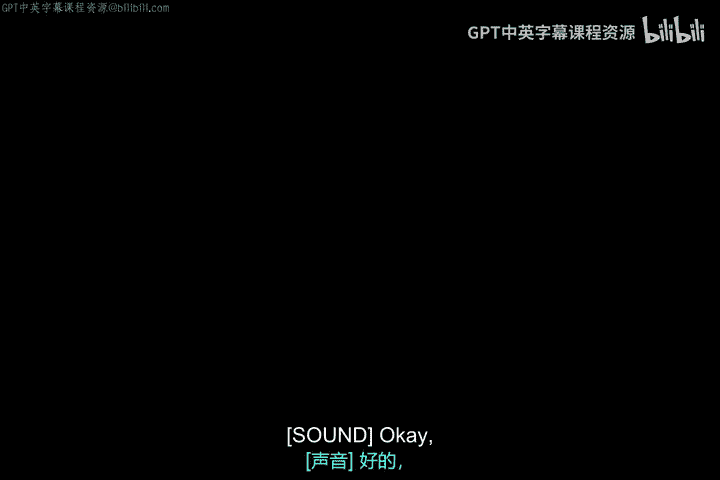
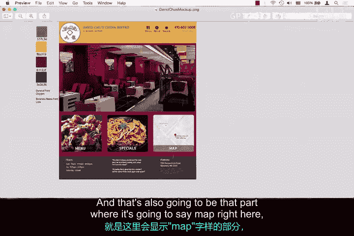

# 约翰霍普金斯大学《Web开发者的HTML, CSS, and Javascript》中英字幕 - P55：12_第35讲 第1部分 导航模块编码.zh_en - GPT中英字幕课程资源 - BV1WzY6z9EUd

Yeah。

Okay so now that we're done with the jumboro right here。

 our next task is to code up these tiles over here and these tiles are the menu。

 the specials and the map Now it's worthwhile to take a look at how these tiles is supposed to behave when they're in a smaller device so this is a view of the larger the desktop view basically this is I believe the tablet view and you could see it's basically about just about the same but then when we get to the mobile version you see that what we want to do is to have the menu and the specials stay on top but the map should basically slide down and now take up two spaces so it will be nice and even between two of them and finally on the very last one if we have it here but we actually don't have it here listed but obviously when it becomes super super small we want them all to just stack one upon the other menu specials and the map。

Okay， so let's go to a code editor and see how we can accomplish it。

 So I'm looking right now at index that HTML， which is located in examples lecture 35 the after folder and this is the index that HTML okay so we still want it to be part of the main content and this is our div for the main content that ends right here and we want it to be just right under the jumotron so we'll put it right about here and since the whole main content is already a container then I don't have to provide another container remember that every bootstri grid has to be inside of a container or an element that is marked with a container class so I don't need to do it that anymore but I do need to define a row so I'll go ahead and define my row。

😊，And there it is right here and I'll even give it an ID we'll call it home tile。

 so it'll be easier for us later to style this， you know have this kind of as a base。 Okay。

 so let me copy and paste some of the code that Ive prem for this lecture and I'll go ahead and go over it afterwards let me close this div actually right here and we'll take a look at it。

 Okay， so again， we're inside the row and now we want every class for the desktop we' concentrate on desktop first for the desktop we want M4 M4 and again M4 which means we're gonna have you know they all add up to 12 which means every single one of them is' gonna take a third of the screen and therefore we're gonna have these three tiles on MD So at the medium screen and above this will become a three tile type of layout。

Moving on down at the small level， meaning at the smaller screen size， so it's columns small。

 the first two are column small6， so they'll take up half the screen and the third one if you take a look is 12。

 So when we're at the small screen size， the first two will take out half the screen each and therefore we' take one basically row and the third tile will slide down kind of to the second row。

 even though it's not a technically a bootstrap second row。

 but itll slide down and it will stretch the entire width of the grid。

 So therefore it will basically equal to the first two columns because they're six and6 and finally at the smallest level at the extra small screen we want every single one of those things to stack one upon the other and therefore we're doing extra small 12 So now it's going to take up the entire width of the screen at the smallest screen size which is probably going to be mobile before we look at the browser let's go ahead and take a look at the contents of each。

😊，These tiles that I'm kind of calling them tiles at least in my mind they are So each one of them is going to have a link AH and the first one is going to point to menu categories In other words。

 when the user is going to click on the menu item which is what this is going the menu tile I should say which is what this is going be I don't want to display the entire menu item item by item to them instead I want to display menu category to them and then let them choose a menu category that will show them the menu items for that menu category So the way that's broken up is we have a link that is surrounding a div and the div has an ID menu tile and inside that div。

 we have a span called menu and the reason I'm breaking them out like that is because the div with an ID menu tile is going to be something we're actually going to size and make a particular like square rectangle looking thing and the span the menu span we're actually going to position absolutely within the。

Dive of the menu tile and since if you remember take a look at our design here。

 let's go take a look at our design real quick you could see that this is smack on the bottom right here and I always wanted to stay in the bottom and the way we're going achieve that is we're going to size the square right here and then make it relative which means all its children can now be positioned absolutely and we're going to be very easily positioning them right at the bottom without having to worry about this element's overall position on the screen so it will be absolute but it'll be at the same time relative to the tile within which it's going to live。

😊，Okay， so that's that and the second one is going to be exactly the same one is the second tile is going to just point to specials so it're going to have a special category called specials and let people basically jump to that category straight away and for now we're going to make these separate pages but as we build out the site we might make a different decision as to how we're going to host these particular pages and present this information。

The last style is going to be the map and I purpose really left it out because I want to show you how I would embed a real map so but the structure of the thing is going to be about the same we're going to still have a and A element。

😊，And we're gonna leave the hf of it alone for now and what we're going to do is we're going to define a target of underscore blank and the reason we're going define a target underscore blank is that if somebody clicks on this of this map I don't want them to forget about our restaurant website so it will automatically either open a new window or usually it will just open a new tab and this is kind of a controversial topic a little I mean I've seen some people say that that's not very nice for users to do。

 but overall I think everybody agrees that the user is going to forget about your site if you willingly and easily take them to a different website and basically have no other way other than a back button to get back to your site so it's probably easier just to open in a separate tab and let them look at the map and the restaurant site is still going to be around still open their browser so they won't forget about it so inside the Atag I'm going to still have a div and the div is going to will give it an ID so。

be easier to select it later， I will say it map tile。

 so these ones are supposed toll be right home tiles， so each one is either ID menu tile。

 special style one in this case is map tile。And if the site sold crocodiles it'll be another one called reptile I just had to do it。

 I couldn't hold myself back anyway so this is the div within which the map is actually going to go。

 this is where it's going to live and it's actually going to be a knife frame。

 but I'll show you how I'm going to embed it in here but one last thing we need to do in this div is that span element that is going to say map and that's also going to be that part where it's going to say map right here。

 this little element span。

Okay， let's save it and let's go ahead and take a look as to what it looks like in the browser and just like I thought there's really nothing much to it yet。

 we have some links here， but we really didn't style any of the actual tiles yet we just have bunch of you know a bunch of links here showing up Let's go back to the code editor and open up our styles that CSS and we'll scroll down to the homepage area。

😊，Whi I should have somewhere here。 Here's the homepage。 Here's our Jumotron。

 and let's make a couple of spaces here。 and let's go ahead and style these tiles。

 I already wrote some styles for this。 So let me go ahead and copy and paste a couple and we'll go from there。

 So here is the styles for the sizing of them。 So first of all。

 we're going to select every single one of them and we'll put a common in between。

 so we can share the styles because they're really supposed to look about just about the same at least on the desktop browser right So first of all。

 I'm going to say that their height is going to be 250 pixels They're with each one is going to be 100%。

 Well， I don't really mean 100 percent of the screen obviously， I mean。

100 percent of whatever their container element is going to be and let's go ahead and take a look as to what the container element I'm talking about。

 So this is that div right here。 and the div is sitting inside the anchor element。

 the a element and that's sitting inside the div。 this is the div that。😊。

Going to get sized by the bootstrap grid system so therefore what I'm essentially saying is is that I want this div。

 this div that encompasses the label and the entire contents of it。

 I want it to be as wide as this grid will allow me to be。

 which is at the point where it's going to be a desktop browser going to be a third of the web page。

Okay so let's go back to the styles that CSS and keep reading here。

 So margin bottom I want the margin bottom the 15 pixels so this is more for when it starts sliding one underneath the other and also to separate it a little bit from the footer that's going to come right below it and this is the important part here I want all of them are important but this is the positioning part position relative So position relative as you remember will not actually move this style anywhere but it will set up something like an anchor for the rest of the child elements of whatever these ideas are so now I'll basically be able to position them absolutely within this element and I'll give it a nice border and it's gonna be a maroon solid border two pixels and overflow hidden that's really there to clip anything that you know we end up having to stick out a little bit and for the most part that's really going to be the map I don't think the rest of the content is actually going stick out because it's not going to be an iframe we're actually gonna size the other elements very exactly but。

😊，The iframe is a little bit harder to control We also want to give a user some sort of indication when they position their mouse over these tiles that if they're in fact about to select something so we're really going just provide a bit of a gray shadow around our border just to let the user know that they're about to select something if their mouse is over it so let's go ahead and save that and let's take a look as what it looks like in the browser and now it' starting to look a little bit better so now I can actually roll my mouse over it and I can see that the border select there's obviously no content inside of it yet but we'll go ahead and stop here for part one of this lecture and in part two we're gonna to start filling out the content we'll put the pictures in and start styling the labels of these tiles。

😊。

