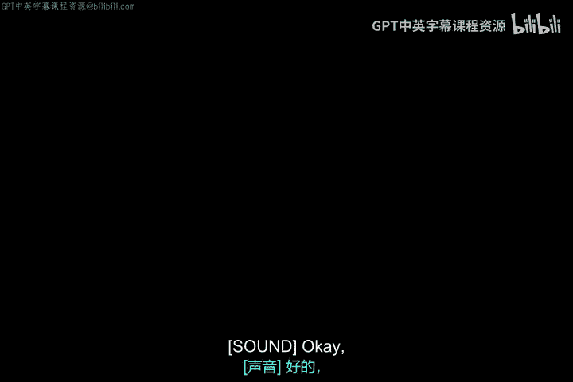
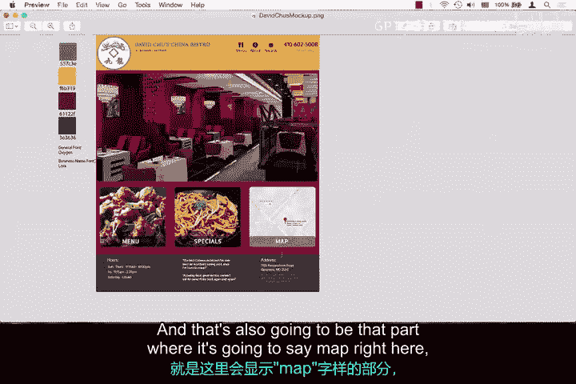

# Web开发者的HTML, CSS, and Javascript：P55：12_第35讲 第1部分 导航模块编码 🧱



在本节课中，我们将学习如何使用Bootstrap网格系统来创建响应式的导航模块（或称为“磁贴”）。我们将构建三个磁贴，分别代表“菜单”、“特价菜”和“地图”，并让它们在不同屏幕尺寸下（桌面、平板、手机）以不同的布局方式呈现。

上一节我们完成了Jumbotron（巨幕）部分的编码。本节中，我们来看看如何构建其下方的三个导航磁贴。

## 分析设计需求 📱

首先，有必要了解这些磁贴在各种设备上的预期行为。
*   在桌面视图下，三个磁贴并排显示，各占屏幕宽度的三分之一。
*   在平板视图下，布局基本与桌面视图相同。
*   在移动设备视图下，我们希望“菜单”和“特价菜”磁贴并排显示在上方，而“地图”磁贴则滑到下方，并占据一整行的宽度。
*   在超小屏幕（如非常小的手机）上，我们希望所有磁贴垂直堆叠。

## 编写HTML结构 💻

现在，让我们转到代码编辑器，看看如何实现它。我们将在 `index.html` 文件中，Jumbotron `div` 的下方，主内容容器内添加代码。

由于主内容已经是Bootstrap的容器（`.container`），我们无需再添加一层容器。但我们需要定义一个行（`.row`）来放置我们的列。

以下是核心的HTML结构代码：

```html
<div class="row" id="home-tiles">
  <div class="col-md-4 col-sm-6 col-xs-12">
    <a href="menu-categories.html">
      <div id="menu-tile">
        <span>菜单</span>
      </div>
    </a>
  </div>
  <div class="col-md-4 col-sm-6 col-xs-12">
    <a href="#">
      <div id="specials-tile">
        <span>特价菜</span>
      </div>
    </a>
  </div>
  <div class="col-md-4 col-sm-12 col-xs-12">
    <a href="#" target="_blank">
      <div id="map-tile">
        <span>地图</span>
      </div>
    </a>
  </div>
</div>
```

### 网格类解析

以下是每个 `div` 上Bootstrap网格类的含义：

*   `col-md-4`: 在中等（medium）及以上屏幕（如桌面），每个磁贴占据4列。由于Bootstrap总共有12列，`4+4+4=12`，因此三个磁贴将并排显示。
*   `col-sm-6`: 在小（small）屏幕（如平板），前两个磁贴各占6列（即半屏宽），第三个磁贴占12列（即全屏宽）。这会导致第三个磁贴（地图）滑到新的一行。
*   `col-xs-12`: 在超小（extra small）屏幕（如手机），所有磁贴都占据12列，即垂直堆叠。

### 链接与内部结构解析

每个磁贴都包含一个链接（`<a>` 标签），其内部是一个带有特定ID的 `div` 和一个 `span` 标签。

*   **链接 (`<a>`)**:
    *   前两个磁贴的链接指向网站内的页面（如 `menu-categories.html`）。
    *   地图磁贴的链接设置了 `target="_blank"`，这会在用户点击时在新标签页中打开链接，确保用户不会离开我们的餐厅网站。
*   **内部 `div`**: 这个 `div`（例如 `#menu-tile`）将被我们用来设置磁贴的尺寸、边框和作为内部元素定位的参考点（通过 `position: relative`）。
*   **内部 `span`**: 这个 `span`（例如包含文字“菜单”）将使用绝对定位（`position: absolute`）被放置在磁贴内部的特定位置（如右下角）。

## 编写基础CSS样式 🎨

现在HTML结构已经就位，但还没有样式。让我们在 `styles.css` 文件中为这些磁贴添加基础样式。

我们将首先为所有磁贴共享的样式编写规则。



```css
#menu-tile,
#specials-tile,
#map-tile {
    height: 250px;
    width: 100%;
    margin-bottom: 15px;
    position: relative;
    border: 2px solid #3F0C1F;
    overflow: hidden;
}
```

以下是每个CSS属性的作用：

*   `height: 250px;`: 设置磁贴的固定高度。
*   `width: 100%;`: 设置磁贴宽度为其父容器（即Bootstrap网格列）的100%。这意味着它会自动适应网格系统分配的宽度。
*   `margin-bottom: 15px;`: 为磁贴底部添加外边距。这在磁贴堆叠时能提供间距，并使其与后续的页脚内容分开。
*   `position: relative;`: 这是关键的一步。它将磁贴设置为相对定位，这本身不会移动元素，但会为其内部使用绝对定位（`position: absolute`）的子元素（即我们的 `span` 标签）建立一个定位的参考坐标系。
*   `border: 2px solid #3F0C1F;`: 为磁贴添加一个2像素宽、实线、酒红色的边框。
*   `overflow: hidden;`: 确保任何可能超出磁贴边界的内容（例如之后嵌入的地图iframe）会被裁剪隐藏。

接下来，让我们添加一个鼠标悬停效果，以提升用户体验。

```css
#menu-tile:hover,
#specials-tile:hover,
#map-tile:hover {
    box-shadow: 0 1px 5px 1px #cccccc;
}
```

*   `:hover`: 这是一个伪类选择器，用于定义当用户鼠标悬停在元素上时的样式。
*   `box-shadow: 0 1px 5px 1px #cccccc;`: 为磁贴添加一个灰色的阴影效果，向用户直观地反馈该元素是可交互的。

## 当前效果与下节预告 👀

保存并刷新浏览器后，我们现在可以看到三个带有边框的矩形框。当鼠标悬停时，它们会出现阴影效果。基本的响应式布局也已经生效：调整浏览器窗口大小，可以观察到磁贴的排列方式会根据我们定义的网格类自动变化。

不过，磁贴内部目前还是空的。我们还没有添加背景图片和定位文字标签。

本节课中我们一起学习了如何使用Bootstrap网格系统创建响应式布局结构，并为其编写了基础的CSS样式，包括尺寸、边框和悬停效果。


在下一部分，我们将为这些磁贴填充内容：添加背景图片，并使用绝对定位将文字标签精确地放置在磁贴的右下角，最终完成导航模块的视觉呈现。