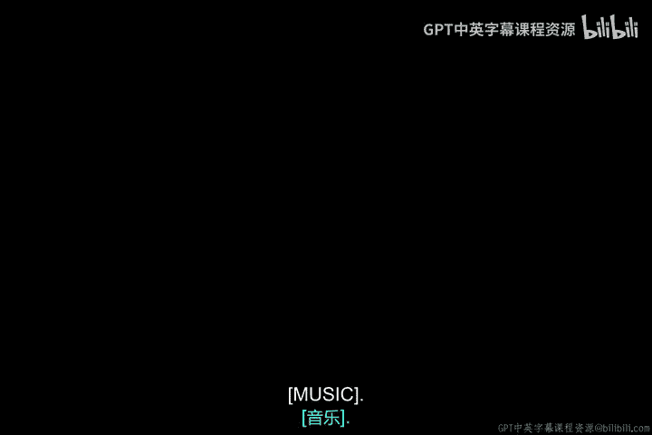
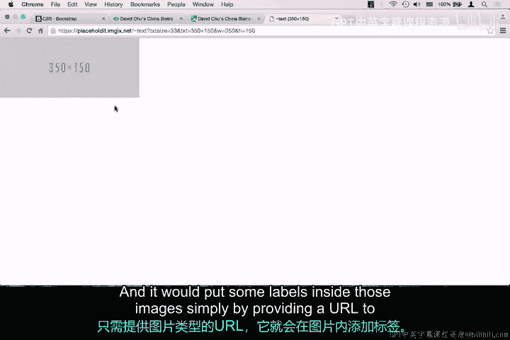
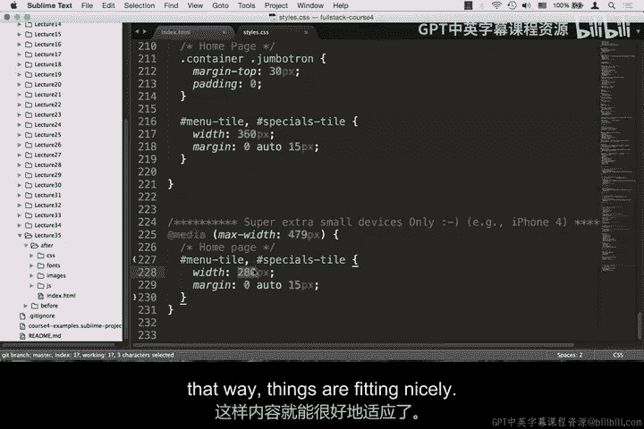
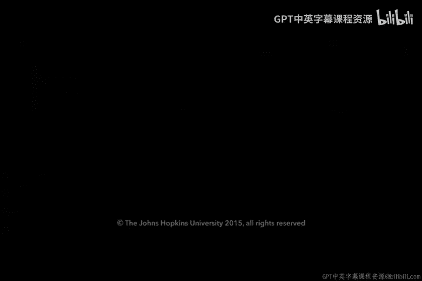

# 约翰霍普金斯大学《Web开发者的HTML, CSS, and Javascript》中英字幕 - P56：13_第35讲 第2部分 导航模块编码.zh_en - GPT中英字幕课程资源 - BV1WzY6z9EUd

Yeah。

In part one of this lecture we wrote the code to position and form the sizing of our tiles the menu specials and the map in this lecture we're gonna continue by filling out the content we'll put in the pictures for the menu on the specials and we'll embed the map and we'll take a look at writing the special styles we need for the responsiveness of these tiles let's go back to our code editor and the next thing we need to do is we need to place the images that we actually are seeing here from the restaurant I happen to have already the images that we want to use for specials and for the menu from the real restaurant。

 these are just kind of placeholders If I didn't however。

 I could always go to this website called place hold that it and I'm able to basically size any image I want and even put some labels inside those images simply by providing a URL to that type of image but for now we're I think good here and we're。

😊。

Use the real images so let me bring in a couple of styles that I already defined for this purpose and we'll paste them right here and let's discuss them for a little bit so first of all this is I'm selecting menu tile and you could see I'm using a background image to fill in the menu tile and fill in the specials tile JPG which by the way are sitting inside the images folder also notice that since our URL is relative how it's going to get served to the browser we do need to say that dot which means we're going up one directory from the styles up one directory and then down to images right here。

Okay so point is it's going to be a background image and I'm already sizing it exactly to be 250 pixels tall and also notice that I'm positioning it in the center of my container element what that's gonna give us is that as the container element that tile shrinks a little bit since kind of the dish the main dish is still sitting in the center we're still going to see quite a bit of it and that kind of eliminates the need for us to provide different sized images for different screen sizes and the truth of matter is if this was a huge image I would probably have to do is because I wouldn't want to waste so much bandwidth but it's a fairly small image and it's just not worth it for me to keep switching the images at this point plus it's a good opportunity for me to show you this technique of being able to position an image as a background image and still not have problems when the container element start shrinking around it and you just position in the center and you should be good to go so let's save that and go ahead and take a look as to what this looks like in the browser and it's certainly starting to look pretty nice so here's our。

😊，This is our menu and our specials we still haven't done anything with the map Well let's go back to the code editor and in the styles that's CSS let's go ahead and position our tag so these tags right here the labels we really need to be right here at the bottom let's go ahead and do that again I have some code that I prepared before the lecture and let me cut and paste it right here and let's go over it right now so first of all we are targeting menu tile span which means it's the span inside the element that is I with menu tile and the same thing with special style and map tile so the first thing you see here is position absolute and that means we're going to be positioning these spans absolutely within the containing element which is the menu tile okay so positioning absolutely we need to bring them all the way to the bottom let's go take a look we need them all the way at the bottom right here well that's very easy to accomplish it's bottom zero right zero that's easy。

😊，And we want the width to be 100， which means 100% of the containing element again。

 want to stretch all the way across the tile。Okay textex All center that's pretty simple and want to bump up the font size to be about you know 1。

6 ms， which is you know 60% above the whatever it is that it's going to land on meaning whatever it's inheriting at this point and text transform is uppercase so I want all of them uppercase no matter what it is that we type inside of our HTML background color is going to be black and the foreground color the text color is going to be white and also I'm going to bump the opacity down a little bit so if I put one here that will be 100% opacity meaning it won't be see through it all。

 but if I do  point8 it'll be just the Ted C through so we'll be able to see our nice picture of the some dish that's in the background of our tile so let's going and save that and take a look in the browser。

And here we go So heres our tiles and you can see the menu and the specials in the map nicely done right at the bottom here。

 the specials and the text is very nicely visible and you can see that there's aacity a little bit tuned down so you can actually see this dish in the background which gives us a really nice touch next let's go ahead and embed the map right here into this map tile the first thing you want to do is want to go to maps go co and you want to search for the location that we need to map into that tile and I already did this here we go it came up right here and so in order to get the embedded map so what you have to do is you have to go to this menu right here and go to share or embed map and it's going to come up with either a link or embedded map so the first thing we're gonna do we're gonna go ahead and copy the link that we have here and go back to the code editor and we'll go to index at hml and we'll paste the link right here inside the Hf and it's kind of a crazy looking link but that's all right okay。

😊，Go back to the browser and this time we'll click on embed map and it is going to give us an iframe with basically all the code that we need。

 We'll again go ahead and copy that。 We'll go back to the code editor and we need to paste this iframe right here in the middle of this dip so we'll go ahead and do that right now we'll paste that right here and we're almost done except we need to adjust the width and the height of the side frame If you look at our styles that CSs you'll see that we're styling all the tiles to be high 250 pixels so let's go ahead and do the same thing here right now our height is 300 so let's turn it down to 250 and the width we actually need to be 100% because once again the width is going to be defined by the grid by the bootstrap grid and we want the style to stretch as much as possible to the edges of that cell inside that grid。

 So let's go ahead and say that and go take a look in the browser let's switch to our site and look at that we're very nicely done map tile here。

😊，Next， the specials and the menu。Okay but what about our responsiveness。

 Let's go ahead and try to squeeze the browser and see how it's reacting。

 So now it's a little bit smaller right here and you can see the tiles became smaller。 That's good。

 and we go to the small size instead of medium so you could see the first the tiles that taking half to screen each and the third one stretch all the way to the 12 so the first one took six the other one took the other six columns and this one is taking 12 let's go ahead and keep squeezing it more and see what happens when we get to a smaller size and even though they're stacking nicely and the map looks good but the menu and the special tiles kind of look weird we really don't want these borders to stretch all the way we want them kind of to stay together with the picture otherwise the whole thing looks weird so we need to fix that so let's go ahead and do that right now。

😊，Instead of going straight to the code editor， let's go ahead and try to fix it in the browser and then we'll copy the code into the code editor later。

 Let's go ahead and open up our Chrome developer tools and actually what we'll do is we'll open up the mobile version of it and will tell us we should reload so we'll go ahead and reload so let's bring the problem here in front of our eyes here there it is So I know that this picture is 360 pixels wide So I wonder what would happen if I go ahead and select it and inspect it right here and there's our menu tile and go ahead and give it the width of 360 pixels。

 Well we got the border fixed， but now this whole thing move to the left instead of sitting in the middle Well there's actually a very quick an easy fix is to specify margin auto for both the right and the left margin and that only works if you actually size the element。

 So we'll go ahead and say margin willll give it a top of0 and to the side of auto。😊。

And to the bottom of 15 pixels。 Now I could actually technically speak。

 say out of here but you don't really need that。 it automatically assumes that whatever is in the second position goes into the fourth position as well。

 So if we do that， we have a nicely positioned element smack in the center of the screen。

 So that's good。 And since this is clearly an issue in the 767 pixel breakpoint we could go back to our code editor and we'll go to the styles and we'll need to scroll down all the way to the media query where that says 767 pixel we'll scroll down to the bottom here and we'll give it our sizes here。

 So we really need two things。 Number one， we need menu tile。😊。

And we also need special style and both of those， we want to give it the width of 360 pixels。

And margin of zero， alto and 15 pixels。So now when we save that and go back to our browser。

We should reload that。And now we could see that in this break point， things are working quite well。

Now it's always a good idea to actually try it out on some real devices and the Chrome browser actually lets you simulate that。

 So let's go ahead and try it on iPhone 4 for example。

 but that seems to be the smallest device here So if we look here and scroll down we could see that you know what the 360 width is not really working for for this particular device because it's too big with the margins and the paddings it's really not fitting in there anymore so that means we really have to create a custom media queryry just for this and I also don't really like how this David Cho' China Bistro is sitting here it's a little too small I would really like it to fill it up a little bit more and let's see if we stretch it out。

😊，Right， it gets to about here。And we really want to increase that。 So if you play around with it。

 you'll notice that this actually gets kind of the perfect sizing right around 476 pixels if you miss around with it。

 so we're going to go back to our code editor。😊，And we're going create yet another media query。

 so this one closes the previous one， so we'll create yet another one and we'll call it I'll cut and paste some code prepared for super small for super extra small devices only which is iPhone 4 and so on So we'll go ahead and close that bracket and we'll cut and paste some styles right here that will help us out with our menu and special tiles and so we basically decrease the width of the actual tiles so that way things are fitting nicely let's go back to our browser and take a look let's go ahead and refresh that just in case and if we now look at iPhone 4。

😊。

And we could see now that things are fitting in very。

 very nicely and the only thing is what I don't like here。

 it's a little too small right we would like the name of the restaurant to be a little bit bigger so let's go back to our code editor and let's go ahead in this media query will increase it just a Ted so we can see it a little bit better and again I have some styles prepared that I played around with so you don't have to watch me play around with it live here and so let's go ahead and put them in right here so all I'm doing is basically saying Naavbar brand H1 that's the brand that's the name of our restaurant and I'm giving it some padding basically preserving some padding maybe making it a little smaller and I'm giving the font size just a little bit bigger than it was default into from the previous breakpoint so let's go ahead and save that and go to our browser and you could see now David Chuchema Bitro gets a little bit more prominent and that's probably a good thing we wanted the restaurant name to be。

😊，Nicely visible and doesn't look like it's a secondary text so just for completeness。

 let's go ahead and check this out and let's pull out this thing just to see how everything is behaving and this seems to be working just fine and since we centered the picture in the background so it's actually always sitting nicely and you kind of see the focus point here you know the broccoli looks kind of good so anyway as you stretch it all the way out and we can actually now take it out of the mobile view everything looks just fine and I think at this point we could say that we are done with these tiles。

😊。

