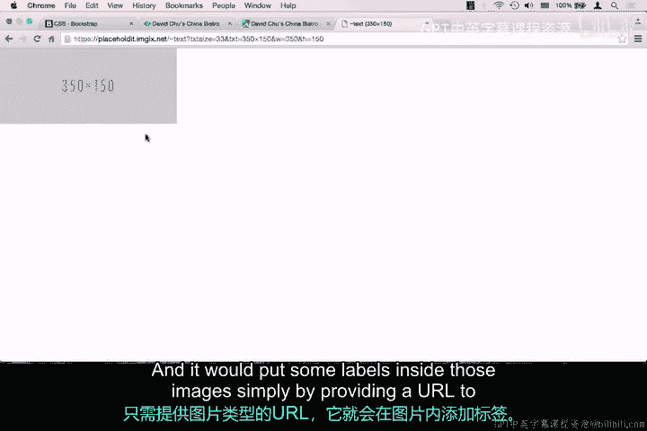
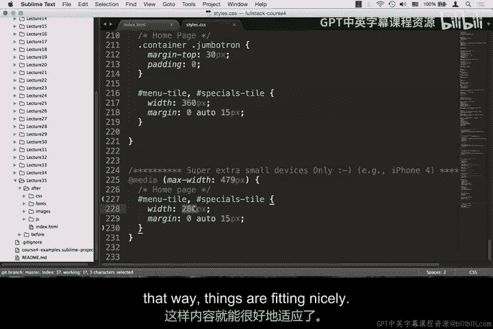
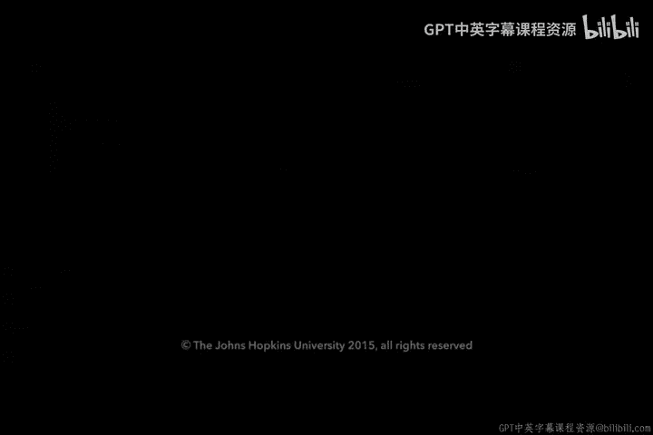

# 响应式网页设计：第35讲：第2部分 导航模块编码


## 概述
在本节课中，我们将继续完善导航模块的内容填充与样式调整。我们将为菜单和特价商品区域添加实际图片，嵌入地图，并编写必要的响应式样式，以确保这些模块在不同屏幕尺寸下都能良好显示。

---



## 填充菜单与特价商品图片

上一节我们完成了菜单、特价商品和地图模块的布局与尺寸设置。本节中，我们首先来填充菜单和特价商品模块的图片内容。

我们将使用来自真实餐厅的图片，而非占位符。这些图片已存放在 `images` 文件夹中。

以下是用于设置背景图片的CSS代码：

```css
.menu-tile {
    background: url('../images/menu-tile.jpg') no-repeat center center;
    background-size: cover;
    height: 250px;
}
.specials-tile {
    background: url('../images/specials-tile.jpg') no-repeat center center;
    background-size: cover;
    height: 250px;
}
```

**代码解释**：
*   `background: url(...)`：将图片设置为元素的背景。
*   `../images/`：URL路径中的 `../` 表示从 `styles` 文件夹向上退一级目录，再进入 `images` 文件夹。
*   `no-repeat center center`：确保图片不重复，并水平和垂直居中。
*   `background-size: cover`：使背景图片覆盖整个元素区域。
*   `height: 250px`：设置模块的固定高度。

将图片居中放置的好处是，当容器元素因响应式布局而缩小时，图片的核心内容（如菜肴）仍能保持在视野中心，无需为不同屏幕尺寸准备多套图片。

保存代码后，页面中的菜单和特价商品模块已显示对应的背景图片。

---

## 定位模块标签

接下来，我们需要将每个模块底部的文字标签（如“菜单”、“特价”）定位到正确位置。

以下是定位标签的CSS代码：

```css
.menu-tile span,
.specials-tile span,
.map-tile span {
    position: absolute;
    bottom: 0;
    right: 0;
    width: 100%;
    text-align: center;
    font-size: 1.6em;
    text-transform: uppercase;
    background-color: #000;
    color: #fff;
    opacity: 0.8;
}
```

**代码解释**：
*   `position: absolute`：使标签相对于其父容器（`.menu-tile`等）进行绝对定位。
*   `bottom: 0` 和 `right: 0`：将标签定位到容器的右下角。结合 `width: 100%`，使其拉伸至容器底部全宽。
*   `text-align: center`：文字居中对齐。
*   `font-size: 1.6em`：将字体大小设置为继承值的1.6倍。
*   `text-transform: uppercase`：将文本转换为大写。
*   `background-color` 和 `color`：设置背景为黑色，文字为白色。
*   `opacity: 0.8`：将不透明度设置为80%，产生半透明效果，使背景图片能隐约透出。

应用此样式后，标签已整齐地显示在每个模块底部，半透明的黑色背景确保了文字清晰可读。

---

## 嵌入地图

现在，我们来处理地图模块，将Google地图嵌入其中。

操作步骤如下：
1.  访问 [Google 地图](https://maps.google.com)。
2.  搜索需要显示的地点。
3.  点击“分享”按钮，选择“嵌入地图”选项。
4.  复制提供的 `<iframe>` 代码。

将复制的 `<iframe>` 代码粘贴到 `index.html` 文件中对应的 `map-tile` 的 `<div>` 内。然后，需要调整iframe的尺寸以匹配我们的设计：

```html
<iframe src="https://www.google.com/maps/embed?pb=..." width="100%" height="250" frameborder="0" style="border:0;" allowfullscreen></iframe>
```

**调整说明**：
*   `height="250"`：将高度设置为250像素，与其他模块保持一致。
*   `width="100%"`：将宽度设置为100%，这样iframe会填满Bootstrap网格分配给它的单元格宽度。

完成嵌入后，地图模块已能正常显示。

---

## 实现响应式调整

我们已经完成了基本内容的填充。接下来，需要确保这些模块在小屏幕设备上也能完美显示。让我们测试一下响应式效果。

当浏览器窗口缩小到移动设备尺寸时，菜单和特价商品模块的边框会随着容器一起收缩，导致视觉效果不佳。我们希望图片和边框能作为一个整体保持固定宽度，并在屏幕中居中显示。

我们可以在浏览器开发者工具中模拟并调试这个问题。通过检查元素，我们发现为 `.menu-tile` 和 `.specials-tile` 设置一个固定宽度（例如360像素），并添加 `margin: 0 auto 15px;` 的样式，可以使它们在容器中水平居中，且上下保留15像素的边距。

由于这个问题主要出现在最大宽度为767像素的断点（Bootstrap的 `sm` 尺寸），我们需要将修复代码写入对应的媒体查询中。

回到代码编辑器，在 `styles.css` 文件中找到 `@media (max-width: 767px)` 媒体查询，并在其中添加以下样式：

```css
@media (max-width: 767px) {
    /* ... 其他现有样式 ... */
    .menu-tile,
    .specials-tile {
        width: 360px;
        margin: 0 auto 15px;
    }
}
```

保存后刷新页面，在767像素及以下的宽度中，菜单和特价模块现在能保持合适宽度并居中显示。

---

## 针对超小设备的优化

然而，在屏幕更小的设备（如iPhone 4）上测试时，360像素的宽度加上内边距会导致布局溢出。此外，顶部的餐厅名称字体也显得过小。

为了解决这个问题，我们需要创建一个针对超小屏幕的额外媒体查询。



我们在 `styles.css` 中 `@media (max-width: 767px)` 的闭合花括号后，添加一个新的媒体查询：

```css
/* 针对超小屏幕设备，如iPhone 4 */
@media (max-width: 479px) {
    .menu-tile,
    .specials-tile {
        width: 300px; /* 减小宽度以适应更小屏幕 */
        margin: 0 auto 10px;
    }
    .navbar-brand h1 {
        padding-top: 5px;
        font-size: 1.8em; /* 增大餐厅名称字体 */
    }
}
```

**代码解释**：
*   `@media (max-width: 479px)`：这个断点专门针对屏幕宽度小于480像素的超小设备。
*   我们进一步减小了 `.menu-tile` 和 `.specials-tile` 的宽度，并调整了边距。
*   通过选择器 `.navbar-brand h1`，我们增大了导航栏中餐厅名称的字体大小，使其在小屏幕上更醒目。

经过这番调整，页面在iPhone 4等超小屏幕设备上也能完美适配，所有元素都清晰可辨且布局合理。

---



## 总结
本节课中，我们一起完成了导航模块核心内容的填充与精细化样式调整。我们学习了如何为元素设置居中背景图片、如何绝对定位底部标签、如何嵌入并调整第三方地图，以及如何通过编写多个媒体查询来解决不同断点下的响应式布局问题。最终，我们实现了一个在从桌面到手机的各种屏幕尺寸上都能优雅显示的导航模块。