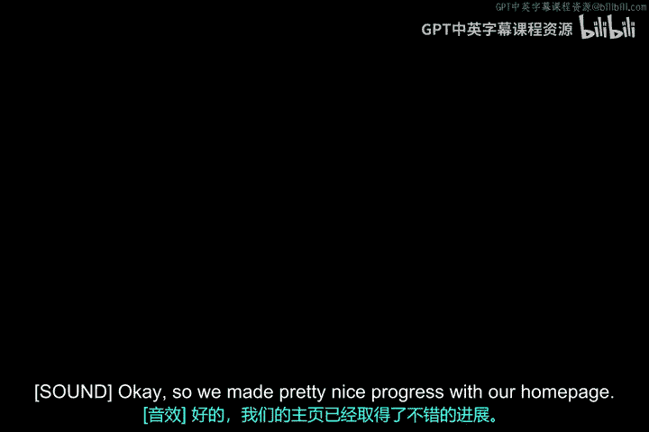
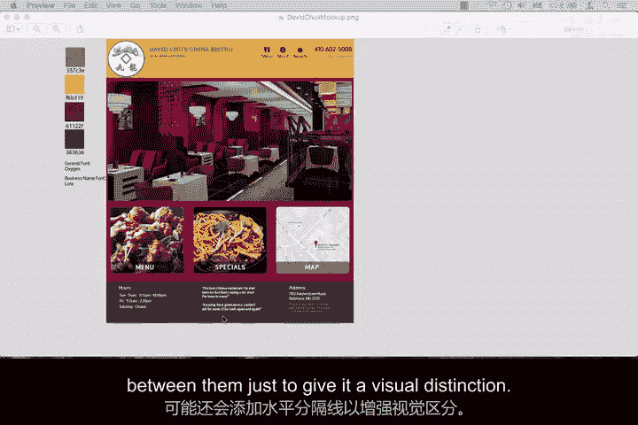
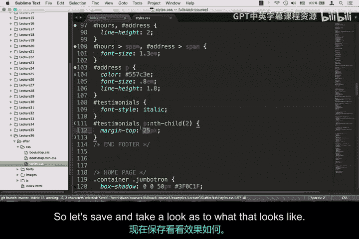
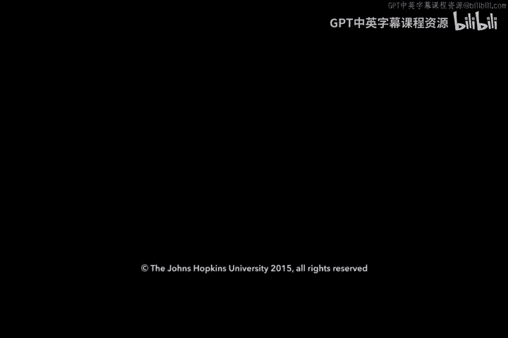

# 约翰霍普金斯大学《Web开发者的HTML, CSS, and Javascript》中英字幕 - P57：14_第36讲 第1部分 页脚编码.zh_en - GPT中英字幕课程资源 - BV1WzY6z9EUd

Yeah。

Okay， so we made pretty nice progress with our homepage， we've coded up the header， the Jumotron。

 and our main tiles that will let us have navigation as well as a map showing where the restaurant is and letting the user click on it and get directions directly to the restaurant。

So the last thing we're going to be coding on this particular page is the footer so basically we need to code up this piece right here and the way we're gonna to do it is we're going to make sure it stays this way in other words in these three columns through the small screen size and as soon as it goes down below this small screen size we want them to stack one upon the other maybe even give them a horizontal line in between them just to give it a visual distinction so let's go back to a code editor and I already have some code prepared for this lecture so I'll copy and paste it in a second and we'll go over it however first let me give you a quick tip it's very convenient sometimes to end the divs especially in a page that goes on for a while has a nice amount of content to end it with a HTML comment that will basically say it's the end of whatever the div it is that you pointing those in this case it's the div with an ID home tile so if I actually scroll up my ID or my editor is going help me out and say oh this is。

div that I'm actually on the closing divmon is corresponding to this one。 but however。

 visually sometimes it's hard to tell what's going on。

 So it it's helpful to put these type of notes in。 okay moving on to the footer well if it's the footer I guess we should use the semantic tag footer and we're gonna give it a class called panel footer and what panel footer class does is set some default background。

 some padding and things like that。 So this is a convenient class inside that panel。

 we're going to have a panel footer。 we're going to have a div that is a container and the container is going to nicely correspond to our container in every single section So in the main section we also had a container that basically I believe the whole main content in it and in the top in the header of of our website we also had a container as well so they should all very nicely line up and of course since we're going to be subdividing this into these three cells or three grids。

Then we're definitely going to need the container in order to place the next div in here that's called the row right the row class div。

 So here we go。 So this is the row class and the way we're going to divide it。

 as I told you is we're going to have these three sections。

12 one section is going to be just announcing what hours the restaurant is going to be open the second is going to give us some address information and the third is going to show the testimonials。

 meaning just give a couple of quotes from customers So again。

 the way we're going to divide that is we want three grids or three cells across the screen and we want them to stack as soon as it gets to be smaller than the small screen size As you remember this means this will stack as soon as it gets to be smaller then the small screen size which is I believe about 768 pixels。

 So around 767 pixels it'll be become extra small and all these sections will start stacking one upon the other。

 And since we have。4 as our column identifier， it means that we're going to have four， four and 4。

 that's 12， so we're going to have three different sections visible across the screen。

Okay before we go into trying to style this， let's just take a look at the actual information here so here we have a span and this span has a break after it so we want basically a break line to go here and then it's going to have the hours again a break is going to have other hours again a break and then'm just going to say Saturday closed Now the reason we kept the span only on the hours is because we want obviously the hours to be a little bit a different font and maybe different size than the rest of the information and the rest of it is going to be pretty much the same now we're going to anticipate that it's going to stack under when it gets to be smaller than the small size and the extra small size and therefore we want some kind of other visual distinction between these sections other than just some spaces so we're going to place a horizontal rule right here HR the HR tag and we're going to give it a class visible XS which means this HR is only going to show up when the screen size is extra small and if the screen side is。

Any bigger than that this HR is not even going to show up so we're good to go here The rest of it is basically exactly the same it's the same structure。

 we have the section， the column definition and the span with some paragraphs here and again we're going to be able to target them specifically and again an HR that's going to be only visible when the screen is extra small and the testimonials are pretty much the same except here we have some paragraphs and that's about it the last div here before the footer ends is just the copyright sign that is David Cho China Bistro 2015 probably should just change it 2016 at this point and we place the copyright sign here as well。

Okay， so let's go ahead and save that and go to our browser and take a look as to what this looks like。

 Okay， so it looks pretty bad， but the positioning it is pretty good right。

 So the default colors of the footer didn't really quite agree with this whole thing。

 So it's kind of hard to really see what's going on here。 But if we squeeze the browser。

 let's go ahead and do that。😊，And let's see this is still pretty in at the small range。

 see what happens when we go to extra small and extra small， you could barely see it here。

 but this is the text and you can see the line here showed up the HR， the horizontal rule。

 the address and the copyright here is also working quite well。 It's sitting right in the center。

 Okay， so let's go ahead and stretch our browser back out and go to the code editor。

And let's scroll down a little bit below the ending of the header styles。

Should be right around here here and the header and let me copy and paste at least some of the styles that I've prebaked for our footer so we'll start the footer styles right here so first of all we're gonna to give it some margin we want to kind of separate ourselves from those tiles that are going to be right above it and we're also going give some padding as well so we're kind of separate within itself within the actual footer itself and padding bottom also lets us separate a little bit better from the very bottom of the edge of the browser and we'll change the background color so it's something that's decently able to be seen on the screen。

And we'll give it a border top 0。 we don't want to border on top。 Notice what I'm doing here。

 I'm actually overriding a bootstrap CSss class， which is fine because whatever it is that it's providing for us is going to merge and some things are going get either negated or just overwrittenden by what I've written here。

 So let's save it right now let's go back to the browser and take a look how we're doing here。

's looking that's much better so far， we still need to style maybe the separation a little bit better and still need to style these headings a little bit better as well。

 Well let's go ahead and try to do that。 let me go ahead and paste a couple of styles that I prepared for this lecture and let's go over those。

 So the final style panel footer div row is basically targeting that whole entire row of the address。

 the testimonials and so on。 And we want to give it a margin bottom of 35。

 So actually let's go ahead and comment out the rest of it。 So we'll see what actually is going on。

 Let's save that and let's go back and we could see that。😊。

Separated the copyright from the rest of the row， and it's now looking a little bit nicer because the copyright really has nothing to do with these three cells here in this grid。

That's one， the next one is。Is going to increase the line height a little bit of the address and the hours and if we go back you could see that we separated it a little bit better。

 so it's not so kind of squished in together so it's still looking pretty good and as far as the testimonial is a concern we left them alone because we want to apply a little of different style to them altogether so let's go back to our code editor and let's move our comment all the way here and let's see so now what we're doing is we're increasing the font size of anything that is within span so our span and address span is going to get the font size increased by about 30%1 point 1。

3M so if we save that and go back to the browser you can see now that the hours and the address headings stand out a little bit better and you could see that that's actually a heading and the information is right below that let's go back to the code editor and move our comment down a little bit more。

😊，So with a pound sign address P what we're targeting is we're targeting that let's go and take a look at we're targeting in the address we're targeting that delivery area within three4 miles and then we wanted to stay kind of green and smaller because it's kind of a note on the side so let's go back to our styles and say so we're making this green and the font size we're making a little bit smaller and the line height we're making a little bit smaller as well the line height before was two so in this case we're making a adjust that's smaller to 1。

8 just to kind of squeeze them a little bit better so let's save that and go back to our browser and you could see here that this turn green and also the line height just to Ted smaller than the line height between between these two lines。

Okay， let's go back to the code editor and move our testimonials actually all the way down here。

 so we'll erase it all together， let's take this spaces out of here， we don't need them。Okay。

 so the testimonials we obviously want them to be italic just to make it look like it's sexually you know people's writing。

 so it least reminds people that it's something personal and testimonials and PNth child2 so the number two one we want the margin to be 25 so what we're saying is let's go back to our HTML what we're saying is that the second paragraph I want the second paragraph to have a margin。

A margin top of 25 so I want to be able to separate the second paragraph from the first one a little bit so let's save that and take a look as to what that looks like and you can see that now this area right here is about 25 pixels so we separated the first testimonial from the second one and you can see also that both of them are itals so they look kind of nice so that's it for part one of this lecture and in part two we're going to start looking into styling this footer so it's laid out nicely even in smaller screen sizes。

😊。

