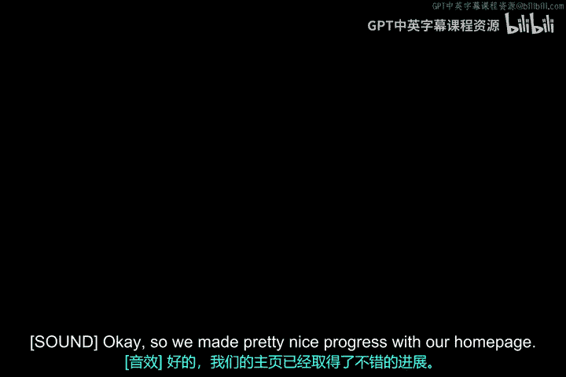
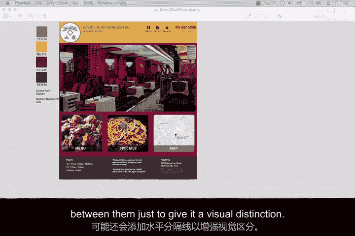
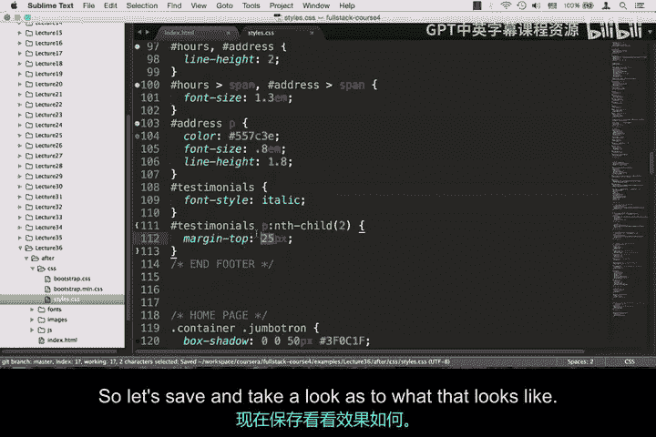
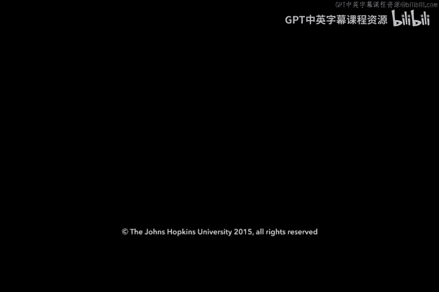

# Web开发者的HTML, CSS, and Javascript：P57：第36讲 第1部分 页脚编码 🧱



在本节课中，我们将学习如何为网站主页编码和样式化页脚部分。我们将使用语义化HTML标签和Bootstrap的网格系统来创建一个响应式布局，使其在大屏幕上显示为三列，在小屏幕上则垂直堆叠。

---



上一节我们完成了主页的标题、巨幕和主要内容区域的编码。本节中，我们来看看如何构建页脚部分。

首先，我们使用 `<footer>` 语义化标签来定义页脚区域，并为其添加 `panel-footer` 类，这个类会提供一些默认的背景和内边距样式。

```html
<footer class="panel-footer">
```

在页脚内部，我们使用一个 `container` 类的 `<div>` 来包裹内容，这能确保页脚内容与页面其他部分的容器对齐。接着，我们添加一个 `row` 类的 `<div>` 来创建行。

```html
<div class="container">
  <div class="row">
```

我们的目标是创建三个等宽的列，分别用于显示营业时间、地址信息和客户评价。在Bootstrap网格系统中，我们使用 `col-sm-4` 类来实现这一点。这意味着在屏幕宽度大于等于小屏幕尺寸（约768像素）时，这三个部分会并排显示；当屏幕小于此尺寸时，它们会垂直堆叠。

以下是每一列的基本结构：

```html
<section class="col-sm-4">
  <span>营业时间</span><br>
  周一至周四：11:15 - 23:00<br>
  周五：11:15 - 02:00<br>
  周六：不营业
  <hr class="visible-xs">
</section>
```

请注意，我们在每个部分后面添加了一个 `<hr>` 水平线，并为其设置了 `visible-xs` 类。这意味着这条水平线只在超小屏幕尺寸下才会显示，用于在堆叠时提供视觉上的分隔。

最后，在页脚底部，我们添加了版权信息。

```html
<div class="text-center">
  © 大卫周中餐馆 2016
</div>
```

---

现在，让我们为页脚添加一些自定义样式，使其与网站的整体设计更加协调。

首先，我们调整页脚的整体外观，包括边距、内边距和背景颜色。

```css
.panel-footer {
  margin-top: 30px;
  padding-top: 35px;
  padding-bottom: 30px;
  background-color: #222;
  border-top: 0;
}
```

接下来，我们调整内容行与版权信息之间的间距。

```css
.panel-footer div.row {
  margin-bottom: 35px;
}
```

为了使营业时间和地址的标题更突出，我们增大其字体大小。

```css
#hours span,
#address span {
  font-size: 1.3em;
}
```

对于地址部分中的附加说明（如配送范围），我们将其设置为绿色并减小字体大小。

```css
#address p {
  color: #557c3e;
  font-size: .8em;
  line-height: 1.8;
}
```

最后，我们样式化客户评价部分，使其文字变为斜体，并增加第二条评价的上边距以增强可读性。

```css
#testimonials {
  font-style: italic;
}
#testimonials p:nth-child(2) {
  margin-top: 25px;
}
```

---





本节课中我们一起学习了如何构建一个响应式页脚。我们使用了Bootstrap的网格系统来创建列布局，并添加了自定义CSS来改善其视觉外观。通过使用 `visible-xs` 类，我们确保了在不同屏幕尺寸下都有良好的视觉分隔。下一部分，我们将继续完善页脚在小屏幕上的布局和样式。