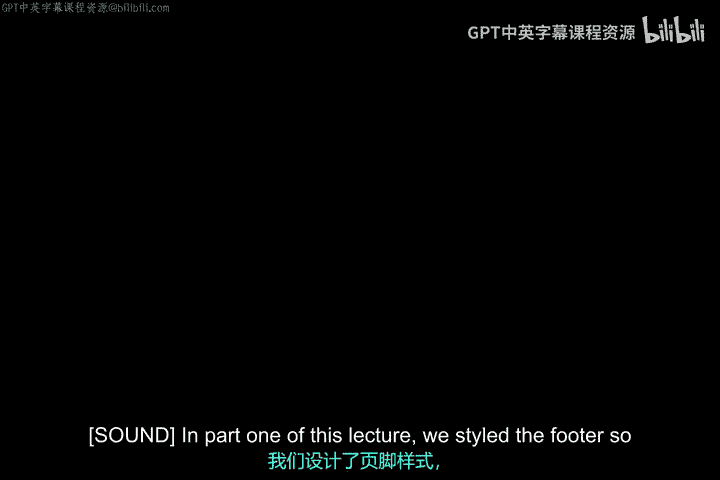

# 约翰霍普金斯大学《Web开发者的HTML, CSS, and Javascript》中英字幕 - P58：15_第36讲 第2部分 页脚编码.zh_en - GPT中英字幕课程资源 - BV1WzY6z9EUd

Yeah。

In part one of this lecture we've styled the footer so it's nicely to laid out on a desktop type of size browser in this lecture we're going to concentrate on styling the footer so it works nicely even on smaller screen sizes such as tablet and even mobile screen sizes。

😊，Okay， so this is all in well when we're in a full desktop mode。

 but what happens when we squeeze the browser a bit。

 let's see what's going on So you could see here first of all it jumped and kind of squeeze itself a little bit well that's a good thing。

 So if we go back and get a little bit more tight here it's still squeezing pretty well and if we go back all the way here。

😊，We could see that it's pretty good。 we see that the HR here showed up and it's pretty good。

 The only thing is， of course， it looks like it's a little bit too close。

 maybe and it certainly will be nice if these things became centered in the screen instead of going to the left。

 Let's go ahead and see if we could do something about that。

 So let's go back to our code editor and I believe I have some premateate styles here and we're clearly trying to target the extra small media query。

 So let's scroll down to the extra small media query。 there it is right here。

 and we'll go down to the last one after the header and we'll place our styles right here。

 we'll copy and paste them let's go over them real quick。

 number one is we kind of increasing the margin bottom to 30 pixels。

 I believe it was a little bit smaller before。 and the sections are now going to be text aligned center so now we're saying we're targeting every section within that panel footer and we're liing them center and making the margin bottom larger。

😊，However on the very last one and the very last section we already have a margin applied to it from the previous styles just as a general desktop version so we wouldn't want to add another margin to the section again so what we're doing is we're saying margin bottom zero because the margin already exists on the entire row so the endth childild3 the third section the testimonials in this case will not get another margin because they already have one from the row and just to make it look a little nicer instead of having an HR go all the way across the screen what we're doing is saying we want to target that section horizontal rule it want to make it with 50% of the screen and will look like a nice neat little separation line between the sections okay we could save that and go back to our browser and let could take a look look at this now it's all centered and it's like a nice little line in between and we don't have double margins here and it seems to look pretty good so if we test it and see how it's looking at different sizes this is looking。

Pretty well and if we stretch it out it should when it gets too small it will go to three column layout and as we stretch it out。

 everything looks pretty good and we could see that on the bottom it's all separated and nicely align Very good So this is our footer and this is really the end of the main page next we're gonna start looking at the sub pagesages those are the pages you're going to be able to get to by clicking either this menu tile or the special tiles and obviously'll be we're gonna have to drill down once we get to the menu categories to be able to drill down to each particular menu item。

